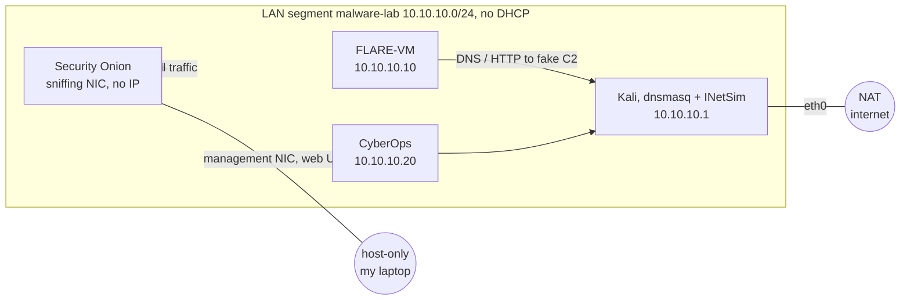

# Day 2 — Setting up the environment

Before I can look at any sample I need a lab I can break without caring. This is what it turned into, and what went wrong on the way there.

## What's in it

- VMware Workstation as hypervisor. VirtualBox works too, a few settings differ and I note them where it matters.
- FLARE-VM, Mandiant's malware analysis setup on top of the Windows 11 development VM from Microsoft. This is where samples run.
- Kali Linux as attacker box and fake internet, with dnsmasq for DNS and INetSim for everything else.
- CyberOps Workstation, the lab VM from Cisco's CyberOps Associate course.
- Security Onion for network security monitoring, listening on the lab segment and recording everything.

## Rules I keep for myself

- Keep the hypervisor updated. A VM escape is the one thing a snapshot doesn't undo.
- When a sample runs, the VM is only on the isolated lab network. Never NAT, never bridged.
- No USB devices in the VM, no shared folders, no valuable data on it.
- Samples come in compressed and password protected, so nothing runs by accident on the way in.
- Snapshots before every step that's hard to undo.

## Windows 11 base

- I took the Windows 11 development environment VM from Microsoft, unzipped it and opened the `.ova`. The default appliance settings are fine.
- First snapshot before touching anything.
- The VM stays on NAT for now, FLARE-VM downloads everything during the install. Only after that it moves to the `malware-lab` LAN segment, see the network plan further down.
- Defender and Windows Update have to be off before FLARE-VM goes on, otherwise Defender eats half the tools. Windows Firewall I turned off by hand. The rest is in the script below.
# Doing the prep in one go

Clicking through the pre-installation list by hand every time I rebuild the VM got old fast, so I put it all in one script. It checks the basics, turns off Defender and Windows Update, waits for a snapshot and then pulls the official `install.ps1` from mandiant/flare-vm and runs it.

I keep the script here in the writeup instead of in a separate folder. Inside the VM I copy the block below into `Install-FlareVM.ps1` and run it from an elevated Windows PowerShell. Not pwsh 7, and not PowerShell ISE either. My first run was in ISE and it sat there doing nothing visible for a long time. ISE has no real console, so the installer's prompts and the Chocolatey output never show up. That's my best explanation for the hang, I haven't confirmed it in `choco.summary.log` yet.

```powershell
Set-ExecutionPolicy Bypass -Scope Process -Force
.\Install-FlareVM.ps1 -NoGui            # defaults + my package list, nothing to click
.\Install-FlareVM.ps1                   # same list, but shown in the GUI first
.\Install-FlareVM.ps1 -DefaultPackages  # plain FLARE-VM default set
```

A few things I ran into while writing it.

- **Tamper Protection can't be scripted.** That's on purpose. If a script could switch it off, so could malware. The script opens Windows Security and just waits until I flip it myself.
- **The GPO keys don't always bite right away.** Real-time protection often stays on until a reboot. So the script checks, and if Defender is still running it sets a RunOnce key, reboots and picks up where it left off after logon.
- **It refuses to run on a real machine.** It looks at the manufacturer, model and BIOS strings for VMware, VirtualBox, Hyper-V, QEMU and so on. Turning off AV on my actual laptop by accident is exactly the mistake I don't want to make. `-Force` overrides it if detection misses a hypervisor.
- **The snapshot step stays manual.** The guest can't snapshot itself, so the script pauses right before the FLARE-VM install, with Defender and updates already off. I still take one more snapshot of the clean Windows install before running anything.
- **FLARE-VM wants a username without spaces**, about 60 GB free and Windows PowerShell 5.1. The script checks all three up front so it doesn't fail an hour into the install.
- **FLARE-VM's own Tamper check gave me a false warning.** It reads a registry value that still says "on" once Defender is disabled by policy. `Get-MpComputerStatus` showed everything off, so I answered Y and it carried on.

Windows Update stays off afterwards. If I ever want to patch the VM I have to remove the `NoAutoUpdate` policy under `HKLM\SOFTWARE\Policies\Microsoft\Windows\WindowsUpdate\AU` again.

## Picking the packages

The FLARE-VM package list is long and more than half of it is red team tooling (C2, credential access, lateral movement). None of that belongs on an analysis box, and Kali already covers the offensive side. So instead of clicking through the GUI the script downloads the official `config.xml`, drops everything marked with `-` in the `$Packages` list and adds the rest. That keeps whatever settings Mandiant puts in the default config, even when they change it.

The list sits inside the script, so there is only one file to copy into the VM. `-PackageList somefile.txt` still works if I want to try a different set without editing the script.

## The script

```powershell
<#
.SYNOPSIS
    Prepares a Windows 10/11 VM and installs FLARE-VM in one run.

.DESCRIPTION
    Follows the FLARE-VM pre-installation steps:
      1. Sanity checks (admin, Windows PowerShell 5.x, Windows 10+, real VM, disk, RAM, username)
      2. Waits for you to switch off Tamper Protection (cannot be done by script, by design)
      3. Disables Microsoft Defender via Group Policy registry keys
      4. Disables Windows Update via Group Policy + service
      5. Reboots if Defender is still active and resumes automatically after logon
      6. Pauses so you can take a VM snapshot
      7. Downloads and runs the official mandiant/flare-vm install.ps1

    ONLY RUN THIS INSIDE A DISPOSABLE ANALYSIS VM. It turns off AV and updates.

.PARAMETER NoGui
    Pass -noGui to the FLARE-VM installer (skip the package selection GUI).

.PARAMETER CustomConfig
    Path or URL to a ready-made FLARE-VM config.xml (passed as -customConfig).
    Overrides -PackageList.

.PARAMETER PackageList
    Optional text file with package ids to add (and "-id" lines to remove) on top of
    the official default config.xml. Without it the list in $Packages below is used.

.PARAMETER DefaultPackages
    Ignore the package list and install the plain FLARE-VM default set.

.PARAMETER Force
    Skip the "am I in a VM?" check. Use only if detection fails on your hypervisor.

.EXAMPLE
    # In an elevated Windows PowerShell (not pwsh 7) inside the VM:
    Set-ExecutionPolicy Bypass -Scope Process -Force
    .\Install-FlareVM.ps1
#>
[CmdletBinding()]
param(
    [switch]$NoGui,
    [string]$CustomConfig,
    [string]$PackageList,
    [switch]$DefaultPackages,
    [switch]$Force,
    [switch]$Resume   # internal: set when relaunched after reboot
)

$ErrorActionPreference = 'Stop'
$FlareInstallerUrl = 'https://raw.githubusercontent.com/mandiant/flare-vm/main/install.ps1'
$FlareConfigUrl    = 'https://raw.githubusercontent.com/mandiant/flare-vm/main/config.xml'
$WorkDir           = Join-Path $env:USERPROFILE 'Desktop\flare-vm-setup'
$RunOnceKey        = 'HKLM:\SOFTWARE\Microsoft\Windows\CurrentVersion\RunOnce'
$RunOnceName       = 'FlareVMSetupResume'

# Package list. One id per line, a leading - removes it from the defaults,
# wildcards work for removals, everything after # is ignored.
# Full list https://github.com/mandiant/VM-Packages/wiki/Packages
$Packages = @'
# --- static, first look at a file
pestudio.vm
die.vm
pebear.vm
explorersuite.vm
exeinfope.vm
floss.vm
stringsifter.vm
capa.vm
hashmyfiles.vm
exiftool.vm
resourcehacker.vm
yara.vm

# --- disassemblers
ghidra.vm
idafree.vm
cutter.vm

# --- debuggers
x64dbg.vm
x64dbg.plugin.scyllahide.vm    # hide debugger from anti-debug checks
x64dbg.plugin.dbgchild.vm      # auto-attach to spawned child processes

# --- dynamic, behaviour
sysinternals.vm
systeminformer.vm
procdot.vm
regshot.vm
apimonitor.vm
pesieve.vm
hollowshunter.vm

# --- network
wireshark.vm
fakenet-ng.vm
networkminer.vm
internet_detector.vm           # changes wallpaper when the VM has internet

# --- unpacking and extracting
upx.vm
7zip.vm                        # adds "unzip infected" to the context menu
uniextract2.vm
mal_unpack.vm

# --- documents and scripts
didier-stevens-suite.vm
pdfstreamdumper.vm
onenoteanalyzer.vm
js-beautify.vm

# --- .NET
dnspyex.vm
ilspy.vm
de4dot-cex.vm

# --- shellcode
blobrunner.vm
blobrunner64.vm
scdbg.vm

# --- general
cyberchef.vm
hxd.vm
python3.vm
libraries.python3.vm
notepadplusplus.vm
vscode.vm

# --- optional, uncomment when needed
# pma-labs.vm                  # LIVE malware samples from Practical Malware Analysis
# goresym.vm                   # Go binaries
# idr.vm                       # Delphi binaries
# pycdc.vm                     # Python bytecode

# --- never install, even if the defaults contain them
-idapro.vm                     # needs a license
-ida.plugin.*                  # need IDA Pro
-visualstudio.vm               # huge and slow
-pdbs.pdbresym.vm              # huge
-mimikatz.vm
-safetykatz.vm
-rubeus.vm
-sliver.vm
-covenant.vm
-metasploit.vm
'@

function Write-Step($msg) { Write-Host "`n[*] $msg" -ForegroundColor Cyan }
function Write-Ok($msg)   { Write-Host "    [+] $msg" -ForegroundColor Green }
function Write-Warn2($msg){ Write-Host "    [!] $msg" -ForegroundColor Yellow }
function Fail($msg)       { Write-Host "`n[x] $msg" -ForegroundColor Red; Read-Host 'Press Enter to exit'; exit 1 }

function Set-RegValue($Path, $Name, $Value, $Type = 'DWord') {
    if (-not (Test-Path $Path)) { New-Item -Path $Path -Force | Out-Null }
    New-ItemProperty -Path $Path -Name $Name -Value $Value -PropertyType $Type -Force | Out-Null
}

# ---------------------------------------------------------------- 1. checks
function Test-Prerequisites {
    Write-Step 'Checking prerequisites'

    $principal = New-Object Security.Principal.WindowsPrincipal([Security.Principal.WindowsIdentity]::GetCurrent())
    if (-not $principal.IsInRole([Security.Principal.WindowsBuiltInRole]::Administrator)) {
        Fail 'Run this script from an elevated (Run as administrator) PowerShell.'
    }
    Write-Ok 'Running as administrator'

    if ($PSVersionTable.PSEdition -ne 'Desktop' -or $PSVersionTable.PSVersion.Major -lt 5) {
        Fail 'Use Windows PowerShell 5.1 (powershell.exe), not PowerShell 7 (pwsh.exe).'
    }
    Write-Ok "Windows PowerShell $($PSVersionTable.PSVersion)"

    $os = Get-CimInstance Win32_OperatingSystem
    if ([int]$os.BuildNumber -lt 10240) { Fail "Windows 10 or newer required (found build $($os.BuildNumber))." }
    Write-Ok "$($os.Caption) build $($os.BuildNumber)"

    $cs   = Get-CimInstance Win32_ComputerSystem
    $bios = Get-CimInstance Win32_BIOS
    $fingerprint = "$($cs.Manufacturer) $($cs.Model) $($bios.Manufacturer) $($bios.SerialNumber) $($bios.Version)"
    $isVm = $fingerprint -match 'VMware|VirtualBox|innotek|QEMU|KVM|Xen|Parallels|Bochs|Virtual Machine|Hyper-V|UTM'
    if (-not $isVm -and -not $Force) {
        Fail "This does not look like a VM ($($cs.Manufacturer) / $($cs.Model)). Refusing to disable Defender on a real machine. Use -Force only if you are sure."
    }
    Write-Ok "Virtual machine detected: $($cs.Manufacturer) $($cs.Model)"

    $freeGb = [math]::Round((Get-PSDrive C).Free / 1GB, 1)
    if ($freeGb -lt 60) { Write-Warn2 "Only $freeGb GB free on C:. FLARE-VM wants at least 60 GB." } else { Write-Ok "$freeGb GB free on C:" }

    $ramGb = [math]::Round($cs.TotalPhysicalMemory / 1GB, 1)
    if ($ramGb -lt 2) { Write-Warn2 "Only $ramGb GB RAM. FLARE-VM wants at least 2 GB (4+ recommended)." } else { Write-Ok "$ramGb GB RAM" }

    if ($env:USERNAME -match '\s') { Fail "Your username '$env:USERNAME' contains a space. FLARE-VM does not support that." }
    Write-Ok "Username '$env:USERNAME' OK"

    try {
        Invoke-WebRequest -Uri 'https://github.com' -UseBasicParsing -Method Head -TimeoutSec 15 | Out-Null
        Write-Ok 'Internet connectivity OK'
    } catch { Fail 'No internet access (github.com unreachable). FLARE-VM downloads everything online.' }
}

# ---------------------------------------------------------------- 2. tamper protection
function Wait-TamperProtectionOff {
    Write-Step 'Checking Tamper Protection'
    $status = Get-MpComputerStatus -ErrorAction SilentlyContinue
    if (-not $status) { Write-Warn2 'Defender status unavailable (already removed?). Skipping.'; return }

    while ((Get-MpComputerStatus).IsTamperProtected) {
        Write-Warn2 'Tamper Protection is ON. Windows does not allow scripts to turn it off.'
        Write-Host  '        Opening Windows Security. Go to: Virus & threat protection > Manage settings'
        Write-Host  '        and switch OFF "Tamper Protection" (and "Real-time protection" while you are there).'
        Start-Process 'windowsdefender://threatsettings'
        Read-Host '        Press Enter once Tamper Protection is off'
    }
    Write-Ok 'Tamper Protection is off'
}

# ---------------------------------------------------------------- 3. defender
function Disable-Defender {
    Write-Step 'Disabling Microsoft Defender via Group Policy'
    $base = 'HKLM:\SOFTWARE\Policies\Microsoft\Windows Defender'

    Set-RegValue $base 'DisableAntiSpyware'          1
    Set-RegValue $base 'DisableAntiVirus'            1
    Set-RegValue $base 'DisableRoutinelyTakingAction' 1
    Set-RegValue $base 'ServiceKeepAlive'            0

    $rtp = "$base\Real-Time Protection"
    Set-RegValue $rtp 'DisableRealtimeMonitoring'    1
    Set-RegValue $rtp 'DisableBehaviorMonitoring'    1
    Set-RegValue $rtp 'DisableOnAccessProtection'    1
    Set-RegValue $rtp 'DisableScanOnRealtimeEnable'  1
    Set-RegValue $rtp 'DisableIOAVProtection'        1

    $spy = "$base\Spynet"
    Set-RegValue $spy 'SpynetReporting'      0
    Set-RegValue $spy 'SubmitSamplesConsent' 2   # never send samples

    Set-RegValue "$base\MpEngine" 'MpEnablePus' 0
    Set-RegValue 'HKLM:\SOFTWARE\Policies\Microsoft\Windows\System' 'EnableSmartScreen' 0

    # Immediate effect where allowed (no-op once policy has taken over)
    try {
        Set-MpPreference -DisableRealtimeMonitoring $true -DisableBehaviorMonitoring $true `
            -DisableIOAVProtection $true -DisableScriptScanning $true -DisableBlockAtFirstSeen $true `
            -MAPSReporting Disabled -SubmitSamplesConsent NeverSend -PUAProtection Disabled -ErrorAction Stop
        Add-MpPreference -ExclusionPath 'C:\' -ErrorAction SilentlyContinue
    } catch { Write-Warn2 "Set-MpPreference: $($_.Exception.Message)" }

    gpupdate /force | Out-Null
    Write-Ok 'Defender policies applied'
}

# ---------------------------------------------------------------- 4. windows update
function Disable-WindowsUpdate {
    Write-Step 'Disabling Windows Update'
    $au = 'HKLM:\SOFTWARE\Policies\Microsoft\Windows\WindowsUpdate\AU'
    Set-RegValue $au 'NoAutoUpdate' 1
    Set-RegValue $au 'AUOptions'    1
    Set-RegValue 'HKLM:\SOFTWARE\Policies\Microsoft\Windows\WindowsUpdate' 'DoNotConnectToWindowsUpdateInternetLocations' 1

    foreach ($svc in 'wuauserv', 'BITS', 'DoSvc') {
        try {
            Stop-Service $svc -Force -ErrorAction Stop
            Set-Service  $svc -StartupType Disabled -ErrorAction Stop
            Write-Ok "Service $svc stopped and disabled"
        } catch { Write-Warn2 "Could not disable ${svc}: $($_.Exception.Message)" }
    }
    Write-Ok 'Windows Update disabled (re-enable later via the AU policy key if you need patches)'
}

# ---------------------------------------------------------------- 5. reboot if needed
function Test-DefenderStillRunning {
    try { return [bool](Get-MpComputerStatus -ErrorAction Stop).RealTimeProtectionEnabled } catch { return $false }
}

function Register-ResumeAndReboot {
    $relaunchArgs = @('-NoProfile', '-ExecutionPolicy', 'Bypass', '-NoExit', '-File', "`"$PSCommandPath`"", '-Resume')
    if ($NoGui)        { $relaunchArgs += '-NoGui' }
    if ($CustomConfig) { $relaunchArgs += @('-CustomConfig', "`"$CustomConfig`"") }
    if ($Force)        { $relaunchArgs += '-Force' }
    if ($DefaultPackages) { $relaunchArgs += '-DefaultPackages' }
    if ($PSBoundParameters.ContainsKey('PackageList')) { $relaunchArgs += @('-PackageList', "`"$PackageList`"") }
    $cmd = "powershell.exe $($relaunchArgs -join ' ')"
    Set-RegValue $RunOnceKey $RunOnceName $cmd 'String'
    Write-Warn2 'Defender real-time protection is still active. A reboot is needed for the policy to take over.'
    Write-Host  '        The script resumes automatically after you log back in.'
    Read-Host   '        Press Enter to reboot now'
    Restart-Computer -Force
    exit 0
}

# ---------------------------------------------------------------- custom package config
function New-FlareConfig([string[]]$Lines, [string]$Source) {
    Write-Step "Building package config from $Source"
    $add = @(); $remove = @()
    foreach ($line in $Lines) {
        $l = ($line -replace '#.*$', '').Trim()
        if (-not $l) { continue }
        if ($l.StartsWith('-')) { $remove += $l.Substring(1).Trim() } else { $add += $l }
    }

    $defaultPath = Join-Path $WorkDir 'config.default.xml'
    Invoke-WebRequest -Uri $FlareConfigUrl -OutFile $defaultPath -UseBasicParsing
    [xml]$cfg = Get-Content $defaultPath -Raw
    $pkgRoot = $cfg.SelectSingleNode('//packages')
    if (-not $pkgRoot) {
        Write-Warn2 'Unexpected config.xml layout, falling back to the default package set.'
        return $null
    }

    $present = @{}
    foreach ($node in @($pkgRoot.SelectNodes('package'))) {
        $name = $node.GetAttribute('name')
        if ($remove | Where-Object { $name -like $_ }) {
            [void]$pkgRoot.RemoveChild($node)
            Write-Host "    - removed $name"
        } else { $present[$name] = $true }
    }
    $defaults = $present.Count

    foreach ($name in $add) {
        if ($present.ContainsKey($name)) { continue }
        if ($remove | Where-Object { $name -like $_ }) { continue }
        $el = $cfg.CreateElement('package')
        $el.SetAttribute('name', $name)
        [void]$pkgRoot.AppendChild($el)
        $present[$name] = $true
    }

    $out = Join-Path $WorkDir 'config.xml'
    $cfg.Save($out)
    Write-Ok "$defaults default + $($present.Count - $defaults) extra = $($present.Count) packages, saved to $out"
    return $out
}

# ---------------------------------------------------------------- 6+7. snapshot and install
function Install-Flare {
    Write-Step 'Snapshot time'
    Write-Host '    Take a VM snapshot NOW from your hypervisor (e.g. "pre-flare-clean").' -ForegroundColor Yellow
    Write-Host '    Defender and updates are off, nothing from FLARE-VM is installed yet.'
    if (Test-Path "$env:USERPROFILE\Desktop\ida*") { Write-Ok 'IDA Pro installer found on Desktop' }
    else { Write-Host '    IDA Pro via idapro.vm? Put the installer (and license) on the Desktop before continuing.' }
    Read-Host '    Press Enter when the snapshot is done'

    Write-Step 'Downloading FLARE-VM installer'
    New-Item -ItemType Directory -Path $WorkDir -Force | Out-Null
    $installer = Join-Path $WorkDir 'install.ps1'
    [Net.ServicePointManager]::SecurityProtocol = [Net.SecurityProtocolType]::Tls12
    Invoke-WebRequest -Uri $FlareInstallerUrl -OutFile $installer -UseBasicParsing
    Unblock-File $installer
    Write-Ok "Saved to $installer"

    Set-ExecutionPolicy Unrestricted -Scope LocalMachine -Force -ErrorAction SilentlyContinue
    Set-ExecutionPolicy Unrestricted -Scope Process      -Force

    $configPath = $CustomConfig
    if (-not $configPath -and -not $DefaultPackages) {
        if ($PackageList) {
            if (-not (Test-Path $PackageList)) { Fail "Package list $PackageList not found." }
            $configPath = New-FlareConfig (Get-Content $PackageList) (Split-Path $PackageList -Leaf)
        } else {
            $configPath = New-FlareConfig ($Packages -split "`r?`n") 'the built-in package list'
        }
    }

    $flareArgs = @{}
    if ($NoGui)      { $flareArgs['noGui'] = $true }
    if ($configPath) { $flareArgs['customConfig'] = $configPath }

    Write-Step 'Running FLARE-VM installer (you will be asked for your Windows password for auto-logon reboots)'
    Write-Host '    This takes a long time and reboots several times. Let it run.' -ForegroundColor Yellow
    Push-Location $WorkDir
    try { & $installer @flareArgs } finally { Pop-Location }
}

# ---------------------------------------------------------------- main
Write-Host '=== FLARE-VM one-shot setup ===' -ForegroundColor Magenta
Remove-ItemProperty -Path $RunOnceKey -Name $RunOnceName -ErrorAction SilentlyContinue

Test-Prerequisites

if (-not $Resume) {
    Wait-TamperProtectionOff
    Disable-Defender
    Disable-WindowsUpdate
    if (Test-DefenderStillRunning) { Register-ResumeAndReboot }
} else {
    Write-Step 'Resumed after reboot'
    if (Test-DefenderStillRunning) {
        Fail 'Defender real-time protection is still on after reboot. Check that Tamper Protection is off, then run the script again.'
    }
    Write-Ok 'Defender real-time protection is off'
}

Install-Flare
```

# Adding Kali, CyberOps and Security Onion

FLARE-VM only shows what happens inside the Windows box. To see the network side as well I added three more VMs.

I started out planning a host-only network for the lab, but ended up on a VMware **LAN segment** called `malware-lab`. The difference matters. On host-only my own laptop sits on the same network as the malware. A LAN segment is a virtual switch that only the VMs are plugged into, the host isn't on it at all.



The order that worked for me is install and update each VM while it still has NAT, take a snapshot, then move it to the LAN segment. Only Kali keeps a NAT adapter next to the lab one, so I can still update it.

## Network plan

A LAN segment has no DHCP, which I only found out when Kali's new `eth1` came up without an address. So every box gets a static IP. I took `10.10.10.0/24` because that's the example range already sitting in `inetsim.conf`.

| VM | Adapter | IP | Gateway / DNS |
| :-- | :-- | :-- | :-- |
| Kali | eth0 on NAT | DHCP (192.168.37.x) | VMware NAT |
| Kali | eth1 on `malware-lab` | 10.10.10.1/24 | none |
| FLARE-VM | Ethernet0 on `malware-lab` | 10.10.10.10/24 | 10.10.10.1 |
| CyberOps | on `malware-lab` | 10.10.10.20/24 | 10.10.10.1 |
| Security Onion | management NIC on host-only | static, host-only range | - |
| Security Onion | sniffing NIC on `malware-lab` | no IP | - |

Kali being the gateway for the lab is the whole trick. It doesn't route anything onwards, so whatever name the sample looks up resolves to Kali and whatever it connects to ends up at INetSim.

## Kali Linux

- I use the prebuilt VMware image from kali.org instead of the installer ISO. It saves the whole install. Default login is `kali` / `kali`, change it first.
- Update while it is still only on NAT.

```bash
sudo apt update && sudo apt full-upgrade -y
sudo apt install -y inetsim
```

- Then add a second network adapter in VMware on the `malware-lab` LAN segment. It shows up as `eth1` with no IP, so I give it one with NetworkManager. `never-default` keeps the default route on `eth0`, so internet still goes out through NAT and only lab traffic uses `eth1`.

```bash
sudo nmcli con add type ethernet ifname eth1 con-name malware-lab \
  ipv4.method manual ipv4.addresses 10.10.10.1/24 \
  ipv4.never-default yes ipv6.method disabled
sudo nmcli con up malware-lab
ip -br a
```

- INetSim fakes DNS, HTTP(S), SMTP, FTP and more, so a sample on FLARE-VM thinks it reached its C2 and keeps going instead of dying quietly. In `/etc/inetsim/inetsim.conf` the two lines I need, `service_bind_address` and `dns_default_ip`, are commented out by default with `10.10.10.1` as the example value. My first grep for them came back empty because I was looking for lines that start with the name and both start with `#`.

```bash
grep -nE 'service_bind_address|dns_default_ip' /etc/inetsim/inetsim.conf
sudo sed -i "69s/.*/service_bind_address 10.10.10.1/; 207s/.*/dns_default_ip 10.10.10.1/" /etc/inetsim/inetsim.conf
```

The line numbers 69 and 207 are from my INetSim 1.3.2 config, check them with the grep first.

- Then I lost some time. After a restart `ss` showed nothing listening, so I assumed INetSim was broken. I went looking for an `ENABLED=0` in `/etc/default/inetsim` that isn't there anymore. Running `sudo inetsim` in the foreground showed every service starting fine on `10.10.10.1`. Two things were going on. The unit was `disabled`, so it wouldn't come back after a reboot. And `systemctl restart` returns before INetSim has forked all its services, so my `ss` simply looked too early.

```bash
sudo systemctl enable --now inetsim
sleep 5
sudo ss -tulpn | grep 10.10.10.1
```

- That list showed everything from 1 to 6667, except 53. In the foreground run there had been one line I waved away as a warning.

```
  * dns_53_tcp_udp - started (PID 3833)
Attempt to start Net::DNS::Nameserver in a subprocess at /usr/share/perl5/INetSim/DNS.pm line 69.
```

It isn't a warning. INetSim forks every service into its own child process, and the newer `Net::DNS` on Kali refuses to run its nameserver in a subprocess. The DNS child dies right after the "started" line, `main.log` keeps saying `dns_53_tcp_udp started`, and every query gets `connection refused`. HTTP, SMTP and the rest are fine, so it's easy to miss. I only noticed when CyberOps could ping Kali but `nslookup` failed.

- I didn't want to patch a Perl library that the next `apt full-upgrade` overwrites again, so DNS moved to dnsmasq. It answers every name with Kali's lab IP, which is all INetSim's DNS did anyway, and INetSim keeps everything else.

```bash
sudo apt install -y dnsmasq
sudo sed -i 's/^start_service dns/#start_service dns/' /etc/inetsim/inetsim.conf

sudo tee /etc/dnsmasq.d/malware-lab.conf >/dev/null <<'EOF'
interface=eth1
bind-interfaces
listen-address=10.10.10.1
except-interface=lo
no-resolv
no-hosts
address=/#/10.10.10.1
local=/#/
log-queries
log-facility=/var/log/dnsmasq-lab.log
EOF

sudo systemctl enable dnsmasq
sudo systemctl restart dnsmasq inetsim
dig @10.10.10.1 evil-c2.test +short     # any name resolves to 10.10.10.1
curl -s http://10.10.10.1 | head -5     # INetSim's default page
```

`local=/#/` came after a wrong guess. Without it every IPv6 lookup came back `REFUSED`. The log said `config error is REFUSED (EDE: not ready)`, because `address=` only holds an IPv4 answer, so dnsmasq tried to forward the AAAA question to an upstream that doesn't exist. I first tried `filter-AAAA`, but that only filters answers coming back from upstream, so it changed nothing. `local=/#/` tells dnsmasq every name is local and nothing gets forwarded, so AAAA now gets an empty `NOERROR`. `bind-interfaces` and `except-interface=lo` keep dnsmasq off Kali's own resolver, so updates over NAT still work. Kali's packaging disables dnsmasq on install ("It looks like a network service, we disable it"), which is why the explicit `enable` is there. The lookups the sample makes now end up in `/var/log/dnsmasq-lab.log` instead of the INetSim log.

## FLARE-VM on the lab

After the FLARE-VM install I move the adapter to the same LAN segment and set the IP, gateway and DNS from an elevated PowerShell.

```powershell
Get-NetAdapter
New-NetIPAddress -InterfaceAlias "Ethernet0" -IPAddress 10.10.10.10 -PrefixLength 24 -DefaultGateway 10.10.10.1
Set-DnsClientServerAddress -InterfaceAlias "Ethernet0" -ServerAddresses 10.10.10.1

ping 10.10.10.1
Resolve-DnsName evil-c2.test
Invoke-WebRequest http://evil-c2.test -UseBasicParsing | Select-Object StatusCode
```

Now every lookup lands on dnsmasq and every connection on INetSim. `/var/log/dnsmasq-lab.log` shows which names the sample asked for, `/var/log/inetsim/service.log` what it did next.

FLARE-VM brings its own fake network, FakeNet-NG. I don't run it together with this setup. FakeNet would catch the traffic locally on the Windows box and Kali and Security Onion would see nothing.

## CyberOps Workstation

- This is the VM from Cisco's CyberOps Associate course on NetAcad. The download sits behind a NetAcad login, linked from the lab "Install the CyberOps Workstation Virtual Machine".
- Import the `.ova`. The lab sheet lists the login (`analyst` / `cyberops`).
- It comes with Wireshark, tcpdump and the files the course labs expect. A lot of it overlaps with Kali, I keep it so the course exercises run exactly as written.
- On the lab it sits on `malware-lab` with `10.10.10.20/24`, gateway and DNS `10.10.10.1`. The NIC is `ens32` and there is no NetworkManager, it's netplan on top of systemd-networkd. `/etc/systemd/network` doesn't even exist, netplan generates that config under `/run`. So the change goes into the netplan file, after a backup to go back to NAT later.

```bash
sudo cp /etc/netplan/01-netcfg.yaml /etc/netplan/01-netcfg.yaml.nat-backup
sudo tee /etc/netplan/01-netcfg.yaml >/dev/null <<'EOF'
network:
  version: 2
  renderer: networkd
  ethernets:
    ens32:
      dhcp4: no
      addresses: [10.10.10.20/24]
      routes:
        - to: 0.0.0.0/0
          via: 10.10.10.1
      nameservers:
        addresses: [10.10.10.1]
EOF
sudo netplan apply
```

The `routes` form worked here. On an older netplan `gateway4: 10.10.10.1` would be the fallback. `nslookup` and `curl http://evil-c2.test` from CyberOps both ended at Kali, so this box is done.

## Security Onion

- Free NSM platform with Suricata, Zeek, full packet capture and the Elastic stack in one. Download the ISO from securityonion.net and verify the signature, the docs explain how.
- This is by far the heaviest VM in the lab. Check the hardware requirements in the docs before choosing an install type. `IMPORT` is the light option for loading pcaps afterwards, `EVAL` or `STANDALONE` when it has to sniff live.
- It needs two network adapters.
  - Management NIC, NAT during install (it pulls updates), then host-only. This one can't go on the LAN segment, because my laptop isn't on that segment and I'd lose the web UI.
  - Sniffing NIC on `malware-lab` with no IP. In VirtualBox this needs **Promiscuous Mode** set to **Allow All**, otherwise it only sees broadcast traffic and none of the FLARE-VM to Kali traffic. VMware Workstation on a Windows host allows promiscuous mode by default.
- During setup it asks which IP range may reach the web interface. I put the host-only subnet there, not the lab range.
- After setup, detonate something on FLARE-VM and check that the alerts and Zeek logs show up in SOC. If nothing shows up, the sniffing NIC's segment and promiscuous mode are the first things to check.

# Loose ends

- FLARE-VM on the LAN segment isn't tested yet. Kali and CyberOps are, the FLARE commands above are what I'm going to run.
- Security Onion isn't installed yet. Everything in its section is the plan, not something I've seen working.
- The ISE hang. I still want to read `choco.summary.log` to see where it actually stopped.

# Analysis tools on FLARE-VM

What ends up on the box with my package list. The offensive tooling from the default set is gone on purpose.

| Toolkit | Tools |
| :------------- | ------------- |
| Static, first look | PEstudio, Detect It Easy, PE-bear, CFF Explorer, Exeinfo PE, FLOSS, StringSifter, capa, YARA, ExifTool, Resource Hacker |
| Disassemblers | Ghidra, IDA Free, Cutter |
| Debuggers | x64dbg with ScyllaHide and DbgChild |
| Dynamic, behaviour | Sysinternals, System Informer, ProcDOT, Regshot, API Monitor, PE-sieve, HollowsHunter |
| Network | Wireshark, FakeNet-NG, NetworkMiner, internet detector |
| Unpacking | UPX, 7-Zip, UniExtract2, mal_unpack |
| Documents and scripts | Didier Stevens suite, PDFStreamDumper, OneNoteAnalyzer, js-beautify |
| .NET | dnSpyEx, ILSpy, de4dot-cex |
| Shellcode | BlobRunner, scdbg |
| General | CyberChef, HxD, Python 3, Notepad++, VS Code |

---

# References

■ [Get a Windows 11 development environment](https://developer.microsoft.com/en-us/windows/downloads/virtual-machines/)
<br>
■ [Download FLARE-VM from the official Repository](https://github.com/mandiant/flare-vm)
<br>
■ [Flare-VM installation guide](https://cloud.google.com/blog/topics/threat-intelligence/flare-vm-update/)
<br>
■ [Kali Linux virtual machines](https://www.kali.org/get-kali/#kali-virtual-machines)
<br>
■ [INetSim](https://www.inetsim.org/)
<br>
■ [Cisco NetAcad CyberOps Associate](https://www.netacad.com/courses/cyberops-associate)
<br>
■ [Security Onion documentation](https://docs.securityonion.net/)
