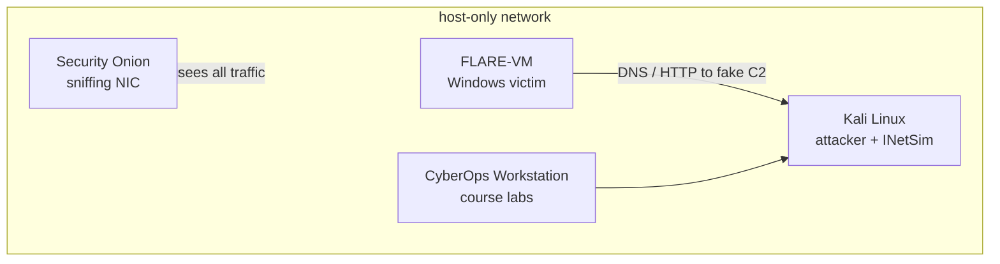

# Day 2 — Setting up the environment
**Tools we will be using**:
- Hypervisor - VirtualBox or VMware
- Windows 10/11 VM 64-bit preferable.
- FLARE VM - Windows malware analysis distribution >>  Comes prepackaged with all the tools we need for malware analysis.
- Kali Linux - attacker box and fake internet (INetSim) for the samples running on FLARE-VM.
- CyberOps Workstation - the lab VM from Cisco's CyberOps Associate course.
- Security Onion - network security monitoring, listens on the lab network and records everything.


> Note: Ensure you disable Windows Update and Windows Defender on your analysis VM.


**Security consideration**:

- Keep your Hypervisor updated.
- When executing malware ensure your network configuration is set to host-only.
- Do not plug any USB devices into the VM.
- Make sure you download compressed and password-protected samples to avoid accidental execution. 
- Take snapshots!
- Do not store any valuable data on your analysis VM.
- Disable shared folders, before execution or analysis.


**Windows 11 development environment**:

- Download the Windows 11 development environment VM from Microsoft
- Unzip the file and double-click on the .ova file
- Customize to preferable appliance setting (Disk-size, etc)
> Note: default is sufficient
- Create a host-only adaptor (you will need it after the FLARE-VM installation)
- Download the FLARE-VM on Win 11
> Note: Take the snapshot of your VM and then install the FLARE-VM 

> Note: Disable Windows firewall | services.msc > Search for windows update service and Windows Defender and disable these services so that it doesn't interfere with the FLARE-VM installation.

- Unzip the file and use the installation guide to install the FLARE-VM machine.
- After installation connect the machine to the host-only adaptor.

# Doing the prep in one go

Clicking through the pre-installation list by hand every time I rebuild the VM got old fast, so I put it all in one script, [Install-FlareVM.ps1](scripts/Install-FlareVM.ps1). It checks the basics, turns off Defender and Windows Update, waits for a snapshot and then pulls the official `install.ps1` from mandiant/flare-vm and runs it.

Inside the VM I save both files next to each other and run it from an elevated Windows PowerShell (not pwsh 7)

```powershell
Set-ExecutionPolicy Bypass -Scope Process -Force
.\Install-FlareVM.ps1 -NoGui            # defaults + my package list, nothing to click
.\Install-FlareVM.ps1                   # same list, but shown in the GUI first
.\Install-FlareVM.ps1 -DefaultPackages  # plain FLARE-VM default set
```

A few things I ran into while writing it.

- **Tamper Protection can't be scripted.** That's on purpose. If a script could switch it off, so could malware. The script opens Windows Security and just waits until I flip it myself.
- **The GPO keys don't always bite right away.** Real-time protection often stays on until a reboot. So the script checks, and if Defender is still running it sets a RunOnce key, reboots and picks up where it left off after logon.
- **It refuses to run on a real machine.** It looks at the manufacturer, model and BIOS strings for VMware, VirtualBox, Hyper-V, QEMU and so on. Turning off AV on my actual laptop by accident is exactly the mistake I don't want to make. `-Force` overrides it if detection misses a hypervisor.
- **The snapshot step stays manual.** The guest can't snapshot itself, so the script pauses right before the FLARE-VM install, with Defender and updates already off. I still take one more snapshot of the clean Windows install before running anything.
- **FLARE-VM wants a username without spaces**, about 60 GB free and Windows PowerShell 5.1. The script checks all three up front so it doesn't fail an hour into the install.

Windows Update stays off afterwards. If I ever want to patch the VM I have to remove the `NoAutoUpdate` policy under `HKLM\SOFTWARE\Policies\Microsoft\Windows\WindowsUpdate\AU` again.

## Picking the packages

The FLARE-VM package list is long and more than half of it is red team tooling (C2, credential access, lateral movement). None of that belongs on an analysis box, and Kali already covers the offensive side. So instead of clicking through the GUI the script downloads the official `config.xml`, drops everything marked with `-` in `flare-packages.txt` and adds the rest. That keeps whatever settings Mandiant puts in the default config, even when they change it.

The package list lives in [scripts/flare-packages.txt](scripts/flare-packages.txt) and the script itself in [scripts/Install-FlareVM.ps1](scripts/Install-FlareVM.ps1).

# Adding Kali, CyberOps and Security Onion

FLARE-VM only shows what happens inside the Windows box. To see the network side as well I added three more VMs, all on the same host-only network as FLARE-VM.



The order that worked for me is install and update each VM while it still has NAT, take a snapshot, then move it to the host-only network. Once a box is on host-only it has no internet anymore.

## Kali Linux

- Use the prebuilt VirtualBox or VMware image from kali.org instead of the installer ISO. It saves the whole install. Default login is `kali` / `kali`, change it first.
- Update while it is still on NAT.

```bash
sudo apt update && sudo apt full-upgrade -y
sudo apt install -y inetsim
```

- INetSim fakes DNS, HTTP(S), SMTP, FTP and more, so a sample on FLARE-VM thinks it reached its C2 and keeps going instead of dying quietly. In `/etc/inetsim/inetsim.conf` set `service_bind_address` and `dns_default_ip` to Kali's host-only IP.

```bash
sudo systemctl restart inetsim
```

- On FLARE-VM set the default gateway and DNS server to Kali's host-only IP. Now every lookup and connection from the sample lands on INetSim, and the INetSim logs in `/var/log/inetsim/` show what it asked for.

## CyberOps Workstation

- This is the VM from Cisco's CyberOps Associate course on NetAcad. The download sits behind a NetAcad login, linked from the lab "Install the CyberOps Workstation Virtual Machine".
- Import the `.ova` in VirtualBox. The lab sheet lists the login (`analyst` / `cyberops`).
- It comes with Wireshark, tcpdump and the files the course labs expect. A lot of it overlaps with Kali, I keep it so the course exercises run exactly as written.

## Security Onion

- Free NSM platform with Suricata, Zeek, full packet capture and the Elastic stack in one. Download the ISO from securityonion.net and verify the signature, the docs explain how.
- This is by far the heaviest VM in the lab. Check the hardware requirements in the docs before choosing an install type. `IMPORT` is the light option for loading pcaps afterwards, `EVAL` or `STANDALONE` when it has to sniff live.
- It needs two network adapters.
  - Management NIC, NAT during install (it pulls updates), then host-only so I can reach the web UI from the host.
  - Sniffing NIC on the lab host-only network with no IP. In VirtualBox set **Promiscuous Mode** to **Allow All**, otherwise it only sees broadcast traffic and none of the FLARE-VM to Kali traffic.
- During setup it asks which IP range may reach the web interface. I put the host-only subnet there.
- After setup, detonate something on FLARE-VM and check that the alerts and Zeek logs show up in SOC. If nothing shows up, the promiscuous mode setting is the first thing to check.
# Analysis tools on FLARE-VM

| Toolkit | Memo |
| :------------- | ------------- |
| Utilities      | PEstudio, PEid, CFF Explorer, ProccesHacker, ProcDOT, Wireshark
| Debuggers      | OnlyDbg, x64Dbg
| Pentest        | Cachedump, VNCviewer, exe2bat
---

# References

■ [Get a Windows 11 development environment](https://developer.microsoft.com/en-us/windows/downloads/virtual-machines/)
<br>
■ [Download FLARE-VM from the official Repository](https://github.com/mandiant/flare-vm)
<br>
■ [Flare-VM installation guide](https://cloud.google.com/blog/topics/threat-intelligence/flare-vm-update/)
<br>
■ [Kali Linux virtual machines](https://www.kali.org/get-kali/#kali-virtual-machines)
<br>
■ [INetSim](https://www.inetsim.org/)
<br>
■ [Cisco NetAcad CyberOps Associate](https://www.netacad.com/courses/cyberops-associate)
<br>
■ [Security Onion documentation](https://docs.securityonion.net/)
