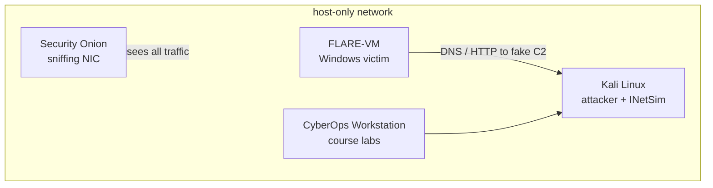

# Day 2 — Setting up the environment
**Tools we will be using**:
- Hypervisor - VirtualBox or VMware
- Windows 10/11 VM 64-bit preferable.
- FLARE VM - Windows malware analysis distribution >>  Comes prepackaged with all the tools we need for malware analysis.
- Kali Linux - attacker box and fake internet (INetSim) for the samples running on FLARE-VM.
- CyberOps Workstation - the lab VM from Cisco's CyberOps Associate course.
- Security Onion - network security monitoring, listens on the lab network and records everything.


> Note: Ensure you disable Windows Update and Windows Defender on your analysis VM.


**Security consideration**:

- Keep your Hypervisor updated.
- When executing malware ensure your network configuration is set to host-only.
- Do not plug any USB devices into the VM.
- Make sure you download compressed and password-protected samples to avoid accidental execution. 
- Take snapshots!
- Do not store any valuable data on your analysis VM.
- Disable shared folders, before execution or analysis.


**Windows 11 development environment**:

- Download the Windows 11 development environment VM from Microsoft
- Unzip the file and double-click on the .ova file
- Customize to preferable appliance setting (Disk-size, etc)
> Note: default is sufficient
- Create a host-only adaptor (you will need it after the FLARE-VM installation)
- Download the FLARE-VM on Win 11
> Note: Take the snapshot of your VM and then install the FLARE-VM 

> Note: Disable Windows firewall | services.msc > Search for windows update service and Windows Defender and disable these services so that it doesn't interfere with the FLARE-VM installation.

- Unzip the file and use the installation guide to install the FLARE-VM machine.
- After installation connect the machine to the host-only adaptor.

# Doing the prep in one go

Clicking through the pre-installation list by hand every time I rebuild the VM got old fast, so I put it all in one script, `Install-FlareVM.ps1`. The full script and the package list are at the end of this section. It checks the basics, turns off Defender and Windows Update, waits for a snapshot and then pulls the official `install.ps1` from mandiant/flare-vm and runs it.

Inside the VM I save both files next to each other and run it from an elevated Windows PowerShell (not pwsh 7)

```powershell
Set-ExecutionPolicy Bypass -Scope Process -Force
.\Install-FlareVM.ps1 -NoGui            # defaults + my package list, nothing to click
.\Install-FlareVM.ps1                   # same list, but shown in the GUI first
.\Install-FlareVM.ps1 -DefaultPackages  # plain FLARE-VM default set
```

A few things I ran into while writing it.

- **Tamper Protection can't be scripted.** That's on purpose. If a script could switch it off, so could malware. The script opens Windows Security and just waits until I flip it myself.
- **The GPO keys don't always bite right away.** Real-time protection often stays on until a reboot. So the script checks, and if Defender is still running it sets a RunOnce key, reboots and picks up where it left off after logon.
- **It refuses to run on a real machine.** It looks at the manufacturer, model and BIOS strings for VMware, VirtualBox, Hyper-V, QEMU and so on. Turning off AV on my actual laptop by accident is exactly the mistake I don't want to make. `-Force` overrides it if detection misses a hypervisor.
- **The snapshot step stays manual.** The guest can't snapshot itself, so the script pauses right before the FLARE-VM install, with Defender and updates already off. I still take one more snapshot of the clean Windows install before running anything.
- **FLARE-VM wants a username without spaces**, about 60 GB free and Windows PowerShell 5.1. The script checks all three up front so it doesn't fail an hour into the install.

Windows Update stays off afterwards. If I ever want to patch the VM I have to remove the `NoAutoUpdate` policy under `HKLM\SOFTWARE\Policies\Microsoft\Windows\WindowsUpdate\AU` again.

## Picking the packages

The FLARE-VM package list is long and more than half of it is red team tooling (C2, credential access, lateral movement). None of that belongs on an analysis box, and Kali already covers the offensive side. So instead of clicking through the GUI the script downloads the official `config.xml`, drops everything marked with `-` in `flare-packages.txt` and adds the rest. That keeps whatever settings Mandiant puts in the default config, even when they change it.

<details>
<summary><b>flare-packages.txt</b></summary>

```text
# FLARE-VM package list for Install-FlareVM.ps1
#
# The script downloads the official default config.xml from mandiant/flare-vm,
# adds every package listed here and removes every line starting with "-".
# Wildcards work for removals (e.g. -ida.plugin.*). Everything after # is ignored.
# Full list https://github.com/mandiant/VM-Packages/wiki/Packages

# --- static, first look at a file
pestudio.vm
die.vm
pebear.vm
explorersuite.vm
exeinfope.vm
floss.vm
stringsifter.vm
capa.vm
hashmyfiles.vm
exiftool.vm
resourcehacker.vm
yara.vm

# --- disassemblers
ghidra.vm
idafree.vm
cutter.vm

# --- debuggers
x64dbg.vm
x64dbg.plugin.scyllahide.vm    # hide debugger from anti-debug checks
x64dbg.plugin.dbgchild.vm      # auto-attach to spawned child processes

# --- dynamic, behaviour
sysinternals.vm
systeminformer.vm
procdot.vm
regshot.vm
apimonitor.vm
pesieve.vm
hollowshunter.vm

# --- network
wireshark.vm
fakenet-ng.vm
networkminer.vm
internet_detector.vm           # changes wallpaper when the VM has internet

# --- unpacking and extracting
upx.vm
7zip.vm                        # adds "unzip infected" to the context menu
uniextract2.vm
mal_unpack.vm

# --- documents and scripts
didier-stevens-suite.vm
pdfstreamdumper.vm
onenoteanalyzer.vm
js-beautify.vm

# --- .NET
dnspyex.vm
ilspy.vm
de4dot-cex.vm

# --- shellcode
blobrunner.vm
blobrunner64.vm
scdbg.vm

# --- general
cyberchef.vm
hxd.vm
python3.vm
libraries.python3.vm
notepadplusplus.vm
vscode.vm

# --- optional, uncomment when needed
# pma-labs.vm                  # LIVE malware samples from Practical Malware Analysis
# goresym.vm                   # Go binaries
# idr.vm                       # Delphi binaries
# pycdc.vm                     # Python bytecode

# --- never install, even if the defaults contain them
-idapro.vm                     # needs a license
-ida.plugin.*                  # need IDA Pro
-visualstudio.vm               # huge and slow
-pdbs.pdbresym.vm              # huge
-mimikatz.vm
-safetykatz.vm
-rubeus.vm
-sliver.vm
-covenant.vm
-metasploit.vm
```

</details>

<details>
<summary><b>Install-FlareVM.ps1</b></summary>

```powershell
<#
.SYNOPSIS
    Prepares a Windows 10/11 VM and installs FLARE-VM in one run.

.DESCRIPTION
    Follows the FLARE-VM pre-installation steps:
      1. Sanity checks (admin, Windows PowerShell 5.x, Windows 10+, real VM, disk, RAM, username)
      2. Waits for you to switch off Tamper Protection (cannot be done by script, by design)
      3. Disables Microsoft Defender via Group Policy registry keys
      4. Disables Windows Update via Group Policy + service
      5. Reboots if Defender is still active and resumes automatically after logon
      6. Pauses so you can take a VM snapshot
      7. Downloads and runs the official mandiant/flare-vm install.ps1

    ONLY RUN THIS INSIDE A DISPOSABLE ANALYSIS VM. It turns off AV and updates.

.PARAMETER NoGui
    Pass -noGui to the FLARE-VM installer (skip the package selection GUI).

.PARAMETER CustomConfig
    Path or URL to a ready-made FLARE-VM config.xml (passed as -customConfig).
    Overrides -PackageList.

.PARAMETER PackageList
    Text file with package ids to add (and "-id" lines to remove) on top of the
    official default config.xml. Defaults to flare-packages.txt next to this script.

.PARAMETER DefaultPackages
    Ignore the package list and install the plain FLARE-VM default set.

.PARAMETER Force
    Skip the "am I in a VM?" check. Use only if detection fails on your hypervisor.

.EXAMPLE
    # In an elevated Windows PowerShell (not pwsh 7) inside the VM:
    Set-ExecutionPolicy Bypass -Scope Process -Force
    .\Install-FlareVM.ps1
#>
[CmdletBinding()]
param(
    [switch]$NoGui,
    [string]$CustomConfig,
    [string]$PackageList = (Join-Path $PSScriptRoot 'flare-packages.txt'),
    [switch]$DefaultPackages,
    [switch]$Force,
    [switch]$Resume   # internal: set when relaunched after reboot
)

$ErrorActionPreference = 'Stop'
$FlareInstallerUrl = 'https://raw.githubusercontent.com/mandiant/flare-vm/main/install.ps1'
$FlareConfigUrl    = 'https://raw.githubusercontent.com/mandiant/flare-vm/main/config.xml'
$WorkDir           = Join-Path $env:USERPROFILE 'Desktop\flare-vm-setup'
$RunOnceKey        = 'HKLM:\SOFTWARE\Microsoft\Windows\CurrentVersion\RunOnce'
$RunOnceName       = 'FlareVMSetupResume'

function Write-Step($msg) { Write-Host "`n[*] $msg" -ForegroundColor Cyan }
function Write-Ok($msg)   { Write-Host "    [+] $msg" -ForegroundColor Green }
function Write-Warn2($msg){ Write-Host "    [!] $msg" -ForegroundColor Yellow }
function Fail($msg)       { Write-Host "`n[x] $msg" -ForegroundColor Red; Read-Host 'Press Enter to exit'; exit 1 }

function Set-RegValue($Path, $Name, $Value, $Type = 'DWord') {
    if (-not (Test-Path $Path)) { New-Item -Path $Path -Force | Out-Null }
    New-ItemProperty -Path $Path -Name $Name -Value $Value -PropertyType $Type -Force | Out-Null
}

# ---------------------------------------------------------------- 1. checks
function Test-Prerequisites {
    Write-Step 'Checking prerequisites'

    $principal = New-Object Security.Principal.WindowsPrincipal([Security.Principal.WindowsIdentity]::GetCurrent())
    if (-not $principal.IsInRole([Security.Principal.WindowsBuiltInRole]::Administrator)) {
        Fail 'Run this script from an elevated (Run as administrator) PowerShell.'
    }
    Write-Ok 'Running as administrator'

    if ($PSVersionTable.PSEdition -ne 'Desktop' -or $PSVersionTable.PSVersion.Major -lt 5) {
        Fail 'Use Windows PowerShell 5.1 (powershell.exe), not PowerShell 7 (pwsh.exe).'
    }
    Write-Ok "Windows PowerShell $($PSVersionTable.PSVersion)"

    $os = Get-CimInstance Win32_OperatingSystem
    if ([int]$os.BuildNumber -lt 10240) { Fail "Windows 10 or newer required (found build $($os.BuildNumber))." }
    Write-Ok "$($os.Caption) build $($os.BuildNumber)"

    $cs   = Get-CimInstance Win32_ComputerSystem
    $bios = Get-CimInstance Win32_BIOS
    $fingerprint = "$($cs.Manufacturer) $($cs.Model) $($bios.Manufacturer) $($bios.SerialNumber) $($bios.Version)"
    $isVm = $fingerprint -match 'VMware|VirtualBox|innotek|QEMU|KVM|Xen|Parallels|Bochs|Virtual Machine|Hyper-V|UTM'
    if (-not $isVm -and -not $Force) {
        Fail "This does not look like a VM ($($cs.Manufacturer) / $($cs.Model)). Refusing to disable Defender on a real machine. Use -Force only if you are sure."
    }
    Write-Ok "Virtual machine detected: $($cs.Manufacturer) $($cs.Model)"

    $freeGb = [math]::Round((Get-PSDrive C).Free / 1GB, 1)
    if ($freeGb -lt 60) { Write-Warn2 "Only $freeGb GB free on C:. FLARE-VM wants at least 60 GB." } else { Write-Ok "$freeGb GB free on C:" }

    $ramGb = [math]::Round($cs.TotalPhysicalMemory / 1GB, 1)
    if ($ramGb -lt 2) { Write-Warn2 "Only $ramGb GB RAM. FLARE-VM wants at least 2 GB (4+ recommended)." } else { Write-Ok "$ramGb GB RAM" }

    if ($env:USERNAME -match '\s') { Fail "Your username '$env:USERNAME' contains a space. FLARE-VM does not support that." }
    Write-Ok "Username '$env:USERNAME' OK"

    try {
        Invoke-WebRequest -Uri 'https://github.com' -UseBasicParsing -Method Head -TimeoutSec 15 | Out-Null
        Write-Ok 'Internet connectivity OK'
    } catch { Fail 'No internet access (github.com unreachable). FLARE-VM downloads everything online.' }
}

# ---------------------------------------------------------------- 2. tamper protection
function Wait-TamperProtectionOff {
    Write-Step 'Checking Tamper Protection'
    $status = Get-MpComputerStatus -ErrorAction SilentlyContinue
    if (-not $status) { Write-Warn2 'Defender status unavailable (already removed?). Skipping.'; return }

    while ((Get-MpComputerStatus).IsTamperProtected) {
        Write-Warn2 'Tamper Protection is ON. Windows does not allow scripts to turn it off.'
        Write-Host  '        Opening Windows Security. Go to: Virus & threat protection > Manage settings'
        Write-Host  '        and switch OFF "Tamper Protection" (and "Real-time protection" while you are there).'
        Start-Process 'windowsdefender://threatsettings'
        Read-Host '        Press Enter once Tamper Protection is off'
    }
    Write-Ok 'Tamper Protection is off'
}

# ---------------------------------------------------------------- 3. defender
function Disable-Defender {
    Write-Step 'Disabling Microsoft Defender via Group Policy'
    $base = 'HKLM:\SOFTWARE\Policies\Microsoft\Windows Defender'

    Set-RegValue $base 'DisableAntiSpyware'          1
    Set-RegValue $base 'DisableAntiVirus'            1
    Set-RegValue $base 'DisableRoutinelyTakingAction' 1
    Set-RegValue $base 'ServiceKeepAlive'            0

    $rtp = "$base\Real-Time Protection"
    Set-RegValue $rtp 'DisableRealtimeMonitoring'    1
    Set-RegValue $rtp 'DisableBehaviorMonitoring'    1
    Set-RegValue $rtp 'DisableOnAccessProtection'    1
    Set-RegValue $rtp 'DisableScanOnRealtimeEnable'  1
    Set-RegValue $rtp 'DisableIOAVProtection'        1

    $spy = "$base\Spynet"
    Set-RegValue $spy 'SpynetReporting'      0
    Set-RegValue $spy 'SubmitSamplesConsent' 2   # never send samples

    Set-RegValue "$base\MpEngine" 'MpEnablePus' 0
    Set-RegValue 'HKLM:\SOFTWARE\Policies\Microsoft\Windows\System' 'EnableSmartScreen' 0

    # Immediate effect where allowed (no-op once policy has taken over)
    try {
        Set-MpPreference -DisableRealtimeMonitoring $true -DisableBehaviorMonitoring $true `
            -DisableIOAVProtection $true -DisableScriptScanning $true -DisableBlockAtFirstSeen $true `
            -MAPSReporting Disabled -SubmitSamplesConsent NeverSend -PUAProtection Disabled -ErrorAction Stop
        Add-MpPreference -ExclusionPath 'C:\' -ErrorAction SilentlyContinue
    } catch { Write-Warn2 "Set-MpPreference: $($_.Exception.Message)" }

    gpupdate /force | Out-Null
    Write-Ok 'Defender policies applied'
}

# ---------------------------------------------------------------- 4. windows update
function Disable-WindowsUpdate {
    Write-Step 'Disabling Windows Update'
    $au = 'HKLM:\SOFTWARE\Policies\Microsoft\Windows\WindowsUpdate\AU'
    Set-RegValue $au 'NoAutoUpdate' 1
    Set-RegValue $au 'AUOptions'    1
    Set-RegValue 'HKLM:\SOFTWARE\Policies\Microsoft\Windows\WindowsUpdate' 'DoNotConnectToWindowsUpdateInternetLocations' 1

    foreach ($svc in 'wuauserv', 'BITS', 'DoSvc') {
        try {
            Stop-Service $svc -Force -ErrorAction Stop
            Set-Service  $svc -StartupType Disabled -ErrorAction Stop
            Write-Ok "Service $svc stopped and disabled"
        } catch { Write-Warn2 "Could not disable ${svc}: $($_.Exception.Message)" }
    }
    Write-Ok 'Windows Update disabled (re-enable later via the AU policy key if you need patches)'
}

# ---------------------------------------------------------------- 5. reboot if needed
function Test-DefenderStillRunning {
    try { return [bool](Get-MpComputerStatus -ErrorAction Stop).RealTimeProtectionEnabled } catch { return $false }
}

function Register-ResumeAndReboot {
    $relaunchArgs = @('-NoProfile', '-ExecutionPolicy', 'Bypass', '-NoExit', '-File', "`"$PSCommandPath`"", '-Resume')
    if ($NoGui)        { $relaunchArgs += '-NoGui' }
    if ($CustomConfig) { $relaunchArgs += @('-CustomConfig', "`"$CustomConfig`"") }
    if ($Force)        { $relaunchArgs += '-Force' }
    if ($DefaultPackages) { $relaunchArgs += '-DefaultPackages' }
    if ($PSBoundParameters.ContainsKey('PackageList')) { $relaunchArgs += @('-PackageList', "`"$PackageList`"") }
    $cmd = "powershell.exe $($relaunchArgs -join ' ')"
    Set-RegValue $RunOnceKey $RunOnceName $cmd 'String'
    Write-Warn2 'Defender real-time protection is still active. A reboot is needed for the policy to take over.'
    Write-Host  '        The script resumes automatically after you log back in.'
    Read-Host   '        Press Enter to reboot now'
    Restart-Computer -Force
    exit 0
}

# ---------------------------------------------------------------- custom package config
function New-FlareConfig([string]$ListPath) {
    Write-Step "Building package config from $(Split-Path $ListPath -Leaf)"
    $add = @(); $remove = @()
    foreach ($line in Get-Content $ListPath) {
        $l = ($line -replace '#.*$', '').Trim()
        if (-not $l) { continue }
        if ($l.StartsWith('-')) { $remove += $l.Substring(1).Trim() } else { $add += $l }
    }

    $defaultPath = Join-Path $WorkDir 'config.default.xml'
    Invoke-WebRequest -Uri $FlareConfigUrl -OutFile $defaultPath -UseBasicParsing
    [xml]$cfg = Get-Content $defaultPath -Raw
    $pkgRoot = $cfg.SelectSingleNode('//packages')
    if (-not $pkgRoot) {
        Write-Warn2 'Unexpected config.xml layout, falling back to the default package set.'
        return $null
    }

    $present = @{}
    foreach ($node in @($pkgRoot.SelectNodes('package'))) {
        $name = $node.GetAttribute('name')
        if ($remove | Where-Object { $name -like $_ }) {
            [void]$pkgRoot.RemoveChild($node)
            Write-Host "    - removed $name"
        } else { $present[$name] = $true }
    }
    $defaults = $present.Count

    foreach ($name in $add) {
        if ($present.ContainsKey($name)) { continue }
        if ($remove | Where-Object { $name -like $_ }) { continue }
        $el = $cfg.CreateElement('package')
        $el.SetAttribute('name', $name)
        [void]$pkgRoot.AppendChild($el)
        $present[$name] = $true
    }

    $out = Join-Path $WorkDir 'config.xml'
    $cfg.Save($out)
    Write-Ok "$defaults default + $($present.Count - $defaults) extra = $($present.Count) packages, saved to $out"
    return $out
}

# ---------------------------------------------------------------- 6+7. snapshot and install
function Install-Flare {
    Write-Step 'Snapshot time'
    Write-Host '    Take a VM snapshot NOW from your hypervisor (e.g. "pre-flare-clean").' -ForegroundColor Yellow
    Write-Host '    Defender and updates are off, nothing from FLARE-VM is installed yet.'
    if (Test-Path "$env:USERPROFILE\Desktop\ida*") { Write-Ok 'IDA Pro installer found on Desktop' }
    else { Write-Host '    IDA Pro via idapro.vm? Put the installer (and license) on the Desktop before continuing.' }
    Read-Host '    Press Enter when the snapshot is done'

    Write-Step 'Downloading FLARE-VM installer'
    New-Item -ItemType Directory -Path $WorkDir -Force | Out-Null
    $installer = Join-Path $WorkDir 'install.ps1'
    [Net.ServicePointManager]::SecurityProtocol = [Net.SecurityProtocolType]::Tls12
    Invoke-WebRequest -Uri $FlareInstallerUrl -OutFile $installer -UseBasicParsing
    Unblock-File $installer
    Write-Ok "Saved to $installer"

    Set-ExecutionPolicy Unrestricted -Scope LocalMachine -Force -ErrorAction SilentlyContinue
    Set-ExecutionPolicy Unrestricted -Scope Process      -Force

    $configPath = $CustomConfig
    if (-not $configPath -and -not $DefaultPackages) {
        if (Test-Path $PackageList) { $configPath = New-FlareConfig $PackageList }
        else { Write-Warn2 "No package list at $PackageList, using the FLARE-VM defaults." }
    }

    $flareArgs = @{}
    if ($NoGui)      { $flareArgs['noGui'] = $true }
    if ($configPath) { $flareArgs['customConfig'] = $configPath }

    Write-Step 'Running FLARE-VM installer (you will be asked for your Windows password for auto-logon reboots)'
    Write-Host '    This takes a long time and reboots several times. Let it run.' -ForegroundColor Yellow
    Push-Location $WorkDir
    try { & $installer @flareArgs } finally { Pop-Location }
}

# ---------------------------------------------------------------- main
Write-Host '=== FLARE-VM one-shot setup ===' -ForegroundColor Magenta
Remove-ItemProperty -Path $RunOnceKey -Name $RunOnceName -ErrorAction SilentlyContinue

Test-Prerequisites

if (-not $Resume) {
    Wait-TamperProtectionOff
    Disable-Defender
    Disable-WindowsUpdate
    if (Test-DefenderStillRunning) { Register-ResumeAndReboot }
} else {
    Write-Step 'Resumed after reboot'
    if (Test-DefenderStillRunning) {
        Fail 'Defender real-time protection is still on after reboot. Check that Tamper Protection is off, then run the script again.'
    }
    Write-Ok 'Defender real-time protection is off'
}

Install-Flare
```

</details>

# Adding Kali, CyberOps and Security Onion

FLARE-VM only shows what happens inside the Windows box. To see the network side as well I added three more VMs, all on the same host-only network as FLARE-VM.



The order that worked for me is install and update each VM while it still has NAT, take a snapshot, then move it to the host-only network. Once a box is on host-only it has no internet anymore.

## Kali Linux

- Use the prebuilt VirtualBox or VMware image from kali.org instead of the installer ISO. It saves the whole install. Default login is `kali` / `kali`, change it first.
- Update while it is still on NAT.

```bash
sudo apt update && sudo apt full-upgrade -y
sudo apt install -y inetsim
```

- INetSim fakes DNS, HTTP(S), SMTP, FTP and more, so a sample on FLARE-VM thinks it reached its C2 and keeps going instead of dying quietly. In `/etc/inetsim/inetsim.conf` set `service_bind_address` and `dns_default_ip` to Kali's host-only IP.

```bash
sudo systemctl restart inetsim
```

- On FLARE-VM set the default gateway and DNS server to Kali's host-only IP. Now every lookup and connection from the sample lands on INetSim, and the INetSim logs in `/var/log/inetsim/` show what it asked for.

## CyberOps Workstation

- This is the VM from Cisco's CyberOps Associate course on NetAcad. The download sits behind a NetAcad login, linked from the lab "Install the CyberOps Workstation Virtual Machine".
- Import the `.ova` in VirtualBox. The lab sheet lists the login (`analyst` / `cyberops`).
- It comes with Wireshark, tcpdump and the files the course labs expect. A lot of it overlaps with Kali, I keep it so the course exercises run exactly as written.

## Security Onion

- Free NSM platform with Suricata, Zeek, full packet capture and the Elastic stack in one. Download the ISO from securityonion.net and verify the signature, the docs explain how.
- This is by far the heaviest VM in the lab. Check the hardware requirements in the docs before choosing an install type. `IMPORT` is the light option for loading pcaps afterwards, `EVAL` or `STANDALONE` when it has to sniff live.
- It needs two network adapters.
  - Management NIC, NAT during install (it pulls updates), then host-only so I can reach the web UI from the host.
  - Sniffing NIC on the lab host-only network with no IP. In VirtualBox set **Promiscuous Mode** to **Allow All**, otherwise it only sees broadcast traffic and none of the FLARE-VM to Kali traffic.
- During setup it asks which IP range may reach the web interface. I put the host-only subnet there.
- After setup, detonate something on FLARE-VM and check that the alerts and Zeek logs show up in SOC. If nothing shows up, the promiscuous mode setting is the first thing to check.
# Analysis tools on FLARE-VM

| Toolkit | Memo |
| :------------- | ------------- |
| Utilities      | PEstudio, PEid, CFF Explorer, ProccesHacker, ProcDOT, Wireshark
| Debuggers      | OnlyDbg, x64Dbg
| Pentest        | Cachedump, VNCviewer, exe2bat
---

# References

■ [Get a Windows 11 development environment](https://developer.microsoft.com/en-us/windows/downloads/virtual-machines/)
<br>
■ [Download FLARE-VM from the official Repository](https://github.com/mandiant/flare-vm)
<br>
■ [Flare-VM installation guide](https://cloud.google.com/blog/topics/threat-intelligence/flare-vm-update/)
<br>
■ [Kali Linux virtual machines](https://www.kali.org/get-kali/#kali-virtual-machines)
<br>
■ [INetSim](https://www.inetsim.org/)
<br>
■ [Cisco NetAcad CyberOps Associate](https://www.netacad.com/courses/cyberops-associate)
<br>
■ [Security Onion documentation](https://docs.securityonion.net/)
