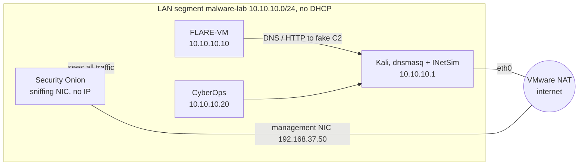

# Day 2 — Setting up the environment

Before I can look at any sample I need a lab I can break without caring. These are the steps I used to build it.

## What's in it

- VMware Workstation as hypervisor. VirtualBox works too, a few settings differ and I note them where it matters.
- FLARE-VM, Mandiant's malware analysis setup on top of the Windows 11 development VM from Microsoft. This is where samples run.
- Kali Linux as attacker box and fake internet, with dnsmasq for DNS and INetSim for everything else.
- CyberOps Workstation, the lab VM from Cisco's CyberOps Associate course.
- Security Onion for network security monitoring, sniffing the lab segment.

## Rules I keep for myself

- Keep the hypervisor updated. A VM escape is the one thing a snapshot doesn't undo.
- When a sample runs, the VM is only on the isolated lab network. Never NAT, never bridged.
- No USB devices in the VM, no shared folders, no valuable data on it.
- Samples come in compressed and password protected, so nothing runs by accident on the way in.
- Snapshots before every step that's hard to undo.
- Shut VMs down from inside the guest, not with Power Off. A hard power off is how I lost a filesystem once.

## Resources

The host has 32 GB RAM and a Ryzen 7 with 16 threads. This split leaves about 12 GB for Windows itself.

| VM | RAM | vCPU |
| :-- | :-- | :-- |
| Security Onion | 8 GB | 4 |
| FLARE-VM | 6 GB | 4 |
| Kali | 4 GB | 2 |
| CyberOps | 2 GB | 1 |

Security Onion really needs the 8 GB. With 4 GB Logstash gets killed and nothing reaches Kibana.

# The lab network

The lab runs on a VMware **LAN segment** called `malware-lab`. A LAN segment is a virtual switch that only the VMs are plugged into, my own machine isn't on it. It has no DHCP, so every box gets a static IP. Kali is the gateway and DNS server for the segment but doesn't route anything onwards, so every name a sample looks up resolves to Kali and every connection ends up at INetSim.



| VM | Adapter | IP | Gateway / DNS |
| :-- | :-- | :-- | :-- |
| Kali | eth0 on NAT | DHCP | VMware NAT |
| Kali | eth1 on `malware-lab` | 10.10.10.1/24 | none |
| FLARE-VM | Ethernet0 on `malware-lab` | 10.10.10.10/24 | 10.10.10.1 |
| CyberOps | ens32 on `malware-lab` | 10.10.10.20/24 | 10.10.10.1 |
| Security Onion | eth1 on NAT (management) | 192.168.37.50/24 | 192.168.37.2 |
| Security Onion | eth0 on `malware-lab` (sniffing) | no IP | - |

Every VM gets installed and updated while it still has NAT, then a snapshot, then it moves to `malware-lab`. Only Kali and the Security Onion management NIC keep NAT. The Security Onion sniffing NIC has no IP, so it can see the lab but never talk to it.

In VMware the LAN segment is created from any VM's network adapter settings, under **LAN segment → LAN Segments… → Add**.

# Kali Linux

1. Download the prebuilt VMware image from kali.org and open it. Default login is `kali` / `kali`, change the password first.
2. Update and install the fake internet while the VM is still only on NAT.

```bash
sudo apt update && sudo apt full-upgrade -y
sudo apt install -y inetsim dnsmasq
```

3. Add a second network adapter in VMware on the `malware-lab` LAN segment. It shows up as `eth1` without an IP. `never-default` keeps the default route on `eth0`, so Kali still updates over NAT and only lab traffic uses `eth1`.

```bash
sudo nmcli con add type ethernet ifname eth1 con-name malware-lab \
  ipv4.method manual ipv4.addresses 10.10.10.1/24 \
  ipv4.never-default yes ipv6.method disabled
sudo nmcli con up malware-lab
```

4. Point INetSim at the lab IP and switch off its own DNS service. The DNS service doesn't work with the `Net::DNS` version on current Kali, so dnsmasq takes over DNS. Both config lines are commented out by default, the grep shows on which line they sit (69 and 207 in INetSim 1.3.2).

```bash
grep -nE 'service_bind_address|dns_default_ip' /etc/inetsim/inetsim.conf
sudo sed -i "69s/.*/service_bind_address 10.10.10.1/; 207s/.*/dns_default_ip 10.10.10.1/" /etc/inetsim/inetsim.conf
sudo sed -i 's/^start_service dns/#start_service dns/' /etc/inetsim/inetsim.conf
```

5. Configure dnsmasq to answer every name with Kali's lab IP, only on `eth1`. `local=/#/` keeps it from trying to forward anything, so IPv6 lookups get an empty answer instead of `REFUSED`. `bind-interfaces` and `except-interface=lo` keep it away from Kali's own resolver.

```bash
sudo tee /etc/dnsmasq.d/malware-lab.conf >/dev/null <<'EOF'
interface=eth1
bind-interfaces
listen-address=10.10.10.1
except-interface=lo
no-resolv
no-hosts
address=/#/10.10.10.1
local=/#/
log-queries
log-facility=/var/log/dnsmasq-lab.log
EOF
```

6. Enable both services. Kali installs them disabled, so without `enable` they're gone after a reboot. INetSim needs a few seconds to fork all its services before `ss` shows them.

```bash
sudo systemctl enable --now dnsmasq inetsim
sleep 5
sudo ss -tulpn | grep 10.10.10.1
dig @10.10.10.1 evil-c2.test +short     # any name resolves to 10.10.10.1
curl -s http://10.10.10.1 | head -5     # INetSim's default page
```

7. Snapshot.

Lookups a sample makes end up in `/var/log/dnsmasq-lab.log`, what it does next in `/var/log/inetsim/service.log`.

# FLARE-VM

## Windows 11 base

1. Download the Windows 11 development environment VM from Microsoft, unzip it and open the `.ova`. The default appliance settings are fine.
2. Snapshot before touching anything.
3. Leave the adapter on NAT. FLARE-VM downloads everything during the install.
4. Turn off Windows Firewall by hand. Defender and Windows Update are handled by the script below.

## Running the install script

The script checks the basics, waits until I switch off Tamper Protection, turns off Defender and Windows Update through policy, reboots and resumes if Defender is still active, pauses for a snapshot and then runs the official `install.ps1` from mandiant/flare-vm with my package list.

- It needs Windows PowerShell 5.1 as administrator. Not pwsh 7, and not PowerShell ISE, which doesn't show the installer's prompts.
- It needs a username without spaces and about 60 GB free disk. The script checks both.
- Tamper Protection can't be switched off by a script, that's by design. The script opens Windows Security and waits until it's off.
- It refuses to run on something that doesn't look like a VM. `-Force` overrides that if detection misses a hypervisor.
- FLARE-VM's own installer may still warn that Tamper Protection is on. If `Get-MpComputerStatus` shows `IsTamperProtected` as `False`, answer Y.

Copy the block from "The script" below into `Install-FlareVM.ps1` inside the VM and run it from an elevated Windows PowerShell.

```powershell
Set-ExecutionPolicy Bypass -Scope Process -Force
.\Install-FlareVM.ps1 -NoGui            # defaults + my package list, nothing to click
.\Install-FlareVM.ps1                   # same list, but shown in the GUI first
.\Install-FlareVM.ps1 -DefaultPackages  # plain FLARE-VM default set
```

The install takes a long time and reboots several times on its own.

Windows Update stays off afterwards. To patch the VM again, remove the `NoAutoUpdate` policy under `HKLM\SOFTWARE\Policies\Microsoft\Windows\WindowsUpdate\AU`.

## Picking the packages

More than half of the default FLARE-VM package list is red team tooling (C2, credential access, lateral movement). None of that belongs on an analysis box, and Kali already covers the offensive side. The script downloads the official `config.xml`, drops everything marked with `-` in the `$Packages` list and adds the rest, so Mandiant's default settings stay intact. `-PackageList somefile.txt` loads a different list without editing the script.

## The script

```powershell
<#
.SYNOPSIS
    Prepares a Windows 10/11 VM and installs FLARE-VM in one run.

.DESCRIPTION
    Follows the FLARE-VM pre-installation steps:
      1. Sanity checks (admin, Windows PowerShell 5.x, Windows 10+, real VM, disk, RAM, username)
      2. Waits for you to switch off Tamper Protection (cannot be done by script, by design)
      3. Disables Microsoft Defender via Group Policy registry keys
      4. Disables Windows Update via Group Policy + service
      5. Reboots if Defender is still active and resumes automatically after logon
      6. Pauses so you can take a VM snapshot
      7. Downloads and runs the official mandiant/flare-vm install.ps1

    ONLY RUN THIS INSIDE A DISPOSABLE ANALYSIS VM. It turns off AV and updates.

.PARAMETER NoGui
    Pass -noGui to the FLARE-VM installer (skip the package selection GUI).

.PARAMETER CustomConfig
    Path or URL to a ready-made FLARE-VM config.xml (passed as -customConfig).
    Overrides -PackageList.

.PARAMETER PackageList
    Optional text file with package ids to add (and "-id" lines to remove) on top of
    the official default config.xml. Without it the list in $Packages below is used.

.PARAMETER DefaultPackages
    Ignore the package list and install the plain FLARE-VM default set.

.PARAMETER Force
    Skip the "am I in a VM?" check. Use only if detection fails on your hypervisor.

.EXAMPLE
    # In an elevated Windows PowerShell (not pwsh 7) inside the VM:
    Set-ExecutionPolicy Bypass -Scope Process -Force
    .\Install-FlareVM.ps1
#>
[CmdletBinding()]
param(
    [switch]$NoGui,
    [string]$CustomConfig,
    [string]$PackageList,
    [switch]$DefaultPackages,
    [switch]$Force,
    [switch]$Resume   # internal: set when relaunched after reboot
)

$ErrorActionPreference = 'Stop'
$FlareInstallerUrl = 'https://raw.githubusercontent.com/mandiant/flare-vm/main/install.ps1'
$FlareConfigUrl    = 'https://raw.githubusercontent.com/mandiant/flare-vm/main/config.xml'
$WorkDir           = Join-Path $env:USERPROFILE 'Desktop\flare-vm-setup'
$RunOnceKey        = 'HKLM:\SOFTWARE\Microsoft\Windows\CurrentVersion\RunOnce'
$RunOnceName       = 'FlareVMSetupResume'

# Package list. One id per line, a leading - removes it from the defaults,
# wildcards work for removals, everything after # is ignored.
# Full list https://github.com/mandiant/VM-Packages/wiki/Packages
$Packages = @'
# --- static, first look at a file
pestudio.vm
die.vm
pebear.vm
explorersuite.vm
exeinfope.vm
floss.vm
stringsifter.vm
capa.vm
hashmyfiles.vm
exiftool.vm
resourcehacker.vm
yara.vm

# --- disassemblers
ghidra.vm
idafree.vm
cutter.vm

# --- debuggers
x64dbg.vm
x64dbg.plugin.scyllahide.vm    # hide debugger from anti-debug checks
x64dbg.plugin.dbgchild.vm      # auto-attach to spawned child processes

# --- dynamic, behaviour
sysinternals.vm
systeminformer.vm
procdot.vm
regshot.vm
apimonitor.vm
pesieve.vm
hollowshunter.vm

# --- network
wireshark.vm
fakenet-ng.vm
networkminer.vm
internet_detector.vm           # changes wallpaper when the VM has internet

# --- unpacking and extracting
upx.vm
7zip.vm                        # adds "unzip infected" to the context menu
uniextract2.vm
mal_unpack.vm

# --- documents and scripts
didier-stevens-suite.vm
pdfstreamdumper.vm
onenoteanalyzer.vm
js-beautify.vm

# --- .NET
dnspyex.vm
ilspy.vm
de4dot-cex.vm

# --- shellcode
blobrunner.vm
blobrunner64.vm
scdbg.vm

# --- general
cyberchef.vm
hxd.vm
python3.vm
libraries.python3.vm
notepadplusplus.vm
vscode.vm

# --- optional, uncomment when needed
# pma-labs.vm                  # LIVE malware samples from Practical Malware Analysis
# goresym.vm                   # Go binaries
# idr.vm                       # Delphi binaries
# pycdc.vm                     # Python bytecode

# --- never install, even if the defaults contain them
-idapro.vm                     # needs a license
-ida.plugin.*                  # need IDA Pro
-visualstudio.vm               # huge and slow
-pdbs.pdbresym.vm              # huge
-mimikatz.vm
-safetykatz.vm
-rubeus.vm
-sliver.vm
-covenant.vm
-metasploit.vm
'@

function Write-Step($msg) { Write-Host "`n[*] $msg" -ForegroundColor Cyan }
function Write-Ok($msg)   { Write-Host "    [+] $msg" -ForegroundColor Green }
function Write-Warn2($msg){ Write-Host "    [!] $msg" -ForegroundColor Yellow }
function Fail($msg)       { Write-Host "`n[x] $msg" -ForegroundColor Red; Read-Host 'Press Enter to exit'; exit 1 }

function Set-RegValue($Path, $Name, $Value, $Type = 'DWord') {
    if (-not (Test-Path $Path)) { New-Item -Path $Path -Force | Out-Null }
    New-ItemProperty -Path $Path -Name $Name -Value $Value -PropertyType $Type -Force | Out-Null
}

# ---------------------------------------------------------------- 1. checks
function Test-Prerequisites {
    Write-Step 'Checking prerequisites'

    $principal = New-Object Security.Principal.WindowsPrincipal([Security.Principal.WindowsIdentity]::GetCurrent())
    if (-not $principal.IsInRole([Security.Principal.WindowsBuiltInRole]::Administrator)) {
        Fail 'Run this script from an elevated (Run as administrator) PowerShell.'
    }
    Write-Ok 'Running as administrator'

    if ($PSVersionTable.PSEdition -ne 'Desktop' -or $PSVersionTable.PSVersion.Major -lt 5) {
        Fail 'Use Windows PowerShell 5.1 (powershell.exe), not PowerShell 7 (pwsh.exe).'
    }
    Write-Ok "Windows PowerShell $($PSVersionTable.PSVersion)"

    $os = Get-CimInstance Win32_OperatingSystem
    if ([int]$os.BuildNumber -lt 10240) { Fail "Windows 10 or newer required (found build $($os.BuildNumber))." }
    Write-Ok "$($os.Caption) build $($os.BuildNumber)"

    $cs   = Get-CimInstance Win32_ComputerSystem
    $bios = Get-CimInstance Win32_BIOS
    $fingerprint = "$($cs.Manufacturer) $($cs.Model) $($bios.Manufacturer) $($bios.SerialNumber) $($bios.Version)"
    $isVm = $fingerprint -match 'VMware|VirtualBox|innotek|QEMU|KVM|Xen|Parallels|Bochs|Virtual Machine|Hyper-V|UTM'
    if (-not $isVm -and -not $Force) {
        Fail "This does not look like a VM ($($cs.Manufacturer) / $($cs.Model)). Refusing to disable Defender on a real machine. Use -Force only if you are sure."
    }
    Write-Ok "Virtual machine detected: $($cs.Manufacturer) $($cs.Model)"

    $freeGb = [math]::Round((Get-PSDrive C).Free / 1GB, 1)
    if ($freeGb -lt 60) { Write-Warn2 "Only $freeGb GB free on C:. FLARE-VM wants at least 60 GB." } else { Write-Ok "$freeGb GB free on C:" }

    $ramGb = [math]::Round($cs.TotalPhysicalMemory / 1GB, 1)
    if ($ramGb -lt 2) { Write-Warn2 "Only $ramGb GB RAM. FLARE-VM wants at least 2 GB (4+ recommended)." } else { Write-Ok "$ramGb GB RAM" }

    if ($env:USERNAME -match '\s') { Fail "Your username '$env:USERNAME' contains a space. FLARE-VM does not support that." }
    Write-Ok "Username '$env:USERNAME' OK"

    try {
        Invoke-WebRequest -Uri 'https://github.com' -UseBasicParsing -Method Head -TimeoutSec 15 | Out-Null
        Write-Ok 'Internet connectivity OK'
    } catch { Fail 'No internet access (github.com unreachable). FLARE-VM downloads everything online.' }
}

# ---------------------------------------------------------------- 2. tamper protection
function Wait-TamperProtectionOff {
    Write-Step 'Checking Tamper Protection'
    $status = Get-MpComputerStatus -ErrorAction SilentlyContinue
    if (-not $status) { Write-Warn2 'Defender status unavailable (already removed?). Skipping.'; return }

    while ((Get-MpComputerStatus).IsTamperProtected) {
        Write-Warn2 'Tamper Protection is ON. Windows does not allow scripts to turn it off.'
        Write-Host  '        Opening Windows Security. Go to: Virus & threat protection > Manage settings'
        Write-Host  '        and switch OFF "Tamper Protection" (and "Real-time protection" while you are there).'
        Start-Process 'windowsdefender://threatsettings'
        Read-Host '        Press Enter once Tamper Protection is off'
    }
    Write-Ok 'Tamper Protection is off'
}

# ---------------------------------------------------------------- 3. defender
function Disable-Defender {
    Write-Step 'Disabling Microsoft Defender via Group Policy'
    $base = 'HKLM:\SOFTWARE\Policies\Microsoft\Windows Defender'

    Set-RegValue $base 'DisableAntiSpyware'          1
    Set-RegValue $base 'DisableAntiVirus'            1
    Set-RegValue $base 'DisableRoutinelyTakingAction' 1
    Set-RegValue $base 'ServiceKeepAlive'            0

    $rtp = "$base\Real-Time Protection"
    Set-RegValue $rtp 'DisableRealtimeMonitoring'    1
    Set-RegValue $rtp 'DisableBehaviorMonitoring'    1
    Set-RegValue $rtp 'DisableOnAccessProtection'    1
    Set-RegValue $rtp 'DisableScanOnRealtimeEnable'  1
    Set-RegValue $rtp 'DisableIOAVProtection'        1

    $spy = "$base\Spynet"
    Set-RegValue $spy 'SpynetReporting'      0
    Set-RegValue $spy 'SubmitSamplesConsent' 2   # never send samples

    Set-RegValue "$base\MpEngine" 'MpEnablePus' 0
    Set-RegValue 'HKLM:\SOFTWARE\Policies\Microsoft\Windows\System' 'EnableSmartScreen' 0

    # Immediate effect where allowed (no-op once policy has taken over)
    try {
        Set-MpPreference -DisableRealtimeMonitoring $true -DisableBehaviorMonitoring $true `
            -DisableIOAVProtection $true -DisableScriptScanning $true -DisableBlockAtFirstSeen $true `
            -MAPSReporting Disabled -SubmitSamplesConsent NeverSend -PUAProtection Disabled -ErrorAction Stop
        Add-MpPreference -ExclusionPath 'C:\' -ErrorAction SilentlyContinue
    } catch { Write-Warn2 "Set-MpPreference: $($_.Exception.Message)" }

    gpupdate /force | Out-Null
    Write-Ok 'Defender policies applied'
}

# ---------------------------------------------------------------- 4. windows update
function Disable-WindowsUpdate {
    Write-Step 'Disabling Windows Update'
    $au = 'HKLM:\SOFTWARE\Policies\Microsoft\Windows\WindowsUpdate\AU'
    Set-RegValue $au 'NoAutoUpdate' 1
    Set-RegValue $au 'AUOptions'    1
    Set-RegValue 'HKLM:\SOFTWARE\Policies\Microsoft\Windows\WindowsUpdate' 'DoNotConnectToWindowsUpdateInternetLocations' 1

    foreach ($svc in 'wuauserv', 'BITS', 'DoSvc') {
        try {
            Stop-Service $svc -Force -ErrorAction Stop
            Set-Service  $svc -StartupType Disabled -ErrorAction Stop
            Write-Ok "Service $svc stopped and disabled"
        } catch { Write-Warn2 "Could not disable ${svc}: $($_.Exception.Message)" }
    }
    Write-Ok 'Windows Update disabled (re-enable later via the AU policy key if you need patches)'
}

# ---------------------------------------------------------------- 5. reboot if needed
function Test-DefenderStillRunning {
    try { return [bool](Get-MpComputerStatus -ErrorAction Stop).RealTimeProtectionEnabled } catch { return $false }
}

function Register-ResumeAndReboot {
    $relaunchArgs = @('-NoProfile', '-ExecutionPolicy', 'Bypass', '-NoExit', '-File', "`"$PSCommandPath`"", '-Resume')
    if ($NoGui)        { $relaunchArgs += '-NoGui' }
    if ($CustomConfig) { $relaunchArgs += @('-CustomConfig', "`"$CustomConfig`"") }
    if ($Force)        { $relaunchArgs += '-Force' }
    if ($DefaultPackages) { $relaunchArgs += '-DefaultPackages' }
    if ($PSBoundParameters.ContainsKey('PackageList')) { $relaunchArgs += @('-PackageList', "`"$PackageList`"") }
    $cmd = "powershell.exe $($relaunchArgs -join ' ')"
    Set-RegValue $RunOnceKey $RunOnceName $cmd 'String'
    Write-Warn2 'Defender real-time protection is still active. A reboot is needed for the policy to take over.'
    Write-Host  '        The script resumes automatically after you log back in.'
    Read-Host   '        Press Enter to reboot now'
    Restart-Computer -Force
    exit 0
}

# ---------------------------------------------------------------- custom package config
function New-FlareConfig([string[]]$Lines, [string]$Source) {
    Write-Step "Building package config from $Source"
    $add = @(); $remove = @()
    foreach ($line in $Lines) {
        $l = ($line -replace '#.*$', '').Trim()
        if (-not $l) { continue }
        if ($l.StartsWith('-')) { $remove += $l.Substring(1).Trim() } else { $add += $l }
    }

    $defaultPath = Join-Path $WorkDir 'config.default.xml'
    Invoke-WebRequest -Uri $FlareConfigUrl -OutFile $defaultPath -UseBasicParsing
    [xml]$cfg = Get-Content $defaultPath -Raw
    $pkgRoot = $cfg.SelectSingleNode('//packages')
    if (-not $pkgRoot) {
        Write-Warn2 'Unexpected config.xml layout, falling back to the default package set.'
        return $null
    }

    $present = @{}
    foreach ($node in @($pkgRoot.SelectNodes('package'))) {
        $name = $node.GetAttribute('name')
        if ($remove | Where-Object { $name -like $_ }) {
            [void]$pkgRoot.RemoveChild($node)
            Write-Host "    - removed $name"
        } else { $present[$name] = $true }
    }
    $defaults = $present.Count

    foreach ($name in $add) {
        if ($present.ContainsKey($name)) { continue }
        if ($remove | Where-Object { $name -like $_ }) { continue }
        $el = $cfg.CreateElement('package')
        $el.SetAttribute('name', $name)
        [void]$pkgRoot.AppendChild($el)
        $present[$name] = $true
    }

    $out = Join-Path $WorkDir 'config.xml'
    $cfg.Save($out)
    Write-Ok "$defaults default + $($present.Count - $defaults) extra = $($present.Count) packages, saved to $out"
    return $out
}

# ---------------------------------------------------------------- 6+7. snapshot and install
function Install-Flare {
    Write-Step 'Snapshot time'
    Write-Host '    Take a VM snapshot NOW from your hypervisor (e.g. "pre-flare-clean").' -ForegroundColor Yellow
    Write-Host '    Defender and updates are off, nothing from FLARE-VM is installed yet.'
    if (Test-Path "$env:USERPROFILE\Desktop\ida*") { Write-Ok 'IDA Pro installer found on Desktop' }
    else { Write-Host '    IDA Pro via idapro.vm? Put the installer (and license) on the Desktop before continuing.' }
    Read-Host '    Press Enter when the snapshot is done'

    Write-Step 'Downloading FLARE-VM installer'
    New-Item -ItemType Directory -Path $WorkDir -Force | Out-Null
    $installer = Join-Path $WorkDir 'install.ps1'
    [Net.ServicePointManager]::SecurityProtocol = [Net.SecurityProtocolType]::Tls12
    Invoke-WebRequest -Uri $FlareInstallerUrl -OutFile $installer -UseBasicParsing
    Unblock-File $installer
    Write-Ok "Saved to $installer"

    Set-ExecutionPolicy Unrestricted -Scope LocalMachine -Force -ErrorAction SilentlyContinue
    Set-ExecutionPolicy Unrestricted -Scope Process      -Force

    $configPath = $CustomConfig
    if (-not $configPath -and -not $DefaultPackages) {
        if ($PackageList) {
            if (-not (Test-Path $PackageList)) { Fail "Package list $PackageList not found." }
            $configPath = New-FlareConfig (Get-Content $PackageList) (Split-Path $PackageList -Leaf)
        } else {
            $configPath = New-FlareConfig ($Packages -split "`r?`n") 'the built-in package list'
        }
    }

    $flareArgs = @{}
    if ($NoGui)      { $flareArgs['noGui'] = $true }
    if ($configPath) { $flareArgs['customConfig'] = $configPath }

    Write-Step 'Running FLARE-VM installer (you will be asked for your Windows password for auto-logon reboots)'
    Write-Host '    This takes a long time and reboots several times. Let it run.' -ForegroundColor Yellow
    Push-Location $WorkDir
    try { & $installer @flareArgs } finally { Pop-Location }
}

# ---------------------------------------------------------------- main
Write-Host '=== FLARE-VM one-shot setup ===' -ForegroundColor Magenta
Remove-ItemProperty -Path $RunOnceKey -Name $RunOnceName -ErrorAction SilentlyContinue

Test-Prerequisites

if (-not $Resume) {
    Wait-TamperProtectionOff
    Disable-Defender
    Disable-WindowsUpdate
    if (Test-DefenderStillRunning) { Register-ResumeAndReboot }
} else {
    Write-Step 'Resumed after reboot'
    if (Test-DefenderStillRunning) {
        Fail 'Defender real-time protection is still on after reboot. Check that Tamper Protection is off, then run the script again.'
    }
    Write-Ok 'Defender real-time protection is off'
}

Install-Flare
```

## FLARE-VM on the lab

1. Snapshot of the finished install while it's still on NAT.
2. In VMware move the adapter to the `malware-lab` LAN segment.
3. Set the IP, gateway and DNS from an elevated PowerShell. `Get-NetAdapter` shows the adapter name.

```powershell
Get-NetAdapter
New-NetIPAddress -InterfaceAlias "Ethernet0" -IPAddress 10.10.10.10 -PrefixLength 24 -DefaultGateway 10.10.10.1
Set-DnsClientServerAddress -InterfaceAlias "Ethernet0" -ServerAddresses 10.10.10.1
```

4. Check that everything lands on Kali.

```powershell
ping 10.10.10.1
Resolve-DnsName evil-c2.test
Invoke-WebRequest http://evil-c2.test -UseBasicParsing | Select-Object StatusCode
```

5. Snapshot.

FLARE-VM also ships FakeNet-NG. I don't run it in this setup, it would catch the traffic locally on the Windows box and Kali and Security Onion would see nothing.

# CyberOps Workstation

1. Download the VM from Cisco's CyberOps Associate course on NetAcad. It's linked from the lab "Install the CyberOps Workstation Virtual Machine" and sits behind a NetAcad login.
2. Import the `.ova` in VMware with **File → Open**. If VMware complains about the format, **Retry** imports it anyway. Login is `analyst` / `cyberops`.
3. Snapshot while it's still on NAT.
4. In VMware move the adapter to `malware-lab`. The NIC is `ens32` and networking runs through netplan on top of systemd-networkd, so the static IP goes into the netplan file. The backup is for going back to NAT later.

```bash
sudo cp /etc/netplan/01-netcfg.yaml /etc/netplan/01-netcfg.yaml.nat-backup
sudo tee /etc/netplan/01-netcfg.yaml >/dev/null <<'EOF'
network:
  version: 2
  renderer: networkd
  ethernets:
    ens32:
      dhcp4: no
      addresses: [10.10.10.20/24]
      routes:
        - to: 0.0.0.0/0
          via: 10.10.10.1
      nameservers:
        addresses: [10.10.10.1]
EOF
sudo netplan apply
```

5. Check that DNS and HTTP end up at Kali.

```bash
ip -br a
nslookup evil-c2.test 10.10.10.1
curl -s http://evil-c2.test | head -5
```

6. Snapshot.

Back to NAT is `sudo cp /etc/netplan/01-netcfg.yaml.nat-backup /etc/netplan/01-netcfg.yaml`, `sudo netplan apply` and the adapter back on NAT in VMware.

# Security Onion

I use the Security Onion VM from the CyberOps course. It's Security Onion 16.04 with Sguil, Snort, Zeek, netsniff-ng and the Elastic stack, set up for importing pcaps. These steps turn it into a live sensor on `malware-lab`. There's no copy and paste into this VM, so every command gets typed.

## VM settings

1. In VMware give it **8 GB RAM** and **4 vCPU**.
2. Find out which adapter is the sniffing NIC. Inside the VM

```bash
ip link show eth0 | grep ether
```

3. In **VM Settings → Network Adapter → Advanced**, the adapter with that MAC goes on the `malware-lab` LAN segment. The other adapter (`eth1`) stays on NAT, that's the management NIC.
4. Snapshot.

In VirtualBox the sniffing adapter also needs **Promiscuous Mode** set to **Allow All**. VMware Workstation on a Windows host allows it by default.

## Clearing the old sensors

The Cisco VM comes with sensor directories for `seconion-eth0` and `seconion-eth1`. Setup refuses to create a sensor whose directory already exists, so they move out of the way first.

```bash
sudo mkdir -p /root/nsm-old/etc /root/nsm-old/data
sudo mv /etc/nsm/seconion-eth0 /etc/nsm/seconion-eth1 /root/nsm-old/etc/
sudo mv /nsm/sensor_data/seconion-eth0 /nsm/sensor_data/seconion-eth1 /root/nsm-old/data/
```

## Setup, part 1 network

```bash
sudo sosetup
```

| Question | Answer |
| :-- | :-- |
| Continue | Yes, Continue! |
| Skip network configuration | No, I need to re-configure /etc/network/interfaces |
| Management interface | eth1 |
| DHCP or static | static |
| IP address | 192.168.37.50 |
| Subnet mask | 255.255.255.0 |
| Gateway | 192.168.37.2 |
| DNS | 192.168.37.2 |
| Local domain | lab |
| Configure sniffing interfaces | Yes, configure sniffing interfaces |
| Sniffing interfaces | eth0 only |

Confirm the summary and let it reboot. The IP sits below VMware's NAT DHCP range (check it under **Edit → Virtual Network Editor → VMnet8 → DHCP Settings**). After the reboot

```bash
ip -br a                  # eth1 192.168.37.50, eth0 UP without IP
ping -c 2 192.168.37.2
```

## Setup, part 2 sensor

```bash
sudo sosetup
```

| Question | Answer |
| :-- | :-- |
| Continue | Yes, Continue! |
| Skip network configuration | Yes, skip network configuration! |
| Evaluation or Production | Evaluation Mode |
| Monitor interface | eth0 |
| Username and password | for Sguil, Squert and Kibana |

## Snort rules

The rule update during setup pulls rules that use `byte_math` in a way the Snort on this VM doesn't support, and Snort quits on startup. These four get disabled, then the rules are rebuilt.

```bash
printf '1:2060259\n1:2060260\n1:2060265\n1:2060266\n' | sudo tee -a /etc/nsm/pulledpork/disablesid.conf
sudo rule-update
sudo nsm_sensor_ps-restart --only-snort-alert
```

## Check

```bash
sudo so-status
```

Everything under `seconion-eth0` (netsniff-ng, pcap_agent, snort_agent, snort, barnyard2), Zeek and the Elastic stack should be `OK`. Logstash needs up to ten minutes after a boot before it leaves `WARN`.

To see the lab traffic, run on CyberOps

```bash
nslookup evil-c2.test 10.10.10.1
curl -s http://evil-c2.test >/dev/null
```

and on Security Onion

```bash
sudo tcpdump -i eth0 -n -c 10 host 10.10.10.1
```

Kibana, Squert and Sguil open from Firefox inside the VM at `https://localhost`. I keep the web interfaces inside the VM, so the firewall stays closed to the host. Search for `evil-c2.test` with the time range on the last hour to find the Zeek DNS and HTTP logs.

Once everything is OK, a last snapshot.

# Analysis tools on FLARE-VM

What ends up on the box with my package list. The offensive tooling from the default set is gone on purpose.

| Toolkit | Tools |
| :------------- | ------------- |
| Static, first look | PEstudio, Detect It Easy, PE-bear, CFF Explorer, Exeinfo PE, FLOSS, StringSifter, capa, YARA, ExifTool, Resource Hacker |
| Disassemblers | Ghidra, IDA Free, Cutter |
| Debuggers | x64dbg with ScyllaHide and DbgChild |
| Dynamic, behaviour | Sysinternals, System Informer, ProcDOT, Regshot, API Monitor, PE-sieve, HollowsHunter |
| Network | Wireshark, FakeNet-NG, NetworkMiner, internet detector |
| Unpacking | UPX, 7-Zip, UniExtract2, mal_unpack |
| Documents and scripts | Didier Stevens suite, PDFStreamDumper, OneNoteAnalyzer, js-beautify |
| .NET | dnSpyEx, ILSpy, de4dot-cex |
| Shellcode | BlobRunner, scdbg |
| General | CyberChef, HxD, Python 3, Notepad++, VS Code |

---

# References

■ [Get a Windows 11 development environment](https://developer.microsoft.com/en-us/windows/downloads/virtual-machines/)
<br>
■ [Download FLARE-VM from the official Repository](https://github.com/mandiant/flare-vm)
<br>
■ [Flare-VM installation guide](https://cloud.google.com/blog/topics/threat-intelligence/flare-vm-update/)
<br>
■ [Kali Linux virtual machines](https://www.kali.org/get-kali/#kali-virtual-machines)
<br>
■ [INetSim](https://www.inetsim.org/)
<br>
■ [Cisco NetAcad CyberOps Associate](https://www.netacad.com/courses/cyberops-associate)
<br>
■ [Security Onion 16.04 documentation (legacy wiki)](https://github.com/Security-Onion-Solutions/security-onion/wiki)<br>
■ [dnsmasq](https://thekelleys.org.uk/dnsmasq/doc.html)
