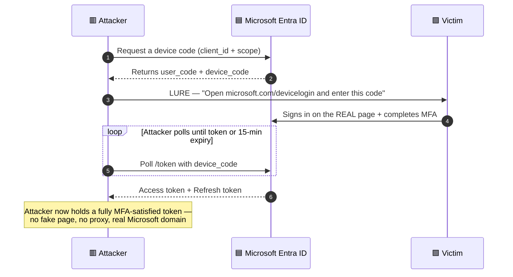
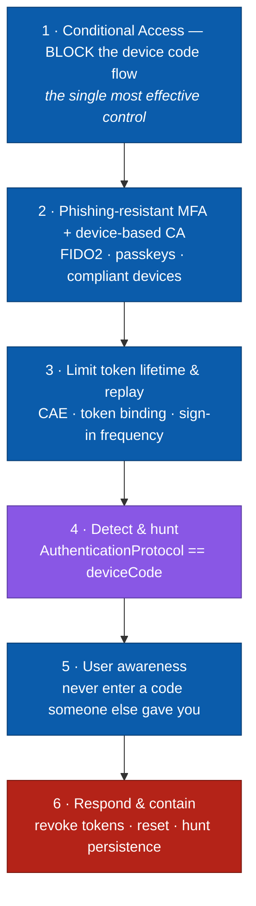

# Day 7 — Device Code Phishing, Detection and Prevention

In my last two posts I covered Adversary-in-the-Middle attacks, better known as AiTM. Phishing kits like Evilginx2 sit between the victim and Microsoft, grab the session cookie and replay it. After that we looked at how to spot and stop that with Microsoft Defender, Entra ID Protection and phishing-resistant MFA.

Today we look at a trick that goes after the same prize, a valid token, but it does it **without** a reverse proxy, **without** a lookalike domain and **without** a fake login page. The victim signs in on the *real* Microsoft website with their *real* MFA method. This is **Device Code Phishing**, and since early 2025 it has been one of the most heavily abused techniques against Microsoft 365 tenants. Microsoft tracks the main crew behind it as **Storm-2372**.

This post stays on the defender side. I walk through what the flow is, why attackers like it so much, and above all how to detect it, hunt for it and keep it out. The sources I used are listed at the bottom.

---

## Table of contents
1. [What is the device code flow?](#what-is-the-device-code-flow)
2. [Why attackers abuse it](#why-attackers-abuse-it)
3. [AiTM vs. Device Code Phishing](#aitm-vs-device-code-phishing)
4. [MITRE ATT&CK mapping](#mitre-attck-mapping)
5. [A real campaign, Storm-2372](#a-real-campaign-storm-2372)
6. [Detection with advanced hunting](#detection-with-advanced-hunting)
7. [Mitigation and prevention](#mitigation-and-prevention)
8. [Incident response playbook](#incident-response-playbook)
9. [Key takeaways](#key-takeaways)
10. [Resources](#resources)

---

## What is the device code flow?
The **OAuth 2.0 Device Authorization Grant** ([RFC 8628](https://datatracker.ietf.org/doc/html/rfc8628)) was built for devices that are awkward to type on. Think smart TVs, printers, IoT boxes and command line tools such as `az login --use-device-code`.

You have almost certainly seen this prompt before.

> To sign in, use a web browser to open the page `https://microsoft.com/devicelogin` and enter the code **F7KQ2XM9P** to authenticate.

Here is the normal flow.

| Step | Actor | What happens |
|------|-------|--------------|
| 1 | Device | Asks the `/devicecode` endpoint for a code, using a `client_id` and a `scope` |
| 2 | Entra ID | Hands back a `user_code`, a `device_code` and a `verification_uri`, good for about 15 minutes |
| 3 | Device | Shows the `user_code` to the user and starts **polling** the `/token` endpoint |
| 4 | User | Opens `microsoft.com/devicelogin` on another device, types the code, signs in and does MFA |
| 5 | Entra ID | Ties that signed-in session to the waiting `device_code` |
| 6 | Device | Its next poll comes back with an **access token and a refresh token** |

Here is the design detail that matters. **The device that receives the token and the browser that does the sign-in do not have to be the same machine.** That gap is exactly what the attacker takes advantage of.

---

## Why attackers abuse it
Compared with AiTM, device code phishing is attractive for a few reasons.

- **No infrastructure.** No reverse proxy, no cloned portal, no domain to register, no TLS certificate. The attacker only has to *start* a device code request and pass the code along.
- **The victim lands on the genuine Microsoft domain.** It really is `login.microsoftonline.com` and `microsoft.com/devicelogin`, so checking the URL, lookalike-domain blocklists and all that "inspect the link" training simply do not help here.
- **The victim does the MFA.** They complete it for real, so the token handed to the attacker already counts as fully MFA'd. Even number matching gets approved, because the victim honestly believes they are approving their own sign-in.
- **A refresh token comes with it.** That means long-lived access and the ability to mint fresh access tokens for other resources.

The social engineering is the whole attack. A typical pretext sounds like *"Join the Teams meeting"*, *"activate your new device"* or *"verify your mailbox, open this link and enter this code"*. The victim is usually approached over Teams, WhatsApp or email, often after the attacker has chatted a bit while posing as IT or a known colleague. The code is generated live, so the 15 minute expiry is no obstacle at all.

> **The core trick.** The attacker kicks off the device code request on their own side, then talks the victim into typing *that* code on the real Microsoft page. The victim signs in, and the attacker's polling session quietly collects the tokens.



---

## AiTM vs. Device Code Phishing

| | **AiTM (Day 5/6)** | **Device Code Phishing (Day 7)** |
|---|---|---|
| Infrastructure | Reverse proxy and a lookalike domain | None, it rides on genuine Microsoft endpoints |
| What the victim sees | A fake or proxied login page | The real `microsoft.com/devicelogin` |
| What is stolen | Session cookie (ESTSAUTH) | Access token **and** refresh token |
| MFA bypass | Cookie replay after MFA | The victim completes MFA for the attacker's session |
| Phishing-resistant MFA (FIDO2) | Strong protection | **Still needs Conditional Access**, the flow itself is not tied to a domain |
| Main detection signal | Impossible travel, new cookie use | `authenticationProtocol = "deviceCode"` in the sign-in logs |
| Primary prevention | Phishing-resistant MFA and session controls | **A Conditional Access policy that blocks the device code flow** |

The main takeaway for defenders is pretty simple. The one control that does the most work here is a **Conditional Access policy that blocks the device code grant** for everyone who does not genuinely need it.

---

## MITRE ATT&CK mapping

| Tactic | Technique | ID |
|--------|-----------|----|
| Initial Access | Phishing | [T1566](https://attack.mitre.org/techniques/T1566/) |
| Credential Access | Steal Application Access Token | [T1528](https://attack.mitre.org/techniques/T1528/) |
| Credential Access | Forge Web Credentials | [T1606](https://attack.mitre.org/techniques/T1606/) |
| Defense Evasion | Use Alternate Authentication Material — Application Access Token | [T1550.001](https://attack.mitre.org/techniques/T1550/001/) |
| Persistence | Account Manipulation, refresh-token reuse and OAuth app consent | [T1098](https://attack.mitre.org/techniques/T1098/) |
| Collection | Email Collection and forwarding rules | [T1114](https://attack.mitre.org/techniques/T1114/) |

---

## A real campaign, Storm-2372
In February 2025 Microsoft Threat Intelligence went public about a campaign they track as **Storm-2372**, assessed as Russia-aligned. It used device code phishing at scale against government, NGO, IT, defence and telecom targets.

Here is what was seen in the wild.

- **Lures came through messaging apps and email**, often dressed up as a Teams meeting invite or a message from a trusted contact the attacker had already warmed up.
- Victims were pointed at `microsoft.com/devicelogin` and told to enter the code the attacker supplied.
- Once they had tokens, the actors went through mail, moved around inside the tenant, and fired off more device code lures internally from the mailbox they had taken over.
- Later in the campaign they started abusing the **Microsoft Authentication Broker** client ID to register their own device, then pulled a Primary Refresh Token (PRT) for longer-lasting access.

A typical intrusion looked like this.

| Time | Event |
|------|-------|
| T | Attacker generates a device code and contacts the target over Teams or email, posing as IT or a colleague |
| T+2 | Victim opens the genuine `microsoft.com/devicelogin` and enters the code |
| T+3 | Victim completes the sign-in **and MFA** on the real Microsoft page |
| T+4 | The attacker's polling session receives an access token and a refresh token |
| T+10 | Attacker reads mail, walks the directory, downloads files |
| T+20 | Attacker sets up inbox rules and sends internal device code lures to spread further |
| T+30 | In later variants, the attacker registers a device and grabs a PRT for persistence |

---

## Detection with advanced hunting
Device code sign-ins are **rare and very telling** in most tenants. If your organisation does not lean on command line tooling or smart devices, then almost every device code sign-in is worth a second look. These KQL queries run in **Microsoft Sentinel** or in **Microsoft Defender XDR and Entra advanced hunting**.

### 1. All device code sign-ins, your baseline
```kusto
SigninLogs
| where TimeGenerated > ago(14d)
| where AuthenticationProtocol == "deviceCode"
| extend City = tostring(LocationDetails.city), Country = tostring(LocationDetails.countryOrRegion)
| project TimeGenerated, UserPrincipalName, AppDisplayName, ResourceDisplayName,
          IPAddress, City, Country, ResultType, UserAgent
| sort by TimeGenerated desc
```
> In Defender XDR advanced hunting, use `AADSignInEventsBeta` and filter on `AuthenticationProtocol == "deviceCode"`, or look for `deviceCode` inside `AuthenticationDetails`.

### 2. Device code sign-ins from countries you do not expect
```kusto
SigninLogs
| where TimeGenerated > ago(30d)
| where AuthenticationProtocol == "deviceCode"
| extend Country = tostring(LocationDetails.countryOrRegion)
| summarize Count = count(), Users = make_set(UserPrincipalName) by Country
| sort by Count asc
```
A device code sign-in from a country where none of your people work is a strong lead.

### 3. First time a user ever uses device code
```kusto
let lookback = 45d;
let recent = 1d;
SigninLogs
| where TimeGenerated > ago(lookback)
| where AuthenticationProtocol == "deviceCode"
| summarize FirstSeen = min(TimeGenerated) by UserPrincipalName
| where FirstSeen > ago(recent)
| project UserPrincipalName, FirstSeen
```

### 4. Odd client or app paired with the device code flow
Attackers often pair the flow with broad first-party client IDs such as Azure CLI, Microsoft Authentication Broker or Office.
```kusto
SigninLogs
| where TimeGenerated > ago(30d)
| where AuthenticationProtocol == "deviceCode"
| summarize Count = count(), Users = dcount(UserPrincipalName)
        by AppDisplayName, AppId, ResourceDisplayName
| sort by Count desc
```
Keep an eye out for the **Microsoft Authentication Broker** (`29d9ed98-a469-4536-ade2-f981bc1d605e`) and **Azure CLI** (`04b07795-8ddb-461a-bbee-02f9e1bf7b46`) turning up where they have no business being.

### 5. Tie a device code sign-in to what happened next
```kusto
let dc_users =
    SigninLogs
    | where TimeGenerated > ago(7d)
    | where AuthenticationProtocol == "deviceCode"
    | distinct UserPrincipalName;
OfficeActivity
| where TimeGenerated > ago(7d)
| where Operation in ("New-InboxRule", "Set-InboxRule", "UpdateInboxRules")
| where UserId in (dc_users)
| project TimeGenerated, UserId, Operation, ClientIP, OriginatingServer
| sort by TimeGenerated desc
```

### 6. Device registered shortly after a device code sign-in
```kusto
let dc =
    SigninLogs
    | where TimeGenerated > ago(14d)
    | where AuthenticationProtocol == "deviceCode"
    | project dcTime = TimeGenerated, UserPrincipalName, IPAddress;
AuditLogs
| where TimeGenerated > ago(14d)
| where OperationName has "Add registered device" or OperationName has "Register device"
| extend UPN = tostring(InitiatedBy.user.userPrincipalName)
| join kind=inner dc on $left.UPN == $right.UserPrincipalName
| where TimeGenerated between (dcTime .. (dcTime + 6h))
| project TimeGenerated, UPN, OperationName, IPAddress, dcTime
```
That pattern is the PRT persistence move from the Storm-2372 campaign.

**Entra ID Protection** will also throw risk detections such as unfamiliar sign-in properties, anonymous IP or impossible travel once the stolen token gets used. Pull those into the same investigation.

---

## Mitigation and prevention
Defence here is layered, but one control really does stand above the rest.



### 1. Block the device code flow with Conditional Access
Entra ID lets you target the **authentication flow** directly in Conditional Access, which is exactly what you want here.

- Go to **Entra admin center -> Protection -> Conditional Access -> Policies -> New policy**.
- Under **Users**, pick all users. Leave out a small named break-glass group and any account that genuinely needs device code, for example a handful of kiosk or IoT identities.
- Under **Target resources**, choose **Authentication flows -> Device code flow**.
- Under **Grant**, choose **Block access**.
- Start in **report-only** mode, check the sign-in logs for real device code usage, then switch it **On**.

This one policy stops the attack no matter how convincing the lure is, because the attacker's polling session can never finish.

### 2. Scope it tightly if you cannot block it everywhere
Some teams genuinely use `az login --use-device-code`, so if that is you, then narrow it instead of blocking it outright.

- Allow device code only for a named group, only from **compliant or Entra-joined devices**, and ideally only from **trusted named locations**.
- Block it for everyone else.

### 3. Phishing-resistant MFA and strong Conditional Access
Just like in Day 6, roll out **FIDO2 security keys, Windows Hello for Business or passkeys**. FIDO2 on its own does not stop the device code flow, since the victim still signs in on the real page. What it does, combined with device-based Conditional Access, is shrink what a stolen token can actually reach.

### 4. Shorten token lifetime and turn on Continuous Access Evaluation
- Turn on **[Continuous Access Evaluation (CAE)](https://learn.microsoft.com/en-us/entra/identity/conditional-access/concept-continuous-access-evaluation)** so a revoke or a risk change lands almost right away instead of waiting for the token to expire.
- Use **sign-in frequency** and switch off **persistent browser session** for your sensitive apps.

### 5. Token protection, also called token binding
Turn on **[token protection](https://learn.microsoft.com/en-us/entra/identity/conditional-access/concept-token-protection)** where it is supported. It ties the refresh token to the device it was issued on, so replaying it from the attacker's machine simply fails.

### 6. User awareness, with the right message
Device code phishing walks straight past "check the URL" training, so that message does not land here. Teach people one simple rule instead.

> **Never enter a sign-in code that someone else gave you.** A code you type at `microsoft.com/devicelogin` should only ever be one that *your own* device just showed *you*. If anyone sends you a code to enter, even "IT", even over Teams, stop and report it.

### 7. Rein in who can consent to apps
Limit user app consent and review your OAuth grants, because token theft campaigns love to pivot into a malicious app consent for persistence.

---

## Incident response playbook
If you confirm a device code phishing compromise, work through this.

1. **Revoke sessions and refresh tokens.** Use `Revoke-MgUserSignInSession` in Graph or revoke from the Entra portal. This is what actually kills the stolen refresh token.
2. **Re-check MFA registration** in case the attacker added or changed an auth method. The Day 6 hunting query for sketchy security-method additions covers this.
3. **Force a password reset** on the affected accounts.
4. **Hunt for persistence.** Look for newly registered devices, new inbox or forwarding rules, new OAuth app consents and new service principals.
5. **Check whether it spread.** Internal device code lures sent from the mailbox, odd Teams messages, that kind of thing.
6. **Roll out the Conditional Access device code block** straight away if it is not already live.
7. **Review mail access and data that left** during the window the attacker had access.

Here is the PowerShell to revoke sessions for one user.

```powershell
# Microsoft Graph PowerShell
Connect-MgGraph -Scopes "User.ReadWrite.All"
Revoke-MgUserSignInSession -UserId "sonia@contoso.com"
```

---

## Key takeaways
- Device code phishing walks off with **real, fully MFA'd tokens** and it needs no fake page and no proxy, because the victim is on the genuine Microsoft site.
- It beats URL and domain based training, and it beats number matching too, since the victim really is approving a real sign-in.
- The **single most effective control is a Conditional Access policy that blocks the device code authentication flow** for everyone who does not need it.
- `AuthenticationProtocol == "deviceCode"` is rare and very telling, so hunt for it, baseline it, and alert on anything odd.
- Stack phishing-resistant MFA, CAE and token protection on top, and give people one rule they can remember, **never enter a code someone else gave you**.

---

## Resources
■ [Storm-2372 conducts device code phishing campaign (Microsoft Threat Intelligence)](https://www.microsoft.com/en-us/security/blog/2025/02/13/storm-2372-conducts-device-code-phishing-campaign/)<br>
■ [OAuth 2.0 Device Authorization Grant — RFC 8628](https://datatracker.ietf.org/doc/html/rfc8628)<br>
■ [Microsoft identity platform and the OAuth 2.0 device authorization grant flow](https://learn.microsoft.com/en-us/entra/identity-platform/v2-oauth2-device-code)<br>
■ [Conditional Access — Authentication flows, blocking the device code flow](https://learn.microsoft.com/en-us/entra/identity/conditional-access/concept-authentication-flows)<br>
■ [Continuous Access Evaluation (CAE)](https://learn.microsoft.com/en-us/entra/identity/conditional-access/concept-continuous-access-evaluation)<br>
■ [Conditional Access token protection](https://learn.microsoft.com/en-us/entra/identity/conditional-access/concept-token-protection)<br>
■ [What is Entra ID Protection?](https://learn.microsoft.com/en-us/entra/id-protection/overview-identity-protection)<br>
■ [MITRE ATT&CK T1528 — Steal Application Access Token](https://attack.mitre.org/techniques/T1528/)<br>
■ [MITRE ATT&CK T1550.001 — Application Access Token](https://attack.mitre.org/techniques/T1550/001/)<br>
■ [Revoke-MgUserSignInSession (Microsoft Graph PowerShell)](https://learn.microsoft.com/en-us/powershell/module/microsoft.graph.users.actions/revoke-mgusersigninsession)<br>
