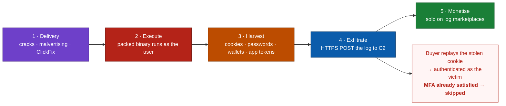
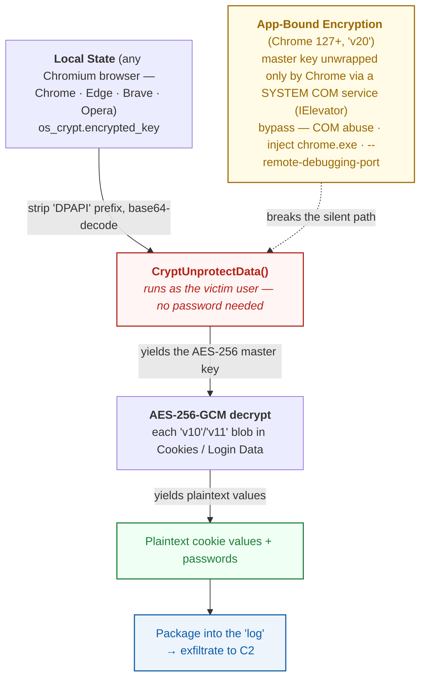
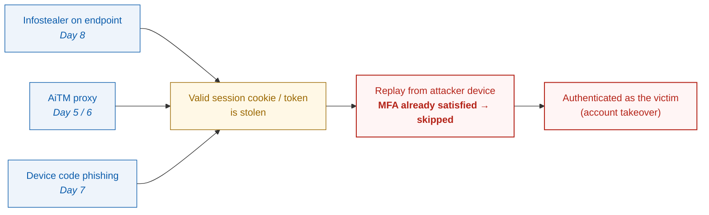

# Day 8 — Infostealers and Browser Cookie Theft

In Days 5 to 7 I looked at how attackers grab authentication **tokens** from a distance. AiTM reverse proxies like Evilginx2 catch the session cookie on the way past, and device code phishing talks the victim into handing over a fully MFA'd token. All of that happens **off the endpoint**, somewhere between the user and Microsoft.

Today we flip it around and look at the other half of the same problem. Malware that runs **on the machine itself** and lifts those cookies and tokens straight out of the browser. That is the **infostealer**, and it is the most common first step behind the stolen cookie cases I described earlier. It also brings us back to the malware analysis work from Days 1 to 3, so this is where the two threads of the series finally meet.

This is a defender and analyst write-up. I describe how stealers work at the level you need to **analyse, detect and defend** against them, not to build one. Sources are at the bottom.

---

## Table of contents
1. [Where infostealers fit](#where-infostealers-fit)
2. [The stealer-as-a-service ecosystem](#the-stealer-as-a-service-ecosystem)
3. [What they target on disk](#what-they-target-on-disk)
4. [A closer look at how Chromium stores and protects secrets](#a-closer-look-at-how-chromium-stores-and-protects-secrets)
5. [App-Bound Encryption and how stealers adapted](#app-bound-encryption-and-how-stealers-adapted)
6. [Static analysis of a stealer sample](#static-analysis-of-a-stealer-sample)
7. [Dynamic analysis, what it does on the host](#dynamic-analysis-what-it-does-on-the-host)
8. [MITRE ATT&CK mapping](#mitre-attck-mapping)
9. [Detection with Defender XDR and Sentinel](#detection-with-defender-xdr-and-sentinel)
10. [Closing the loop, cookie theft equals MFA bypass](#closing-the-loop-cookie-theft-equals-mfa-bypass)
11. [Mitigation](#mitigation)
12. [Key takeaways](#key-takeaways)
13. [Resources](#resources)

---

## Where infostealers fit



An infostealer is grab-and-go malware. Unlike a RAT it usually does **not** care about sticking around. It runs once, scoops up everything valuable it can reach in seconds or minutes, ships it off to a C2, and often deletes itself on the way out. That bundle of stolen data is called a **log**, and it gets sold on marketplaces and Telegram channels.

The most valuable thing in a modern log is no longer the passwords. It is the **session cookies**. A live Microsoft, Google or Okta session cookie lets the buyer replay the session and skip authentication completely, which is exactly what AiTM achieves, only here it came off the victim's own laptop instead of a proxy. That is how one infection on one employee device turns into full M365 account takeover with MFA already out of the way.

---

## The stealer-as-a-service ecosystem

Most infections trace back to a handful of commodity families sold as a subscription. They share the same tradecraft and mostly differ in packer, config format and C2.

| Family | Notes |
|--------|-------|
| **LummaC2** | One of the busiest since 2023 and 2024, actively developed, strong cookie and wallet theft. Law enforcement disrupted it in 2025 but clones carry on |
| **StealC** | Light, modular, cloned a lot |
| **RedLine and META** | Long runners with enormous credential volume. RedLine infrastructure was taken down in 2024 |
| **Vidar and Raccoon** | Older but still around, Raccoon operators were indicted |
| **Atomic (AMOS)** | The macOS equivalent, same cookie and keychain theft idea on Mac |

Delivery is almost always social. Fake software cracks, SEO poisoned download sites, malvertising, "ClickFix" and fake CAPTCHA pages that get the user to paste a command into Run or PowerShell, and poisoned npm or PyPI packages. The binary itself is usually packed or crypted, which you will recognise from Day 3, to get past static AV.

---

## What they target on disk

A typical stealer walks a list of well known paths and copies whatever is worth money.

- **Browser cookies**, the crown jewels, since they are live sessions
- **Saved passwords** from the browser credential stores
- **Autofill data and credit cards**
- **Crypto wallets**, both browser extensions like MetaMask and desktop wallet files
- **App tokens** for Discord, Telegram, Steam, and FTP or SSH clients such as FileZilla and WinSCP
- **VPN and RDP configs**
- **A system profile**, which is a screenshot, installed software and a hardware ID, used to fingerprint the victim and resell the log as "fresh"
- **Documents**, usually `*.txt` and `*.pdf`, plus anything that looks like a wallet seed phrase by filename

For anyone defending Microsoft 365, the two that really matter are the **browser cookies**, which mean session hijack, and the **saved credentials**, which feed password reuse and spraying.

---

## A closer look at how Chromium stores and protects secrets

This is the technical heart of the post. Chromium browsers such as Chrome, Edge, Brave and Opera keep their data in **SQLite** databases inside the user profile, for example.

```
%LOCALAPPDATA%\Google\Chrome\User Data\Default\Login Data      <- saved passwords
%LOCALAPPDATA%\Google\Chrome\User Data\Default\Network\Cookies <- cookies
%LOCALAPPDATA%\Google\Chrome\User Data\Local State             <- the wrapped master key
```

The secret values inside those databases are **encrypted**, and for years the protection chain worked like this.

1. Chrome generates a random **AES-256 master key**.
2. That key gets encrypted with **Windows DPAPI**, which ties it to the logged-in user, and is stored base64 encoded with a `DPAPI` prefix in the `os_crypt.encrypted_key` field of **Local State**.
3. Every cookie and password value is then encrypted with **AES-256-GCM** using that master key, and saved with a version prefix such as `v10` or `v11`.

So the decryption chain that an analyst, or a stealer, follows looks like this.



> **Which browsers does this cover?** The chain above applies to every **Chromium** browser, so Chrome, **Edge**, Brave, Opera and Vivaldi, because they all share `os_crypt` with DPAPI and now App-Bound Encryption. Only the profile path changes, for example `%LOCALAPPDATA%\Microsoft\Edge\User Data\`. **Firefox works differently** and does not use DPAPI at all. It keeps logins in `logins.json` encrypted through **Mozilla NSS** with the key sitting in `key4.db`, optionally protected by a *Primary Password*, and cookies in `cookies.sqlite`. Stealers simply carry a second code path for it.

The weak spot this chain always had is that **DPAPI only asks that the code runs as the same user**. No extra prompt, no password. Any process in that user's context could decrypt the browser's secrets. That is exactly why `crypt32!CryptUnprotectData` combined with SQLite access to `Login Data` and `Cookies` is such a strong behavioural signature.

---

## App-Bound Encryption and how stealers adapted

In **Chrome 127**, released in July 2024, Google added **App-Bound Encryption**, usually shortened to ABE, specifically to break the chain above. New values carry a `v20` prefix.

- The master key now gets wrapped a second time so that only **Chrome itself** can unwrap it, verified by the executable path.
- The unwrapping runs through a **privileged COM elevation service** called `IElevator` that runs as SYSTEM and checks the caller really is Chrome before handing the key back.
- The result is that calling `CryptUnprotectData` as the user is **no longer enough**, because a random process cannot unwrap a `v20` key.

That genuinely raised the bar. Within weeks though, stealer developers worked around it, mostly in three ways.

- **Abusing the elevation COM service**, calling the `IElevator` interface so Chrome's own privileged service decrypts the key for them.
- **Running in-process**, by injecting into Chrome or executing the decryption inside the Chrome process so the path check passes.
- **Remote debugging**, launching the browser with `--remote-debugging-port` and pulling the cookies out over the DevTools protocol.

For an analyst that is actually good news, because all three are **noisy**. Unexpected use of the Chrome elevation service, Chrome spawned with debugging flags by a parent that is not a browser, or a thread appearing inside `chrome.exe` are all solid detections. Google has kept hardening ABE through 2025, and it stays an arms race.

> **What this means for defenders.** ABE did not kill cookie theft, but it turned a silent `CryptUnprotectData` call into something that leaves tracks you can hunt for.

---

## Static analysis of a stealer sample

Following the Day 3 method, here is what to look at **without running** the sample. Work in an isolated VM and treat the file as live.

**1. Triage and packing.** Hash it with SHA-256, check VirusTotal, run **DIE** or **Exeinfo PE**. Stealers are usually packed, which shows up as high entropy in `.text`, a tiny import table and a UPX or custom crypter. A nearly empty IAT means you unpack first, so dynamic unpack and then dump.

**2. Imports once unpacked.** These combinations are the red flags.

| API or DLL | Why it matters |
|-----------|----------------|
| `crypt32.dll!CryptUnprotectData` | DPAPI decryption of the browser master key |
| `sqlite3_open` or a bundled SQLite | Reading the `Login Data` and `Cookies` databases |
| `CreateToolhelp32Snapshot`, `OpenProcess` | Enumerating or injecting into browser processes |
| `InternetOpen`, `WinHttpConnect`, WinSock | C2 exfiltration |
| `GetUserNameW`, `GetComputerNameW`, `RegQueryValueEx` | Host fingerprinting |

**3. Strings.** Pull both ASCII and Unicode. Stealers leak their whole target map in plaintext more often than you would expect.

- Profile paths such as `\User Data\`, `Login Data`, `Network\Cookies` and `Local State`
- Target apps such as `wallet.dat`, `MetaMask`, `tdata` for Telegram and `Discord\Local Storage`
- The `os_crypt`, `encrypted_key` and `v10` markers
- C2 clues such as URLs, user agents, Telegram bot tokens and build or campaign IDs

**4. YARA.** Write or apply rules against the unpacked sample based on the string and import combinations above, plus the known config structures for each family.

---

## Dynamic analysis, what it does on the host

Detonate it in an isolated sandbox with **ProcMon**, **ProcDOT**, a network capture and **Regshot**, the same Day 3 toolset. Here is what you should expect to see.

- **A burst of read access** to browser profile files, so a lot of `CreateFile` and `ReadFile` operations on `Login Data`, `Cookies`, `Web Data` and `Local State` across every installed browser, usually all at once.
- **DPAPI calls** right after it reads `Local State`.
- Where ABE is in play, interaction with the **Chrome elevation service**, Chrome launched with `--remote-debugging-port`, or a thread created inside `chrome.exe`.
- **Staging**, which is a temp folder filling up and sometimes being zipped.
- **A C2 beacon**, an HTTPS POST of the bundle to an IP or domain, very often followed by **self-deletion**.
- Little or **no persistence**, which fits the grab-and-go profile.

A ProcDOT graph makes the shape obvious. One short-lived process fans out reads across the browser databases, then makes a single outbound connection.

---

## MITRE ATT&CK mapping

| Tactic | Technique | ID |
|--------|-----------|----|
| Credential Access | Credentials from Password Stores — **Credentials from Web Browsers** | [T1555.003](https://attack.mitre.org/techniques/T1555/003/) |
| Credential Access | **Steal Web Session Cookie** | [T1539](https://attack.mitre.org/techniques/T1539/) |
| Credential Access | Unsecured Credentials — Credentials in Files | [T1552.001](https://attack.mitre.org/techniques/T1552/001/) |
| Collection | Data from Local System | [T1005](https://attack.mitre.org/techniques/T1005/) |
| Defense Evasion | Obfuscated or Packed Files | [T1027.002](https://attack.mitre.org/techniques/T1027/002/) |
| Command and Control | Application Layer Protocol — Web | [T1071.001](https://attack.mitre.org/techniques/T1071/001/) |
| Exfiltration | Exfiltration Over C2 Channel | [T1041](https://attack.mitre.org/techniques/T1041/) |

---

## Detection with Defender XDR and Sentinel

The behaviour you are hunting comes down to two things. **A process that is not a browser touching browser credential and cookie files**, and **cookie replay** turning up later in the identity logs. The first three queries run in **Defender XDR advanced hunting**, the last one in **Sentinel**.

### 1. A non-browser process reading browser cookie or login databases
```kusto
DeviceFileEvents
| where Timestamp > ago(7d)
| where FileName in~ ("Cookies", "Login Data", "Web Data", "Local State")
     or FolderPath has_any (@"\User Data\", @"\Network\Cookies")
| where InitiatingProcessFileName !in~ ("chrome.exe","msedge.exe","brave.exe","opera.exe","firefox.exe")
| where ActionType in ("FileAccessed","FileModified","FileCopied")
| project Timestamp, DeviceName, InitiatingProcessFileName, InitiatingProcessFolderPath,
          InitiatingProcessCommandLine, FileName, FolderPath, InitiatingProcessAccountName
| sort by Timestamp desc
```

### 2. Chrome started with a remote debugging port by an odd parent
```kusto
DeviceProcessEvents
| where Timestamp > ago(7d)
| where FileName in~ ("chrome.exe","msedge.exe")
| where ProcessCommandLine has "--remote-debugging-port"
| where InitiatingProcessFileName !in~ ("explorer.exe","chrome.exe","msedge.exe","services.exe")
| project Timestamp, DeviceName, InitiatingProcessFileName, ProcessCommandLine, AccountName
| sort by Timestamp desc
```
This one catches the ABE workaround described earlier.

### 3. A short-lived process that reads many browser files and then phones home
```kusto
let readers =
    DeviceFileEvents
    | where Timestamp > ago(7d)
    | where FileName in~ ("Cookies","Login Data","Local State")
    | where InitiatingProcessFileName !in~ ("chrome.exe","msedge.exe","brave.exe","opera.exe","firefox.exe")
    | summarize FilesTouched = dcount(FolderPath) by DeviceId, InitiatingProcessId = InitiatingProcessId, InitiatingProcessFileName
    | where FilesTouched >= 3;
DeviceNetworkEvents
| where Timestamp > ago(7d)
| join kind=inner readers on DeviceId, $left.InitiatingProcessId == $right.InitiatingProcessId
| project Timestamp, DeviceName, InitiatingProcessFileName, RemoteIP, RemoteUrl, FilesTouched
| sort by Timestamp desc
```

### 4. Cookie replay after the infection
```kusto
SigninLogs
| where TimeGenerated > ago(7d)
| where ResultType == 0
| extend Country = tostring(LocationDetails.countryOrRegion)
| summarize Countries = make_set(Country), IPs = make_set(IPAddress),
            Sessions = dcount(tostring(DeviceDetail.deviceId))
            by UserPrincipalName, bin(TimeGenerated, 1h)
| where array_length(Countries) > 1
| sort by TimeGenerated desc
```
> Run this alongside the **Day 6** AiTM hunting and the **Day 7** `deviceCode` queries. A stealer log and an AiTM capture both end in the same place, a replayed session from a new location or device.

---

## Closing the loop, cookie theft equals MFA bypass

This is why the whole series hangs together.



Three different techniques, **one outcome**, a replayed session that walks past MFA. Which means the defences overlap too. The identity side controls from Day 6 and Day 7 are exactly what limits the damage of a stolen cookie.

- **Token protection**, also called token binding, ties the cookie or token to the original device, so replaying it from the attacker's machine just fails.
- **Continuous Access Evaluation** kills the session quickly once risk shows up.
- **Conditional Access**, with compliant device and trusted location, blocks replay from an unmanaged attacker host.

---

## Mitigation

**On the endpoint, stop the theft.**

- **EDR in block mode** with Defender for Endpoint, using the file and process detections above as custom detection rules.
- **Attack Surface Reduction** rules and SmartScreen to blunt the usual delivery routes such as cracks, ClickFix and malvertising.
- **Application control** with WDAC or AppLocker so unsigned stealer binaries never get to run.
- Keep browsers up to date so **App-Bound Encryption** and its later hardening are actually in force.
- User awareness on **ClickFix and paste-into-Run** lures and on software cracks.

**On the identity side, survive the theft.** Assume a cookie *will* get stolen eventually and make it worthless when it does. That means **token protection**, **CAE**, **phishing-resistant MFA** and **device compliance in Conditional Access**, all covered in Days 6 and 7.

**When a log is confirmed, respond.**

- **Revoke sessions and refresh tokens**, force a password reset, and treat **every credential saved in that browser profile as burned**, so rotate all of them.
- Hunt the device for the delivery chain, and check which other accounts were touched.

---

## Key takeaways
- Infostealers are the **endpoint route** to the same prize as AiTM and device code phishing, a **replayable session cookie** that walks past MFA.
- The classic Chromium theft chain runs **Local State master key → `CryptUnprotectData` with DPAPI → AES-GCM decrypt of the `v10` and `v11` cookies**, and that combination with SQLite access to `Login Data` and `Cookies` is a high value signature.
- **App-Bound Encryption**, the `v20` values from Chrome 127 onwards, broke the silent path. Stealers adapted through the elevation COM service, in-process execution and remote debugging, and all three are **noisy and huntable**.
- Detect the **behaviour**, so a non-browser process reading cookie databases, Chrome with debugging flags, or mass reads followed by a beacon. Do not lean on hashes alone.
- Make the stolen cookie useless with **token binding, CAE and device based Conditional Access**. That is where the malware line and the identity line of this series finally come together.

---

## Resources
■ [MITRE ATT&CK T1555.003 — Credentials from Web Browsers](https://attack.mitre.org/techniques/T1555/003/)<br>
■ [MITRE ATT&CK T1539 — Steal Web Session Cookie](https://attack.mitre.org/techniques/T1539/)<br>
■ [Google Security Blog — Improving the security of Chrome cookies on Windows, App-Bound Encryption](https://security.googleblog.com/2024/07/improving-security-of-chrome-cookies-on.html)<br>
■ [Microsoft — Disrupting Lumma Stealer](https://blogs.microsoft.com/on-the-blog/2025/05/21/microsoft-leads-international-effort-to-disrupt-lumma-stealer/)<br>
■ [CISA — alerts and advisories, including RedLine and META](https://www.cisa.gov/news-events/alerts)<br>
■ [Microsoft Defender XDR — advanced hunting schema tables](https://learn.microsoft.com/en-us/defender-xdr/advanced-hunting-schema-tables)<br>
■ [Microsoft — Token protection in Conditional Access](https://learn.microsoft.com/en-us/entra/identity/conditional-access/concept-token-protection)<br>
■ [Chromium — the os_crypt design](https://chromium.googlesource.com/chromium/src/+/main/components/os_crypt/)<br>
■ [Windows DPAPI — CryptUnprotectData](https://learn.microsoft.com/en-us/windows/win32/api/dpapi/nf-dpapi-cryptunprotectdata)<br>
