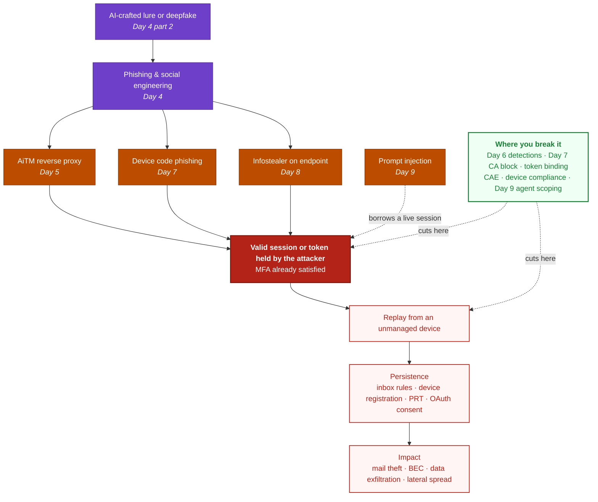
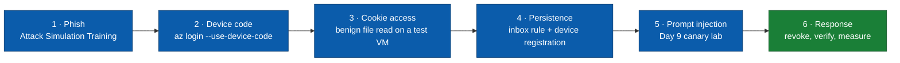

# Day 10 — The Identity Attack Chain, a Purple Team Capstone

Ten days. We went from unpacking a binary to arguing with a chatbot, and it would be easy to read that as nine unrelated topics. It is not. Look back at Days 4 to 9 and the same sentence keeps turning up in different clothes.

**Someone ends up holding a valid session they did not earn, and MFA never gets in the way.**

AiTM proxies it. Device code phishing asks for it politely. Infostealers take it off the laptop. Prompt injection does not even need the session, because it borrows the one already running. Different entry points, one prize.

So Day 10 is not a new attack. It is the capstone. One **attack chain** that stitches the whole series together, a **detection coverage matrix** that tells you honestly what you would and would not catch, a **purple team exercise** you can actually run this week using only legitimate tooling, and the **detection rules** to deploy afterwards.

> **Scope and authorisation.** Everything here runs against a tenant and devices you own or are authorised to test. Every simulation below uses official Microsoft tooling or harmless local actions. Nothing here needs real malware or real attack infrastructure. Tell your security team before you start, because some of this is supposed to set off alarms.

---

## Table of contents
1. [The chain, all nine days on one page](#the-chain-all-nine-days-on-one-page)
2. [Detection coverage matrix](#detection-coverage-matrix)
3. [The purple team exercise](#the-purple-team-exercise)
4. [Stage by stage, what to run and what to expect](#stage-by-stage-what-to-run-and-what-to-expect)
5. [Turning a hunting query into a live rule](#turning-a-hunting-query-into-a-live-rule)
6. [Scoring the exercise](#scoring-the-exercise)
7. [Where this series falls short](#where-this-series-falls-short)
8. [Maturity self-assessment](#maturity-self-assessment)
9. [Key takeaways](#key-takeaways)
10. [Resources](#resources)

---

## The chain, all nine days on one page



The useful thing about drawing it this way is the bottleneck. Four different entry paths all funnel through **one node**, and that node is where almost all of your defensive leverage sits. You will never block every lure. You can make the token worthless when it is replayed somewhere else.

---

## Detection coverage matrix

This is the part worth keeping. Every technique the series touched, which day covers it, and what actually catches it. Fill in the last column for your own environment and you have a gap list in one sitting.

| ATT&CK | Technique | Day | What catches it | Your status |
|--------|-----------|-----|-----------------|-------------|
| [T1566](https://attack.mitre.org/techniques/T1566/) | Phishing | 4, 5 | Defender for Office 365, user reporting | |
| [T1557](https://attack.mitre.org/techniques/T1557/) | Adversary-in-the-Middle | 5, 6 | Entra ID Protection, impossible travel, Defender XDR AiTM disruption | |
| [T1539](https://attack.mitre.org/techniques/T1539/) | Steal Web Session Cookie | 6, 8 | Day 8 query 1, non-browser process reading cookie stores | |
| [T1528](https://attack.mitre.org/techniques/T1528/) | Steal Application Access Token | 7 | Day 7 queries 1 to 4, `AuthenticationProtocol == "deviceCode"` | |
| [T1550.001](https://attack.mitre.org/techniques/T1550/001/) | Application Access Token replay | 6, 7, 8 | Token binding, CAE, impossible travel | |
| [T1555.003](https://attack.mitre.org/techniques/T1555/003/) | Credentials from Web Browsers | 8 | Day 8 queries 1 and 3, DPAPI plus SQLite access pattern | |
| [T1098](https://attack.mitre.org/techniques/T1098/) | Account Manipulation | 6, 7 | Day 6 security-method query, Day 7 query 6 | |
| [T1136](https://attack.mitre.org/techniques/T1136/) | Create Account, device registration | 7 | Day 7 query 6, registration after a device code sign-in | |
| [T1114](https://attack.mitre.org/techniques/T1114/) | Email Collection, forwarding rules | 6, 7 | Day 7 query 5, `New-InboxRule` correlation | |
| [T1027.002](https://attack.mitre.org/techniques/T1027/002/) | Packed or obfuscated files | 1, 3, 8 | Static triage, entropy, DIE and Exeinfo | |
| [T1041](https://attack.mitre.org/techniques/T1041/) | Exfiltration over C2 | 8 | Day 8 query 3, mass read followed by a beacon | |
| [AML.T0051](https://atlas.mitre.org/techniques/AML.T0051) | LLM Prompt Injection | 9 | Day 9 Lab 1, plus queries 3 and 4 | |
| AML.T0051.001 | Indirect prompt injection | 9 | Day 9 Lab 1 hidden-text variants | |
| [T1098.003](https://attack.mitre.org/techniques/T1098/003/) | Additional cloud roles and consent | 7, 9 | Day 9 Graph permission audit | |

Two honest notes on this table. The **Your status** column is the whole point, because a query sitting in a blog post catches nothing. And a few rows have no good detection at all, only prevention, which is exactly why the Day 7 Conditional Access block matters so much.

---

## The purple team exercise

Six stages, roughly half a day, and every single one uses legitimate tooling. No malware, no attack infrastructure, no third-party kit.



Run it with two people if you can. One executes and writes down timestamps, the other sits in Defender and Sentinel and writes down what appeared and when. The gap between those two lists is your report.

**Before you start.** Create a test user with a normal licence, a test device you can wipe, and a scratch SharePoint site. Note the exact start time, because every query below filters on time.

---

## Stage by stage, what to run and what to expect

### Stage 1, phishing
**Run.** Use **Attack Simulation Training** in Defender for Office 365 and pick a credential harvest or AiTM scenario against your test user. It is Microsoft's own tool, it is built for exactly this, and it keeps you away from real phishing infrastructure.

**Expect.** Simulation telemetry, user reporting if you have trained it, and a baseline for how long reporting actually takes in your organisation.

**Measure.** Time from delivery to the first human report. That number is more useful than most detections.

---

### Stage 2, device code sign-in
**Run.** This one is beautifully simple, because the legitimate tool produces exactly the telemetry an attacker would.

```powershell
# On the test machine, as the test user
az login --use-device-code
```

Complete the sign-in at `microsoft.com/devicelogin`. You have now generated a genuine device code authentication in your tenant.

**Expect.** A `deviceCode` sign-in in the logs within a few minutes.

```kusto
SigninLogs
| where TimeGenerated > ago(1h)
| where AuthenticationProtocol == "deviceCode"
| project TimeGenerated, UserPrincipalName, AppDisplayName, AppId, IPAddress, ResultType
| sort by TimeGenerated desc
```

**The real test.** If you deployed the Day 7 Conditional Access block, **this sign-in should fail**. A successful sign-in here means the policy is missing, scoped too narrowly, or still sitting in report-only. That is the single most valuable finding of the whole exercise.

---

### Stage 3, browser credential store access
**Run.** On an isolated test VM, as the test user, simply **copy** the browser cookie database to a temp folder. A plain file copy is enough to produce the telemetry. You are not decrypting anything and you do not need to.

```powershell
# Test VM only. This just reads the file, nothing is decrypted.
$src = "$env:LOCALAPPDATA\Google\Chrome\User Data\Default\Network\Cookies"
Copy-Item $src "$env:TEMP\cookietest.db" -ErrorAction SilentlyContinue
Get-Item "$env:TEMP\cookietest.db" | Select-Object FullName, Length
```

**Expect.** A `DeviceFileEvents` hit where the initiating process is PowerShell rather than a browser, which is exactly the Day 8 signature.

```kusto
DeviceFileEvents
| where Timestamp > ago(1h)
| where FileName in~ ("Cookies","Login Data","Local State")
| where InitiatingProcessFileName !in~ ("chrome.exe","msedge.exe","brave.exe","opera.exe","firefox.exe")
| project Timestamp, DeviceName, InitiatingProcessFileName, InitiatingProcessCommandLine, FolderPath
| sort by Timestamp desc
```

**Measure.** Did anything alert, or did the event merely land in a table nobody looks at? Those are very different outcomes.

**Clean up.** Delete the copy when you are done.

---

### Stage 4, persistence
**Run.** Two ordinary administrative actions that happen to be classic attacker moves.

1. Create an inbox rule on the test mailbox that forwards or redirects to another internal address.
2. Register the test device in Entra, or join it, if it is not already.

**Expect.** Both should be visible, and the Day 7 correlation query should tie the rule back to the earlier device code sign-in.

```kusto
let dc_users =
    SigninLogs
    | where TimeGenerated > ago(1d)
    | where AuthenticationProtocol == "deviceCode"
    | distinct UserPrincipalName;
OfficeActivity
| where TimeGenerated > ago(1d)
| where Operation in ("New-InboxRule","Set-InboxRule","UpdateInboxRules")
| where UserId in (dc_users)
| project TimeGenerated, UserId, Operation, ClientIP
```

**Measure.** Did anyone correlate the two on their own, or did it take your query to join them up? Correlation is usually where real environments fall down.

---

### Stage 5, prompt injection
**Run.** Lab 1 from Day 9. Drop the canary document on the scratch site and ask the assistant a normal question.

**Expect.** Either the canary comes back, or it does not. Both are findings.

```kusto
CloudAppEvents
| where Timestamp > ago(1h)
| where ActionType == "CopilotInteraction"
| extend Copilot = parse_json(tostring(parse_json(tostring(RawEventData)).CopilotEventData))
| mv-expand Resource = Copilot.AccessedResources
| extend ResourceName = tostring(Resource.Name)
| project Timestamp, AccountDisplayName, ResourceName
| sort by Timestamp desc
```

**Measure.** Can you prove from the logs alone which document fed the answer? If not, you cannot investigate an AI incident, and that is worth writing down.

---

### Stage 6, response and verification
This is the stage most exercises skip, and it is the one that tells you whether any of the rest matters.

**Run.**

```powershell
Connect-MgGraph -Scopes "User.ReadWrite.All"
Revoke-MgUserSignInSession -UserId "testuser@contoso.com"
```

Then, on the still-open session from stage 2, try to use the token again.

**Expect.** With **Continuous Access Evaluation** in place, access should drop within minutes rather than at the end of the token lifetime.

**Measure.** Time from revoke to the session actually dying. If that is an hour, your containment story is an hour long, and everyone should know that number before an incident, not during one.

---

## Turning a hunting query into a live rule

A query you run by hand is a hobby. Here is the template that makes it a control. This is the Sentinel analytics rule format, using the Day 7 device code hunt as the example.

```yaml
id: 8f2c91ad-4e5b-4c77-9f1a-3d6e0b5a7c21
name: Device code sign-in from an unexpected location
description: |
  Detects a successful device code authentication from a country where the
  organisation has no staff. Device code is rare in most tenants, which makes
  it high signal. See Day 7 for context.
severity: Medium
status: Available
requiredDataConnectors:
  - connectorId: AzureActiveDirectory
    dataTypes:
      - SigninLogs
queryFrequency: 1h
queryPeriod: 1h
triggerOperator: gt
triggerThreshold: 0
tactics:
  - CredentialAccess
relevantTechniques:
  - T1528
  - T1550.001
query: |
  let allowed = dynamic(["NL","BE","DE"]);
  SigninLogs
  | where AuthenticationProtocol == "deviceCode"
  | where ResultType == 0
  | extend Country = tostring(LocationDetails.countryOrRegion)
  | where Country !in (allowed)
  | project TimeGenerated, UserPrincipalName, AppDisplayName, AppId, IPAddress, Country
entityMappings:
  - entityType: Account
    fieldMappings:
      - identifier: FullName
        columnName: UserPrincipalName
  - entityType: IP
    fieldMappings:
      - identifier: Address
        columnName: IPAddress
incidentConfiguration:
  createIncident: true
  groupingConfiguration:
    enabled: true
    reopenClosedIncident: false
    lookbackDuration: PT5H
    matchingMethod: AllEntities
```

Swap the `allowed` list for your own countries and you have a working rule. The same shape takes any query from Days 6 to 9.

**For Defender XDR custom detections**, the path is different but shorter. Go to **Hunting -> Advanced hunting**, run the query, then use **Create detection rule**. Three things decide whether it is any good.

- The query must return a **timestamp column** and a **device or account column**, otherwise it cannot create an alert.
- Set the **frequency** sensibly. Every hour is usually right, since every 24 hours is too slow for token theft.
- Fill in the **impacted entities**, because that is what makes the alert investigable rather than just noisy.

**Before you enable anything**, run it over the last thirty days first and count the hits. If it fires two hundred times, it is a hunting query, not a detection. Tune it or leave it as a hunt. An alert nobody trusts is worse than no alert.

---

## Scoring the exercise

Score each stage honestly. The goal is a number you can improve next quarter, not a clean sheet.

| Score | What it means |
|-------|---------------|
| **0** | Nothing in the logs. You are blind to this. |
| **1** | The data is in a table, but nothing surfaced it. |
| **2** | A query finds it, run by hand, after the fact. |
| **3** | An alert fired automatically. |
| **4** | It was blocked outright, or auto-contained. |

Six stages, so twenty-four points. Most organisations running this for the first time land somewhere around eight, and that is a perfectly reasonable starting point. The number on its own means little. **The number three months later is the whole point.**

Write down three things per stage. What you ran, what appeared, and how long it took. That document is worth more to your team than any blog post, including this one.

---

## Where this series falls short

Ten days in, it is only fair to say what is missing.

- **On-premises and hybrid.** Everything here assumes cloud identity. AD CS abuse, Kerberos attacks, golden tickets and hybrid sync compromise are a whole other series.
- **The attacker's operational side.** I never covered infrastructure, pivoting or command and control in any depth, because the series stayed on the identity and detection side.
- **Scale.** These queries are written for clarity, not for a tenant with a hundred thousand users. You would need summarisation and materialised views there.
- **Non-Microsoft stacks.** Nearly everything leans on Entra, Defender and Purview. The concepts port to Okta, Google Workspace and CrowdStrike, but the queries do not.
- **Detection decay.** Schema names change, product behaviour changes, and the Day 9 telemetry is young and moving. Anything here needs re-validating against your own tenant, which is exactly why hunting query 1 on Day 9 comes first.

---

## Maturity self-assessment

Ten questions. Count the yeses.

| # | Question | Covered on |
|---|----------|-----------|
| 1 | Is the device code flow blocked in Conditional Access for everyone who does not need it | Day 7 |
| 2 | Is phishing-resistant MFA deployed for admins at minimum | Day 6 |
| 3 | Is Continuous Access Evaluation on, and do you know your revoke-to-dead time | Day 6, 7 |
| 4 | Is token protection or token binding enabled where supported | Day 7 |
| 5 | Do you alert when a non-browser process reads browser credential stores | Day 8 |
| 6 | Would you spot a device registration shortly after an unusual sign-in | Day 7 |
| 7 | Is the Unified Audit Log on, with AI interactions retained | Day 9 |
| 8 | Have you measured oversharing before rolling out an assistant | Day 9 |
| 9 | Do you know what every agent's token can actually reach | Day 9 |
| 10 | Have you run an exercise like this one in the last six months | Day 10 |

**8 to 10** means you are ahead of most. **4 to 7** is normal and workable, so pick the two cheapest gaps. **0 to 3** means start with question 1, because it is a single policy and it closes an entire attack path in an afternoon.

---

## Key takeaways
- Nine days of different attacks funnel into **one bottleneck**, an attacker holding a valid session. That is where your leverage is.
- **A query in a blog post catches nothing.** The coverage matrix only becomes useful once the status column is filled in for your own environment.
- You can run a full purple team exercise with **nothing but legitimate tooling**, because `az login --use-device-code`, a file copy and Attack Simulation Training produce the same telemetry an attacker would.
- Stage 2 is the cheapest high-value test in the series. If that sign-in **succeeds**, you found a real gap in one command.
- **Stage 6 is the one people skip.** Knowing your revoke-to-dead time before an incident is worth more than another detection.
- Score it, write it down, and run it again in three months. The second number is the one that matters.
- Ten days of notes are worth less than one afternoon of actually testing your own tenant. Go and run it.

---

## Resources
■ [MITRE ATT&CK — enterprise matrix](https://attack.mitre.org/matrices/enterprise/)<br>
■ [MITRE ATLAS — matrix and techniques](https://atlas.mitre.org/)<br>
■ [Microsoft — Attack simulation training in Defender for Office 365](https://learn.microsoft.com/en-us/defender-office-365/attack-simulation-training-get-started)<br>
■ [Microsoft — Create custom detection rules in Defender XDR](https://learn.microsoft.com/en-us/defender-xdr/custom-detection-rules)<br>
■ [Microsoft — Scheduled analytics rules in Microsoft Sentinel](https://learn.microsoft.com/en-us/azure/sentinel/detect-threats-custom)<br>
■ [Microsoft — Conditional Access authentication flows](https://learn.microsoft.com/en-us/entra/identity/conditional-access/concept-authentication-flows)<br>
■ [Microsoft — Continuous Access Evaluation](https://learn.microsoft.com/en-us/entra/identity/conditional-access/concept-continuous-access-evaluation)<br>
■ [Microsoft — Token protection in Conditional Access](https://learn.microsoft.com/en-us/entra/identity/conditional-access/concept-token-protection)<br>
■ [Microsoft — Azure CLI sign-in with a device code](https://learn.microsoft.com/en-us/cli/azure/authenticate-azure-cli-interactively)<br>
■ [Atomic Red Team — open library of small, testable attack simulations](https://github.com/redcanaryco/atomic-red-team)<br>
■ [Microsoft — Purview DSPM for AI](https://learn.microsoft.com/en-us/purview/ai-microsoft-purview)<br>
