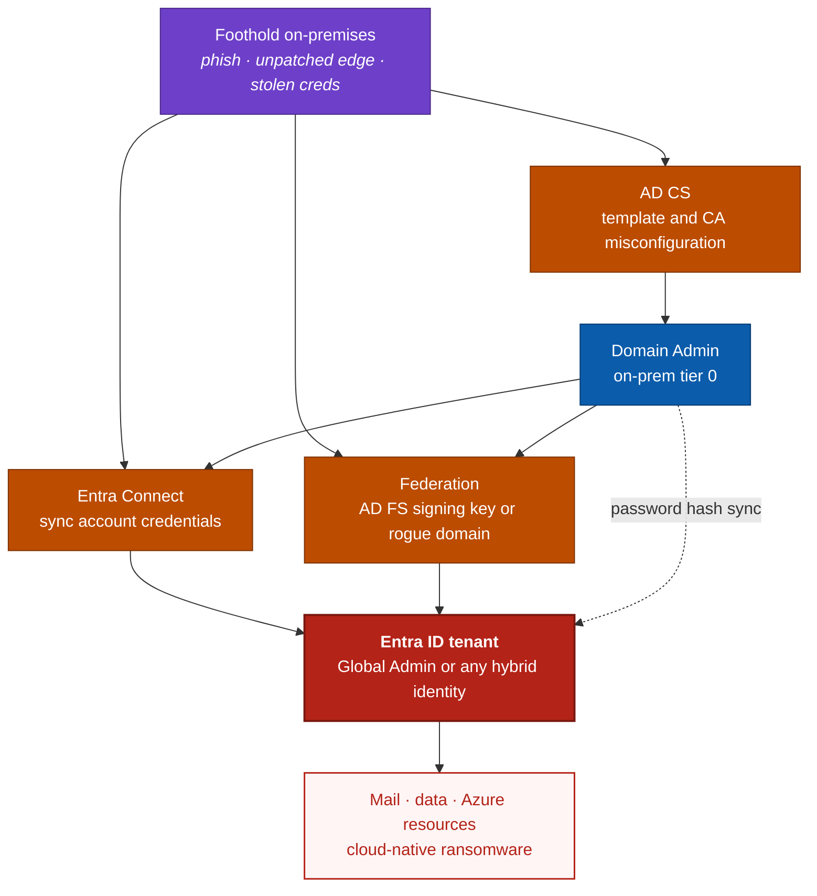

# Day 11 — The On-Prem Back Door, hybrid identity attack paths

Days 5 to 10 were all cloud. AiTM, device code, stolen cookies, prompt injection, and then a capstone that said the bottleneck is an attacker holding a valid session. All true, and all of it quietly assumed your identity starts in Entra.

For most organisations it does not. It starts in a domain controller in a rack somewhere, and syncs upward.

That changes everything, because it means there is a second door. One where **Conditional Access never gets a vote**, where phishing-resistant MFA is irrelevant, and where the attacker does not steal a session at all. They mint one. Own the on-premises estate and in a lot of tenants you own the cloud a few minutes later.

This is the gap I listed in Day 10 as missing from the series, so this is me going back to fill it. It is a research day, so there is more digging and more citation than usual, and I flag where sources disagree rather than smoothing it over.

> **Scope and authorisation.** Every command here is read-only auditing of an estate you own or are authorised to assess. Nothing below exploits anything. The offensive tools are named because you need to know what your assessors and your adversaries use, not so you can point them at someone else.

---

## Table of contents
1. [Why this breaks the Day 10 model](#why-this-breaks-the-day-10-model)
2. [The hybrid trust map](#the-hybrid-trust-map)
3. [Path 1, Active Directory Certificate Services](#path-1-active-directory-certificate-services)
4. [Certighost, a live example from 2026](#certighost-a-live-example-from-2026)
5. [Path 2, the Entra Connect sync account](#path-2-the-entra-connect-sync-account)
6. [Path 3, federation and forged tokens](#path-3-federation-and-forged-tokens)
7. [Audit your own estate](#audit-your-own-estate)
8. [Detection, and why it is genuinely hard](#detection-and-why-it-is-genuinely-hard)
9. [Hardening, in priority order](#hardening-in-priority-order)
10. [What is still unresolved](#what-is-still-unresolved)
11. [Key takeaways](#key-takeaways)
12. [Resources](#resources)

---

## Why this breaks the Day 10 model

Day 10 drew every attack path funnelling into one node, an attacker holding a valid session. The defences all clustered around that node. Token binding, Continuous Access Evaluation, device compliance.

Hybrid identity adds a path that arrives **underneath** all of it.

| | **Cloud paths, Days 5 to 9** | **Hybrid paths, Day 11** |
|---|---|---|
| How the session is obtained | Stolen or phished from a user | Minted by the attacker |
| Does MFA help | Yes, phishing-resistant MFA helps a lot | No, it is never consulted |
| Does Conditional Access help | Yes, device and location controls bite | Often not, the identity is trusted upstream |
| What the attacker needs | A victim who interacts | A foothold on-premises |
| What you see | Odd sign-ins, impossible travel | A completely normal looking sign-in |
| Where the fix lives | Entra configuration | Active Directory, PKI, and sync design |

That fifth row is the uncomfortable one. These attacks tend to produce sign-ins that look **correct**, because by the time Entra sees them they are correct. The forgery happened earlier, somewhere Entra cannot observe.

---

## The hybrid trust map



Three bridges, all one-way in the direction you do not want. The thing worth staring at is that **Domain Admin is not the destination here, it is a waypoint.** For a long time the on-premises conversation ended at domain takeover. In a hybrid estate that is the halfway mark.

---

## Path 1, Active Directory Certificate Services

AD CS is the most reliable privilege escalation surface in Active Directory, and the reason is simple. A certificate is an identity assertion. If you can talk a Certificate Authority into issuing you a certificate that says you are someone else, you **are** someone else, and you did not need their password.

Since SpecterOps published the original research the community has catalogued a growing family of misconfigurations, labelled ESC1 onwards. The tooling, mainly **Certipy** and **Certify**, now covers roughly ESC1 through ESC16.

> **A note on the numbering.** Sources disagree. Most treat ESC1 to ESC16 as the set, while at least one lists up to ESC17 with ESC12 unassigned. Treat the numbers as community labels rather than a standard, and check your assessment tool's own documentation for what it actually tests.

You do not need all sixteen in your head. A small number cause most real compromises.

| Label | The misconfiguration | Why it is so bad |
|-------|---------------------|------------------|
| **ESC1** | A template lets the requester supply their own Subject Alternative Name, and allows client authentication | Request a certificate as any user, including a Domain Admin. The classic one-step escalation |
| **ESC2 and ESC3** | Templates with Any Purpose, or that allow enrolling on behalf of another | Same outcome by a slightly longer route |
| **ESC4** | Weak permissions on the template object itself | If you can edit a template you can make it an ESC1 template, then use it |
| **ESC6** | The CA honours requester-supplied SANs across every template | A CA-wide version of ESC1 |
| **ESC7** | Weak permissions on the CA | Approve your own pending requests, or change CA settings |
| **ESC8** | The CA's web enrolment endpoint accepts relayed NTLM | Relay a domain controller's authentication and get a DC certificate |
| **ESC16** | The CA globally disables the SID security extension | The CA strips the SID regardless of template settings, so any client-auth template becomes usable |

The pattern across all of them is the same. The CA is trusted to vouch for identity, and these are all ways to make it vouch for the wrong one.

**One important piece of context.** Microsoft's hardening for certificate mapping, **KB5014754**, added a SID into issued certificates so a certificate cannot be loosely mapped to a different account. The timeline moved several times. Full Enforcement was pushed from November 2023 to February 2025, and the September 2025 security update stopped honouring the registry opt-out. By now that should be in force on patched domain controllers, and it genuinely removes some of the easier paths.

It does not remove them all, which brings us to the current example.

---

## Certighost, a live example from 2026

This is the part that makes AD CS a 2026 topic rather than a 2021 one.

On **14 July 2026** Microsoft shipped a fix for **CVE-2026-54121**, nicknamed **Certighost**. It is an improper authorization flaw in AD CS, CWE-285, scored **CVSS 8.8**.

**What it does.** When the CA needs to resolve information about the client requesting a certificate, it can fall back to a lookup known as a *chase*, following a host supplied by the requester over SMB and LDAP. The CA did not verify that the host it was chasing was actually a domain controller.

**Why that matters.** An attacker with nothing more than **a valid domain account and network access** could obtain a certificate that authenticates as a **domain controller**. From there the usual privileged operations follow, including DCSync against `krbtgt`. No administrative rights, no user interaction.

**The conditions.** The chase fallback only happens for templates that require a DNS name, and only on CAs that have the `EDITF_ENABLECHASECLIENTDC` flag set. So this is not every estate, which is exactly why the audit command further down matters.

**Where it stands.** On **24 July 2026**, ten days after the patch, researchers published a full technical writeup with a working proof of concept. Microsoft has said it has not confirmed threat actor exploitation and that the activity observed so far looks like security testing. Defender raises the alert **"Potential Certighost (CVE-2026-54121) AD CS abuse"**.

Affected products run from Windows Server 2012 through 2025 including Server Core, plus Windows 10 1607 and 1809.

> Treat the gap between patch day and public proof of concept as your planning assumption. Ten days is normal now. Confirm the fixed build numbers against the MSRC advisory before you schedule the rollout, because third-party write-ups differ on details.

---

## Path 2, the Entra Connect sync account

This is the bridge that gets used in real ransomware intrusions, and it is worth understanding properly because the hardening story is genuinely messy.

Entra Connect needs an account in the cloud with enough power to create, update and manage synced identities. That account sits in the **Directory Synchronization Accounts** role. It is a role you cannot assign yourself through the portal, because it is granted by the Connect wizard.

**What an attacker does with it.** Microsoft's own reporting on **Storm-0501** describes the pattern. The group located Entra Connect Sync servers and recovered plaintext credentials for the sync accounts. With those credentials you can reset the Entra ID password of hybrid accounts. Microsoft also reported the group resetting on-premises passwords that were synced through password hash sync, then registering its own MFA and satisfying Conditional Access from hybrid-joined devices.

Read that last sentence again, because it is the whole lesson of this post. The attacker **satisfied Conditional Access**. Not bypassed, satisfied. Every control from Days 6 and 7 did its job correctly and the attacker still won, because the identity was legitimate by the time the controls looked at it.

Storm-0501 then went further and **registered a malicious federated domain** in victim tenants, which gave them the ability to forge SAML tokens, which is path 3.

By its August 2025 update, Microsoft reported the group had shifted toward cloud-based ransomware, exfiltrating data and destroying data and backups inside the cloud environment.

**The hardening story.** In **August 2024** Microsoft removed unused permissions from the Directory Synchronization Accounts role, which had carried 48 role permissions. That was real progress. But Tenable's follow-up research found the role still allowed meaningful abuse, and reported that current Entra Connect versions still create the sync account with the old role assigned. Their earlier work covered abusing credential-update permissions to add credentials to powerful applications or service principals.

There is further movement. Multiple sources report that from **1 June 2026**, Entra ID blocks Connect Sync and Cloud Sync from hard-matching an incoming AD object onto an existing cloud-managed user that holds any directory role, with a second wave reported for July 2026. **I could not confirm either date against a Microsoft announcement**, so verify it before you plan around it.

**The practical takeaway does not depend on any of those dates.** Treat the Entra Connect server as **Tier 0**, the same as a domain controller, and treat every member of that role the same way. Microsoft also recommends enabling TPM on Entra Connect Sync servers so the stored credentials are harder to recover, which is a direct answer to what Storm-0501 did.

---

## Path 3, federation and forged tokens

If your tenant trusts an on-premises federation service, then whoever holds the **token signing key** can mint an assertion for anyone. This is Golden SAML, and it is mapped as [T1606.002](https://attack.mitre.org/techniques/T1606/002/).

The cloud side cannot tell the difference. A forged assertion is cryptographically valid, so the sign-in looks ordinary.

There are two shapes to be aware of.

**Stealing the key.** Classic Golden SAML takes the AD FS token signing certificate and signs assertions offline. Mandiant published research on recovering an active AD FS signing key through machine DPAPI. Worth reading the detail there, because in that particular case Entra ID **rejected** the recovered certificate since it was no longer valid for signing, and the attack failed. Coverage notes that Entra would have accepted a forged Global Administrator assertion had the key been usable.

**Adding your own trust.** The cheaper modern version, and the one Storm-0501 used, needs no key theft at all. An attacker who already has enough Entra privilege registers a federated domain, or adds a secondary token signing certificate to the federation configuration, and then signs their own tokens as a legitimate issuer.

The second shape matters more for most readers, because it is a **cloud configuration change** you can actually watch for, which the audit section covers.

---

## Audit your own estate

All read-only. Run these before you read any further hardening advice, because the results will tell you which parts apply to you.

### Is the Certighost chase flag set on your CA
Run on each Enterprise CA.

```powershell
# Shows the CA EditFlags. Look for EDITF_ENABLECHASECLIENTDC
certutil -getreg CA\EditFlags

# Also worth checking, the CA-wide SAN flag behind ESC6
# EDITF_ATTRIBUTESUBJECTALTNAME2 in the same output
```

### Is strong certificate binding actually enforced
Run on domain controllers.

```powershell
Get-ItemProperty -Path "HKLM:\SYSTEM\CurrentControlSet\Services\Kdc" `
    -Name StrongCertificateBindingEnforcement -ErrorAction SilentlyContinue |
    Select-Object PSComputerName, StrongCertificateBindingEnforcement
```
Absent is no longer the same as unsafe on a patched DC, since the September 2025 update stopped honouring the opt-out, but you still want to know what is configured and why.

### Who holds the sync role, and what else is in your privileged roles

```powershell
Connect-MgGraph -Scopes "RoleManagement.Read.Directory","Directory.Read.All"

$roles = @("Directory Synchronization Accounts","Global Administrator",
           "Hybrid Identity Administrator","Privileged Authentication Administrator")

foreach ($r in $roles) {
    $role = Get-MgDirectoryRole -Filter "displayName eq '$r'" -ErrorAction SilentlyContinue
    if ($role) {
        Get-MgDirectoryRoleMember -DirectoryRoleId $role.Id | ForEach-Object {
            $m = Get-MgDirectoryObject -DirectoryObjectId $_.Id
            [pscustomobject]@{
                Role = $r
                Member = $m.AdditionalProperties.displayName
                UPN = $m.AdditionalProperties.userPrincipalName
            }
        }
    }
} | Sort-Object Role | Format-Table -AutoSize
```
Every account that comes back is Tier 0. If any of them is a normal admin's day-to-day account, that is your finding.

### Which of your domains are federated, and to what

```powershell
Connect-MgGraph -Scopes "Domain.Read.All"

Get-MgDomain -All | Where-Object { $_.AuthenticationType -eq "Federated" } | ForEach-Object {
    $d = $_.Id
    $cfg = Get-MgDomainFederationConfiguration -DomainId $d -ErrorAction SilentlyContinue
    foreach ($c in $cfg) {
        [pscustomobject]@{
            Domain              = $d
            IssuerUri           = $c.IssuerUri
            PassiveSignInUri    = $c.PassiveSignInUri
            SigningCertExpires  = $c.SigningCertificateUpdateStatus.LastRunDateTime
            PreferredAuthProto  = $c.PreferredAuthenticationProtocol
        }
    }
} | Format-List
```
You are looking for a federated domain you did not expect, an issuer URI that is not yours, or more signing certificates than you intended. A rogue federated domain is one of the quietest persistence mechanisms in the cloud, and it shows up right here.

---

## Detection, and why it is genuinely hard

Be honest with yourself about this. The forgery happens where Entra cannot see it, so cloud telemetry alone will not catch the moment of compromise. What you can catch is the **setup** and the **aftermath**.

### 1. A federation configuration change, which should be rare and loud
```kusto
AuditLogs
| where TimeGenerated > ago(90d)
| where OperationName has_any ("Set domain authentication",
                               "Set federation settings",
                               "Add unverified domain",
                               "Add verified domain",
                               "Update domain")
| extend Actor = tostring(InitiatedBy.user.userPrincipalName)
| project TimeGenerated, OperationName, Actor, Result,
          Target = tostring(TargetResources[0].displayName)
| sort by TimeGenerated desc
```
In most tenants this should return almost nothing. Every row deserves an explanation.

### 2. Sync account behaving unlike a sync account
```kusto
SigninLogs
| where TimeGenerated > ago(30d)
| where UserPrincipalName startswith "Sync_" or UserPrincipalName has "ADToAADSyncServiceAccount"
| summarize Signins = count(), IPs = make_set(IPAddress, 20),
            Apps = make_set(AppDisplayName, 10)
        by UserPrincipalName, bin(TimeGenerated, 1d)
| sort by TimeGenerated desc
```
That account should sign in from your Connect server and nowhere else. Any other source IP, or any unexpected application, is worth stopping for. This is also the single best argument for putting a Conditional Access policy on it that restricts it to the Connect server addresses.

### 3. Password resets on hybrid accounts, the Storm-0501 move
```kusto
AuditLogs
| where TimeGenerated > ago(30d)
| where OperationName has_any ("Reset user password","Change user password",
                               "Update user","Set force change user password")
| extend Actor = tostring(InitiatedBy.user.userPrincipalName)
| where Actor has_any ("Sync_","ADToAADSyncServiceAccount")
| project TimeGenerated, OperationName, Actor,
          Target = tostring(TargetResources[0].userPrincipalName)
| sort by TimeGenerated desc
```

### 4. New MFA method registered right after a password change
This is the pattern that lets an attacker satisfy your Conditional Access. It reuses the Day 6 security-method hunt, so if you built that one you already have it.

### On-premises signals
Cloud queries only go so far. On the AD FS and AD CS side, the commonly cited signals are AD FS events **1200** and **1202** for token issuance, which you correlate against Entra sign-in logs to find accepted federated sign-ins with no matching upstream authentication, plus **1007** for certificate export and **4662** and **5058** for access to the signing key. I would verify those IDs against Microsoft's own AD FS documentation before building rules on them, because several of the sources repeating them are low authority.

**Defender for Identity** is the product that closes much of this gap, and it now ships a dedicated **AD CS sensor**. Two deployment details matter more than people expect. AD CS auditing is **off by default**, so the sensor sees little until you turn it on. And if AD CS runs on a dedicated server, that computer account has to be in the gMSA security group or the sensor service will not start.

---

## Hardening, in priority order

Ordered by what buys the most for the least effort.

1. **Patch AD CS and check the chase flag.** The July 2026 update, on every Enterprise CA, plus the `certutil -getreg CA\EditFlags` check above.
2. **Treat the Entra Connect server as Tier 0.** Same controls as a domain controller. No general admin logons, no shared management plane with workstations.
3. **Enable TPM on Entra Connect Sync servers**, which directly targets the credential recovery Storm-0501 relied on.
4. **Put Conditional Access on the sync account**, restricted to the Connect server addresses. If it ever authenticates from anywhere else, it fails.
5. **Audit your certificate templates.** ESC1 is still the most common finding in real assessments. Any template that lets the requester supply a SAN and allows client authentication is an escalation path.
6. **Confirm strong certificate binding** is actually enforced on patched DCs.
7. **Review federated domains and signing certificates**, and alert on changes.
8. **Get off AD FS** if you still run it. Moving to cloud authentication removes the on-premises signing key from the picture entirely, which is the only permanent fix for key theft.
9. **Deploy Defender for Identity with the AD CS sensor**, and turn on CA auditing so it has something to read.
10. **Re-run the Day 10 exercise** with a hybrid stage added, because this path was not in it.

---

## What is still unresolved

A research post should say what it could not settle.

- **The ESC numbering is not a standard.** Sources disagree past ESC16, and the labels are community convention. Use your tool's own documentation.
- **The 2026 hard-match block dates** for Entra Connect are reported by several third parties and I could not confirm them against a Microsoft announcement. Verify before planning around them.
- **The AD FS event IDs** circulate widely but mostly through secondary sources. Validate them in your own environment.
- **Defender for Identity's current AD CS alert list** was not something I could pin down from the search results, since the authoritative pages returned navigation rather than content. Check the Defender for Identity alerts reference directly.
- **This post is Microsoft-shaped.** The same trust problem exists wherever an on-premises directory feeds a cloud identity provider, but the specifics will not transfer.

---

## Key takeaways
- Hybrid identity adds a path that arrives **underneath** every control from Days 5 to 10. The attacker does not steal a session, they mint one, and MFA is never consulted.
- **Domain Admin is a waypoint, not a destination.** In a hybrid estate, on-premises takeover is the halfway point to the tenant.
- **AD CS is the most reliable escalation surface in AD**, and Certighost, CVE-2026-54121, shows it is still producing fresh critical bugs. Patch, then check the chase flag, because the flaw only applies where it is set.
- The **Entra Connect sync account is a bridge with a key under the mat.** Storm-0501 recovered its credentials and then **satisfied** Conditional Access rather than bypassing it.
- **A rogue federated domain is the quietest persistence in the cloud**, and it is also one of the easiest things to audit. Go look at your federated domains today.
- Detection is hard because the forgery happens where the cloud cannot see it. Hunt the **setup and the aftermath**, and accept that prevention carries more weight here than it did in the earlier posts.

---

## Resources
■ [Microsoft — Storm-0501, ransomware attacks expanding to hybrid cloud environments](https://www.microsoft.com/en-us/security/blog/2024/09/26/storm-0501-ransomware-attacks-expanding-to-hybrid-cloud-environments/)<br>
■ [Microsoft — Storm-0501's evolving techniques lead to cloud-based ransomware](https://www.microsoft.com/en-us/security/blog/2025/08/27/storm-0501s-evolving-techniques-lead-to-cloud-based-ransomware/)<br>
■ [Microsoft — Detecting CVE-2026-54121, Certighost, with Microsoft Defender](https://techcommunity.microsoft.com/blog/microsoftthreatprotectionblog/detecting-cve-2026-54121-certighost-with-microsoft-defender/4542861)<br>
■ [Microsoft — KB5014754, certificate-based authentication changes on Windows domain controllers](https://support.microsoft.com/kb/5014754)<br>
■ [Microsoft — Securing AD CS, Defender for Identity's sensor unveiled](https://techcommunity.microsoft.com/blog/microsoftthreatprotectionblog/securing-ad-cs-microsoft-defender-for-identitys-sensor-unveiled/3980265)<br>
■ [Microsoft Learn — Defender for Identity security assessment, insecure AD CS enrollment endpoints (ESC8)](https://learn.microsoft.com/en-us/defender-for-identity/security-assessment-insecure-adcs-certificate-enrollment)<br>
■ [Microsoft Learn — Entra Connect accounts and permissions](https://learn.microsoft.com/en-us/entra/identity/hybrid/connect/reference-connect-accounts-permissions)<br>
■ [Certipy wiki — privilege escalation techniques](https://github.com/ly4k/Certipy/wiki/06-%E2%80%90-Privilege-Escalation)<br>
■ [SpecterOps — Certify documentation, escalation techniques overview](https://docs.specterops.io/ghostpack-docs/Certify.wik-mdx/4-escalation-techniques)<br>
■ [Unit 42 — Inside AD CS escalation, unpacking advanced misuse techniques](https://origin-unit42.paloaltonetworks.com/active-directory-certificate-services-exploitation/)<br>
■ [Tenable — Despite recent security hardening, Entra ID synchronization remains open for abuse](https://www.tenable.com/blog/despite-recent-security-hardening-entra-id-synchronization-feature-remains-open-for-abuse)<br>
■ [Tenable — Stealthy persistence with the Directory Synchronization Accounts role](https://medium.com/tenable-techblog/stealthy-persistence-with-directory-synchronization-accounts-role-in-entra-id-63e56ce5871b)<br>
■ [Google Cloud — Recovering active AD FS signing keys with machine DPAPI](https://cloud.google.com/blog/topics/threat-intelligence/recovering-active-adfs-signing-keys-machine-dpapi/)<br>
■ [Cloud-Architekt — AzureAD attack and defense, AAD Connect sync service account](https://github.com/Cloud-Architekt/AzureAD-Attack-Defense/blob/main/AADCSyncServiceAccount.md)<br>
■ [MITRE ATT&CK T1606.002 — Forge Web Credentials, SAML tokens](https://attack.mitre.org/techniques/T1606/002/)<br>
