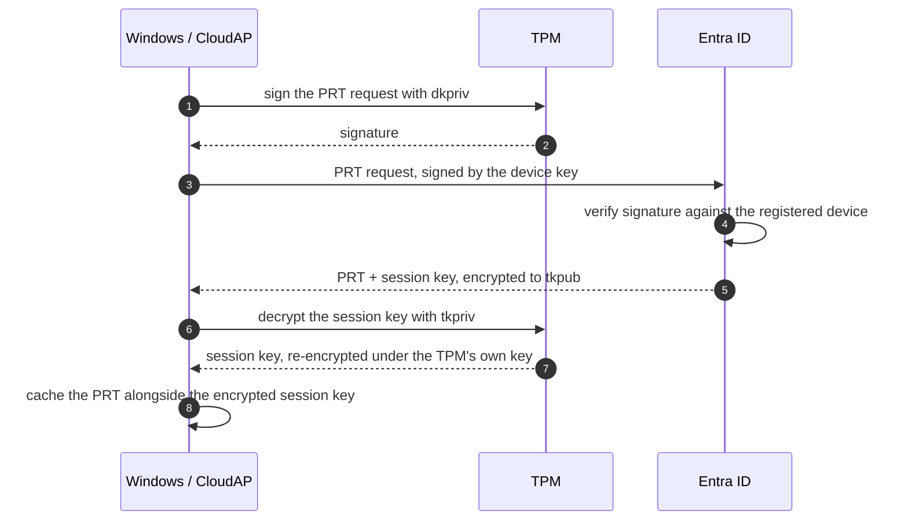

# Day 13 — The one token you cannot just copy

Something has been true of every attack in this series and I only noticed it while writing Day 12.

The AiTM proxy steals a session cookie and replays it. The infostealer lifts cookies off disk and the buyer replays them. Device code phishing hands the attacker an access token and a refresh token, and they use them from their own machine. Three different techniques, and in all three the stolen thing works anywhere, for anyone holding it.

That is what a **bearer token** is. Whoever bears it, gets in. There is no question of who you are, only whether you have the string.

There is one credential in the Microsoft stack that does not behave this way, and it is the one underneath all of it. The **Primary Refresh Token**. Copy it to another machine and it is worthless.

I wanted to understand exactly why, because "it is bound to the device" is the kind of phrase people repeat without being able to say what the binding actually consists of.

## What it is

A PRT is the credential that makes single sign-on work on a Windows device joined to Entra ID. You sign in to Windows once, and afterwards Office, Edge, Teams and anything else that asks can get access tokens without prompting you again. The PRT is what they are trading in behind the scenes.

It is issued during Windows sign-in, held by the **CloudAP** plugin, and it is valid for **90 days**, continuously renewed as long as the user keeps using the device. CloudAP refreshes it roughly every 4 hours during sign-in.

A note on that number, because it trips people up. A lot of writing on PRTs says 14 days. Microsoft's current documentation says 90. The 14 day figure comes from older documentation and still circulates widely, so if you see the two side by side, 90 is the current one.

## The keys that make it work

This is where the device binding actually lives, and it starts before any PRT exists.

When a device registers with Entra ID it generates **two key pairs**.

The **device key**, `dkpub` and `dkpriv`. This is the device's identity. The public half goes to Entra and gets associated with the device object.

The **transport key**, `tkpub` and `tkpriv`. This one exists purely to receive secrets.

Where those private keys live is the entire point. On a machine with a TPM, they are generated inside the TPM and **never leave it**. You cannot read `tkpriv` out of a TPM. You can ask the TPM to perform operations with it, and it will, on that machine, while you have the rights to ask.

On a machine without a TPM, they fall back to DPAPI protection instead, and DPAPI protection is software. Hold that thought.

## How a PRT is issued

Read step 5 again, because that is the whole trick.

Entra does not send the session key in the clear. It encrypts it **to the transport key's public half**. The only thing in the world that can decrypt it is `tkpriv`, and `tkpriv` is sealed inside the TPM of the machine that registered.

So the session key can only ever be unwrapped on that one physical device. And from that moment on, the session key is what signs everything.

The PRT itself is just a blob. Steal the blob and you have a blob. The thing that makes the blob usable is the session key, and the session key is pinned to the silicon.

## How the browser uses it

The flow for getting an access token in a browser is where this gets concrete, and it is more involved than most people assume.

Edge or Chrome hits a Microsoft sign-in URL. The browser talks to a local native host, `BrowserCore.exe`, which asks the Windows token broker for a **PRT cookie**. That cookie is a short-lived JWT containing the PRT, a **nonce**, and context used to derive the signing key. It is signed with a key derived from the session key. The browser then sends it in the `x-ms-RefreshTokenCredential` header.

If the request arrives without a valid nonce, Entra does not simply reject it. It redirects back with an `sso_nonce`, and the client has to build the cookie again with that nonce inside. Nonces are short-lived, on the order of minutes.

Entra then checks the nonce, verifies the signature against the session key it issued, confirms the device is still valid in the tenant, and issues the token.

That nonce requirement is not decoration. It arrived in a change around **September 2020** and it is what killed the original pass-the-PRT attack. Before it, a stolen PRT could be replayed on its own. After it, every single use requires a freshly signed response to a challenge the server just invented, and signing requires the session key, and the session key requires the TPM.

A replay attack needs the credential to be reusable. This one is not, by construction.

## So why do people still steal PRTs

Because the chain has one soft link, and knowing where it is tells you what the binding does and does not buy you.

Asking the TPM to do work is slow. Hitting it for every single web request would be painful, so CloudAP derives a **derived key** from the session key plus a random context, and uses that for signing. That derived key lives in **LSASS memory**.

Which means the strongest protection in the design, the one that makes the credential unstealable, holds right up until someone gets SYSTEM on the machine and reads LSASS. At that point they are not defeating the TPM. They are taking the thing the TPM was used to produce.

So the honest version of "a PRT cannot be stolen" is this. It cannot be stolen remotely, it cannot be phished, it cannot be captured by a proxy, and copying the file does nothing. It can be taken by code already running with high privilege on that specific machine.

That is a completely different risk profile from a session cookie, and it is a much better one. But it is not magic, and the distinction matters when someone tells you token theft is solved.

On a device without a TPM, this is all considerably weaker, because the key material sits under DPAPI and DPAPI keys can be extracted by an attacker in the user's context, which is exactly the capability an infostealer has, as in Day 8.

## What this actually taught me

I have been writing "token binding" and "token protection" for six days as though they were a feature you switch on. They are not. They are the user-visible end of this specific arrangement, and the arrangement is the interesting part.

The design does something I had not properly appreciated. It never tries to keep the credential secret. The PRT travels, gets cached, sits in memory, and the design does not care. What it protects is the **ability to use** the credential, by making every use require a fresh cryptographic operation that only one piece of hardware can perform.

That is a genuinely different idea from everything else in this series. A session cookie is a secret and its security is entirely a function of staying secret, which is why the moment Evilginx sees it, it is over. A PRT is not really a secret at all. It is a reference to a capability that lives somewhere you cannot copy.

Which reframes what Days 5 to 8 were actually about. Those attacks did not break any cryptography. They stole bearer tokens, and bearer tokens have exactly one defence, which is nobody else getting a copy. That is a terrible thing to rely on and we relied on it for twenty years because the alternative needed hardware in every machine.

The hardware is in the machines now.

---

Where I read, and one note on sources. I could not reach learn.microsoft.com directly from this machine, so Microsoft's page below is cited from search extracts rather than read end to end. Everything I have stated about the key material, the session key encryption and the nonce handshake is corroborated across the independent write-ups listed, which is why I am comfortable stating it plainly. The 14 versus 90 day discrepancy is the one place the sources genuinely split, and that is addressed above.

[Microsoft Learn, understanding the Primary Refresh Token](https://learn.microsoft.com/en-us/entra/identity/devices/concept-primary-refresh-token) is the primary reference.

[Dirk-jan Mollema and the AADInternals write-up on PRTs](https://aadinternals.com/post/prt/) covers pass-the-token and the nonce change. [3or.de on CVE-2021-33779](https://blog.3or.de/understanding-primary-refresh-tokens-and-cve-2021-33779-how-pass-the-prt-was-eliminated) is the clearest explanation of how pass-the-PRT was closed and what changed in the key derivation. [Pulse Security](https://pulsesecurity.co.nz/articles/exploiting-entraid-prt) and [Vaadata](https://www.vaadata.com/en/blog/prt-primary-refresh-token-how-it-works-and-exploitation-techniques/) both walk the cookie and nonce mechanics. [Synacktiv on Windows Hello for Business and Entra](https://www.synacktiv.com/en/publications/whfb-and-entra-id-say-hello-to-your-new-cache-flow) goes deeper into the caching side than anything else I found.
