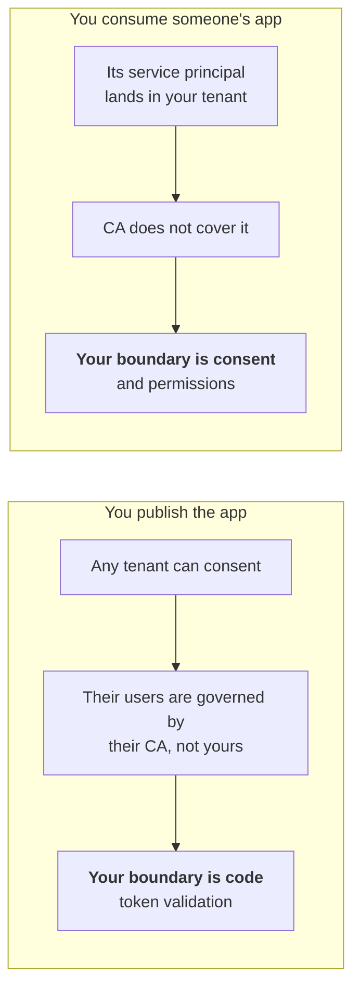

# Day 14 — Where the boundary moves

Every control I have written about since Day 5 has been a Conditional Access policy. Block the device code flow, require a compliant device, demand phishing-resistant MFA, bind the token to hardware. All of it rests on the same assumption, which is that Entra sits in front of the thing you are protecting and gets to say no.

Multi-tenant apps break that assumption, and not through misconfiguration. Microsoft documents the limit.

So the question is what is actually left, and the answer turned out to be more interesting than I expected, because it is not one answer. It depends entirely on which side of the app you are standing on.

## First, the premise is real

I wanted to confirm this rather than assume it, because "CA does not work there" is the kind of claim that usually turns out to be a licensing problem.

It is not. Three things, all from Microsoft's own documentation.

**Conditional Access for workload identities only covers single-tenant service principals registered in your own tenant.** Multi-tenant apps are explicitly out of scope. Managed identities are excluded as well.

**Group assignment silently does nothing.** You can put a service principal in a group, and a Conditional Access policy assigned to that group will not be enforced against it. The workload identity has to be named in the policy directly. That is the kind of detail that produces a policy somebody believes is working.

**Continuous access evaluation for workload identities has the same boundary**, single-tenant only, and only for Microsoft Graph.

There is one asymmetry worth noting. **Entra ID Protection still detects risk on multi-tenant apps.** It just cannot act on it, because risk-based Conditional Access only applies to single-tenant service principals. You get the signal without the enforcement, which is better than nothing and worse than it sounds.

So the premise holds. For a multi-tenant app, the policy engine is not in the path.

## Two completely different problems

The thing that unlocked this for me is that "protecting multi-tenant apps" is two separate questions wearing one name.

Different failure modes, different owners, different fixes. Worth separating before anyone starts buying things.

## If you publish the app, the boundary is your code

This is the part that surprised me, because it is a genuine shift in responsibility. With a single-tenant app, Entra is your security boundary. With a multi-tenant app, Entra hands you a token and the trust decision becomes yours.

### Validate the issuer properly, which is harder than it looks

The naive implementation compares the token's `iss` to the issuer in your metadata and calls it done. For a multi-tenant app that comparison cannot work, because the issuer is different for every tenant.

Microsoft's guidance is specific. Rather than expecting the token's `iss` to exactly match the metadata issuer, take the `{tenantid}` placeholder in the issuer metadata, substitute the `tid` claim from the token you just received, and then require an exact match.

Then two more checks that are easy to skip.

Confirm `tid` is actually a GUID. Confirm `iss` has the form `https://login.microsoftonline.com/{tid}/v2.0`, with that exact `tid`. Microsoft's wording on why is worth quoting, because it explains the point rather than just stating the rule.

> This validation ties the tenant back to the issuer and back to the scope of the signing key creating a chain of trust.

That chain is the whole thing. Without it you have a signature that is valid, from a tenant you never checked.

And if your app pulls keys from `/common` or `/organizations`, there is an extra requirement. You must also validate that the issuer property in the published metadata matches the `iss` claim in the token, on top of the usual `tid` check.

### Then ask whether you trust that tenant at all

Validating the issuer proves the token came from a real Entra tenant. It does not say anything about whether that tenant should be talking to you. Anyone with a tenant can consent to your app, and a tenant costs nothing.

MSRC's own guidance on this is blunt and I think correct. Keep a list of approved tenant IDs, validate the `tid` from the ID token against it after sign-in, and deny when there is no match.

They also lead with a better question, which is whether the app actually needs to be multi-tenant at all. A surprising number are multi-tenant because a template was multi-tenant.

### Do not key accounts on email

This is nOAuth, disclosed by Descope in June 2023, and it is the cleanest example of why the boundary being in your code matters.

The `email` claim in Entra is **mutable and unverified**. A tenant administrator can set it to anything. If your app matches an incoming user to an existing account by email address, then someone who controls any tenant can set a user's email to your customer's address and sign in as them. No password, no MFA prompt, nothing to detect on the victim's side, because the victim is not involved.

The fix is to key on `sub`, which uniquely identifies the principal in the issuing tenant, and never on a human-readable address.

Microsoft changed the defaults in response. App registrations created after June 2023 do not emit an email claim by default when the address is unverified, and there is a claim called `xms_edov` that tells you whether an email is domain-verified.

Two things to be careful with. Those defaults protect **new** registrations, so an app registered before June 2023 does not get them for free. And this is still being actively fixed in real products in 2026, which tells you how much code out there still matches on email.

## If you consume the app, the boundary is consent

Flip it around. Someone else's multi-tenant app gets a service principal in your tenant, and you have just established that Conditional Access will not govern it.

What is actually left is earlier in the process.

**Consent is the real control plane.** Microsoft's recommended configuration is to allow user consent only for apps from verified publishers, and only for low-impact permissions, with an admin consent workflow for everything else. This is the single highest-leverage setting discussed in this whole post, because it operates before the service principal exists. Once an app is consented with broad permissions, you are negotiating with a thing that already holds what it asked for.

**Defender for Cloud Apps can act afterwards.** OAuth app policies can notify admins, revoke an app's permissions, or disable the app. One distinction that matters operationally, for Microsoft 365 a ban prevents third-party apps from getting permission to access Office but does not revoke what they already have. Revoking is a separate action, so "banned" and "no longer has access" are two different states.

**Session policies control behaviour, not access.** They can stop downloads after authentication. They do not stop the app authenticating.

**Target the resource instead of the identity.** Since you cannot write a policy against the foreign service principal, you can write policies against what it is trying to reach. This came from community answers rather than Microsoft documentation, so I would test it rather than take it on faith, but the logic is sound and it is the only Conditional Access angle left.

## What I take from this

The pattern underneath both halves is the same, and it is the thing I did not have words for before today.

Conditional Access is a boundary that lives at the edge of your tenant. Multi-tenant apps exist specifically to cross that edge, so the boundary cannot follow them. It does not fail, it just ends, and Microsoft is clear in the documentation that it ends.

What replaces it is unglamorous. Validating a claim correctly. Keeping an allowlist of tenant IDs. Not matching users on email. Deciding who may consent to what. None of that appears on a dashboard and none of it has a toggle.

Which means the realistic position on a multi-tenant app is that **the platform is not protecting it and something else has to**. For an app you publish, that something is a few dozen lines of validation written by a developer who has to know this exists. For an app you consume, it is a consent decision made once, often quickly, often by someone who just wanted the integration to work.

Both of those are much weaker places to put a security boundary than a Conditional Access policy. That is not a reason to avoid multi-tenant apps. It is a reason to stop treating them as covered.

---

Where I read.

Microsoft on [Conditional Access for workload identities](https://learn.microsoft.com/en-us/entra/identity/conditional-access/workload-identity) and on [users, groups and workload identities](https://learn.microsoft.com/en-us/entra/identity/conditional-access/concept-conditional-access-users-groups), which is where the multi-tenant exclusion is stated. [CAE for workload identities](https://learn.microsoft.com/en-us/entra/identity/conditional-access/concept-continuous-access-evaluation-workload) for the same boundary, and [securing workload identities with ID Protection](https://learn.microsoft.com/en-us/entra/id-protection/concept-workload-identity-risk) for the detection-without-enforcement gap.

For the validation rules, [access tokens in the Microsoft identity platform](https://learn.microsoft.com/en-us/entra/identity-platform/access-tokens) and [converting an app to multi-tenant](https://learn.microsoft.com/en-us/entra/identity-platform/howto-convert-app-to-be-multi-tenant). The [MSRC variant hunting post from November 2025](https://www.microsoft.com/en-us/msrc/blog/2025/11/msrc-variant-hunting-from-multi-tenant-authorization-to-model-context-protocol) is where the tenant allowlist advice comes from, and [Joonas W on n-tenant applications](https://joonasw.net/view/best-practices-for-n-tenant-azure-ad-applications) is the best independent writeup on the same ground.

For nOAuth, [Descope's disclosure](https://www.descope.com/noauth) and [Semperis on the cross-tenant angle](https://www.semperis.com/blog/noauth-abuse-alert-full-account-takeover/).

On the consuming side, Defender for Cloud Apps [governance actions](https://learn.microsoft.com/en-us/defender-cloud-apps/governance-actions) and the [OAuth app policy documentation](https://github.com/MicrosoftDocs/defender-docs/blob/public/defender-for-cloud-apps/app-permission-policy.md).
